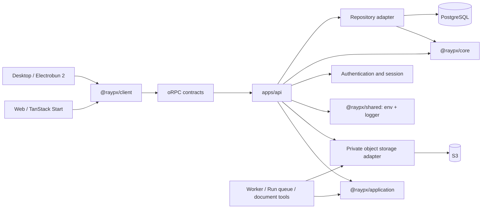

# Architecture Overview

> Cloud platform direction: [ADR-0016](./decisions/0016-cloud-agent-platform.md).

Live model and public research execution are unavailable following
[ADR-0027](./decisions/0027-remove-pi-sdk.md). Stored Cloud content, authorization,
private files and independently verified document helpers remain.

Raypx is a Bun-managed, Turbo orchestrated TypeScript monorepo for a cloud Web
application with an independent Hono API, plus an Electrobun
desktop client.

## Design goals

- Keep Web, Desktop, API, Worker and the UI workbench independently runnable.
- Share contracts, core business rules, UI primitives, and API clients without
  sharing platform-specific route trees.
- Keep server-side business rules behind small, stable interfaces.
- Use Bun for dependency installation and repository scripts while keeping
  Bun 1.4.0 as the production server and repository runtime.
- Extract a workspace package only after a stable seam and multiple real
  consumers exist.

## System shape



The API is the business boundary. Web and Desktop never access the database
directly.

The [cloud platform](./cloud-platform.md) defines the current Search/Computer
model, new database baseline, delivery review and usage ledger. Desktop is a
lightweight cloud project client; local execution and device routing are retired
by [ADR-0019](./decisions/0019-retire-legacy-desktop-execution.md).

The domain language and aggregate boundaries are recorded in the root
[`CONTEXT.md`](../../CONTEXT.md). `@raypx/core` is the domain-kernel package;
its source is organized by business context rather than by application
features. Application features remain in `apps/web/src/features/` and
`apps/desktop/src/features/`. See [ADR-0008](./decisions/0008-domain-contexts-stay-in-core.md)
for the package and extraction rule.

## Workspace layout

The workspace listing lives in [`README.md`](../../README.md) and, grouped by
dependency direction, in [`AGENTS.md`](../../AGENTS.md); `bun run policy` keeps
both in step with what Bun resolves. [Shared packages](./packages.md) and
[applications](./applications.md) describe each one. Organisation _inside_ a
workspace is covered by [file structure](../development/file-structure.md).

`apps/worker` owns durable Run claims and isolated Runner lifecycle. API and Worker share
application commands while remaining independently deployable. `features`,
and a generic `config` package are intentionally not standalone
workspaces either.

Environment validation belongs to the published `@voidmix/env` library; each
application assembles and validates its own configuration. Logger, cache and
session-type APIs are subpaths of the shared foundation package.

## Dependency direction

```text
apps/web      ─┐
apps/desktop  ─┴──> client ───> contracts

apps/storybook ───> ui

apps/web ───> client ───> contracts ───> apps/api
apps/api ───> Hono + application + core + db + contracts
apps/api ───> shared/auth + shared/cache + shared/logger + Hono/oRPC adapters
apps/web/desktop ───> shared/logger (Vite client integration)
apps/worker ───> shared/logger
apps/worker ───> application + db
apps/api/worker ───> storage
apps/web/storybook ───> agent-ui + ui
apps/desktop       ───> ui
packages/storage ───> core + shared
packages/db/mail/scripts ───> shared/logger
apps + packages/db/mail/scripts/shared ───> @voidmix/env
packages/db ───> core
packages/core/db ───> shared
packages/scripts ───> db + core + shared
```

Rules:

1. Frontend applications never import `@raypx/db`.
2. `@raypx/core` never imports React, Hono, Nitro, or Drizzle.
3. `@raypx/contracts` performs no network or database work.
4. API authenticates requests; Application enforces current resource capabilities.
5. Operational logs never contain raw credentials or session tokens.
6. New shared packages require a stable interface and at least two consumers.
7. Domain rules stay in core; adapters provide storage, Auth mail, processing
   and export capabilities through explicit ports.
8. Hono owns HTTP and streaming mechanics; oRPC owns typed structured procedure
   contracts. Neither transport layer owns domain rules.

## Detailed documents

- [Applications](./applications.md)
- [Cloud platform](./cloud-platform.md)
- [Shared packages](./packages.md)
- [Product design](./design.md)
- [Project Studio migration](./project-studio.md)
- [Account-first V2](./account-first-v2.md)
- [Toolchain](./tooling.md)
- [Runtime and deployment](./deployment.md)
- [Decision records](./decisions/README.md)
- [Testing and verification](../development/testing.md)
