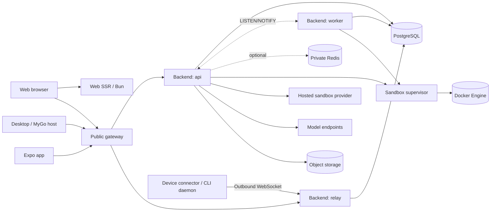

# Architecture

Status: target architecture on the `next` branch. The code on this branch still
implements the earlier device-owned product. Guides under
[development](../development/getting-started.md) describe that code until a
[delivery phase](../roadmap.md) replaces it. The earlier architecture and its
decision records remain in the history of `canary`.

Raypx is the durable home for persistent Agents. An Agent has an identity, one
continuing conversation, memory, routines and a computer. It keeps working while
the person is away, and it is the same Agent on every device they sign in from.
People share a Space to work with the same Agents.

## Principles

- **One authority.** PostgreSQL holds every Agent, conversation, Run and approval.
  Clients express intent and render state. The backend owns orchestration,
  authorization, validation, retries and recovery.
- **The operator owns the deployment.** The complete product runs on infrastructure
  the operator controls. Every external service is optional and sits behind a
  provider-neutral port.
- **A Space is the authorization boundary.** Nothing crosses between Spaces
  implicitly.
- **A computer is a durable place.** Its home survives a stopped, restarted or
  replaced container.
- **The Agent runtime stays outside the computer.** Credentials never enter it.
- **Context is not permission.** Memory, prompts and inbound text never authorize
  an action.
- **Report what happened.** Show real execution, failures and retry state. Never
  claim an external effect happened exactly once.
- **Deterministic by default.** Tests run offline. Live provider runs are opt-in.

## Process topology

| Process            | Owns                                                                        |
| ------------------ | --------------------------------------------------------------------------- |
| Web                | Server rendering and static assets. It imports no backend code.             |
| Backend `api`      | Sign-in, oRPC, HTTP API, the event stream, and the Runs it starts.          |
| Backend `worker`   | Recovery scans, scheduled and maintenance jobs, and the Runs it takes over. |
| Backend `relay`    | Outbound connections from device connectors and their command routing.      |
| Sandbox supervisor | The Docker socket, computer containers, homes and resource ceilings.        |
| Device connector   | Granted directories and commands on one registered device.                  |

One backend artifact runs every role. `SERVER_ROLE` selects `api`, `worker`,
`relay` or the default `all` in one process. Split roles share PostgreSQL and
notify each other through it. Redis is optional. Pi runs inside the `api` and
`worker` roles and reaches a computer only through the Computer port.

## Workspaces

Workspaces are discovered from the root Bun workspace patterns. Applications are
composition roots, libraries expose explicit source entries, and executable tooling
stays outside runtime dependency graphs. See
[ADR 0059](0059-manifest-workspace-boundaries.md) and
[workspaces](../development/workspaces.md).

| Workspace            | Role                                                                                         |
| -------------------- | -------------------------------------------------------------------------------------------- |
| `apps/api`           | Composition root for the `api`, `worker` and `relay` roles.                                  |
| `apps/web`           | TanStack Start client for every workflow.                                                    |
| `apps/desktop`       | MyGo host around the Web UI. It launches the device connector.                               |
| `apps/cli`           | The device connector daemon and operator commands.                                           |
| `apps/mobile`        | Expo client that shares Core and contracts.                                                  |
| `infra/sandbox`      | The supervisor service and the computer image.                                               |
| `packages/core`      | Domain schemas, identifiers and pure rules.                                                  |
| `packages/contracts` | oRPC wire definitions composed from Core schemas.                                            |
| `packages/providers` | Ports and adapters: computer, memory search, connections, web access.                        |
| `packages/database`  | Drizzle schema, migrations and Space-scoped repositories.                                    |
| Feature packages     | `agents`, `runs`, `spaces`, `memory`, `routines`, `pages`: model, server and client entries. |
| Shared packages      | `auth`, `account`, `ui`, `blocks`, `i18n`, `email`, `storage`, `logger`.                     |

Rules that carry over unchanged: explicit package exports, an acyclic workspace
graph, no application imported by another workspace, vendor SDKs only inside
adapters, and a new package only when a second consumer needs it.

Toolchain: Bun 1.4.4, Turbo, Vite+, standalone Vitest, Drizzle, Better Auth, Hono,
oRPC and Pi. The policy, verification and release gates in
[testing](../development/testing.md) apply unchanged.

## Topic guides

- [Domain model and data](domain.md)
- [Run execution and recovery](execution.md)
- [Conversations and the event stream](events.md)
- [Approvals and effects](approvals.md)
- [Computers, the supervisor and device connectors](computers.md)
- [Spaces, membership and settings](spaces.md)
- [Routines, memory, pages and connections](capabilities.md)
- [Clients](clients.md)
- [Security boundaries](security.md)
- [Deployment and operations](operations.md)
- [Internationalization and device preferences](internationalization.md)
- [Opt-in browser analytics](analytics.md)

## Decision history

[ADR 0066](0066-server-owned-agent-platform.md) records this architecture and
replaces the earlier ownership and runtime decisions. Records that still apply:

- [0034: Extensible foundation](0034-extensible-foundation.md)
- [0038: MyGo Desktop host](0038-mygo-desktop-host.md) — the host; execution ownership replaced by 0066
- [0042: Application services and adapters](0042-application-layering.md)
- [0043: Package surfaces](0043-package-surfaces.md)
- [0046: MyGo / Bun and immutable CLI artifacts](0046-mygo-bun-artifacts.md)
- [0047: Production Bun CLI packaging](0047-bun-cli-production-packaging.md)
- [0048: Core feature domain models](0048-core-feature-models.md)
- [0049: Feature server ownership](0049-feature-server-ownership.md)
- [0050: Independent Mobile React](0050-mobile-react-boundary.md)
- [0051: Backend runtime roles](0051-backend-runtime-roles.md) — extended with the `worker` role by 0066
- [0055: In-repository internationalization runtime](0055-in-repo-intl-runtime.md)
- [0056: In-repository devkit](0056-in-repo-devkit.md) — superseded by 0057
- [0057: Repository automation workspaces](0057-repository-automation-workspaces.md)
- [0058: Derived source platforms](0058-derived-source-platforms.md) — superseded by 0059
- [0059: Manifest workspace boundaries](0059-manifest-workspace-boundaries.md)
- [0060: Turbo task graph](0060-turbo-task-graph.md)
- [0061: Standalone Vitest](0061-standalone-vitest.md)
- [0062: Desktop sign-in in the system browser](0062-desktop-browser-sign-in.md)
- [0063: OAuth/OIDC for Desktop sign-in](0063-desktop-oauth.md)
- [0064: JSON message catalogs with generated literal types](0064-json-message-catalogs.md)
- [0066: Server-owned Agent platform](0066-server-owned-agent-platform.md)

Records 0035, 0037, 0039, 0040, 0041, 0044, 0052, 0053, 0054 and 0065 described
device-owned execution and are removed on this branch.
