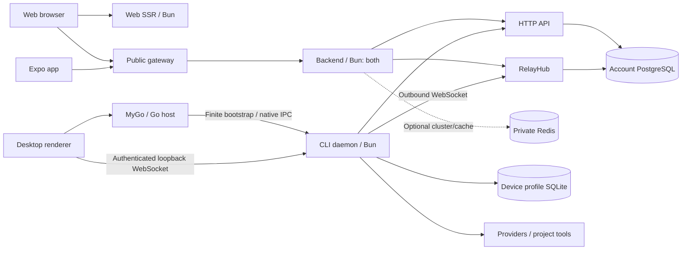

# Architecture

Workspaces are discovered from the root Bun workspace patterns. Applications are
composition roots; libraries expose explicit source entries; tooling remains out
of runtime dependency graphs. Manifests are the only workspace inventory.

## Process topology

PostgreSQL stores account data and remote read projections. The device profile
owns local work, enrollment identity, execution receipts and its replay journal.
Remote authorization enables an outbound channel; it does not transfer ownership
of local work or upload unrelated history. Closing Desktop disconnects its UI
without stopping daemon Agent tasks. Explicit GUI Quit lets the user decide
whether to stop active Agent tasks. It stops the GUI's terminals and tools across
origins. Transport loss preserves them for scoped recovery.

## User interfaces

### Web and Desktop

Web is a TanStack Start SSR application on Nitro's Bun server preset. Desktop uses the same DOM components in
a MyGo WKWebView/WebView2 shell. Go owns OS capabilities and finite bootstrap of
its version-matched bundled CLI; the renderer uses a separate authenticated daemon
WebSocket. The daemon owns sessions, API/account policy and acknowledged events
([ADR 0052](0052-daemon-desktop-channel.md), with execution and session recovery in
[ADR 0054](0054-desktop-execution-recovery.md)). Native owners, server origins and
enrollment identities isolate accepted tools and terminals from connection loss.
The renderer can list executions, query retained tool results and restore Herdr
screens/history without replaying commands or input. Later bootstrap can attach
an unlocked session key; Settings provides retry or native-confirmed reset of
all origins' saved sign-ins in the current profile.
Desktop builds with TanStack Start SPA mode: file routes, and a text-free root
shell prerendered to index.html. It has no server, so no server functions.
Desktop mounts its device-local workspace independently of account resolution.
Remote data and host authorization use a contextual login boundary. Local work
belongs to the device workspace; old account-owned local history is unsupported. Web supports
guest browsing and restores an explicitly submitted guest draft after login,
without automatically sending it. The CLI engine and persisted local state remain
independent of browser sessions.
The product entry is project → session → requests → result. A project is one
authorized directory, identified with its ownership scope and computer. Desktop
restores valid recent local selection; Web lists remote projects after login and
opens account settings over the current page with `#settings/account`. Desktop
keeps its independent `/account` route. URL selection never dispatches execution.
TaskWorkspacePort list targets flow through HTTP/private IPC into storage filters
before cursor/limit. Query keys, page probes and draft identities use the same
target; unavailable targets are explicit and never redirect execution elsewhere.

### Mobile

Phone browsers use Web. The Expo iOS/Android application in `apps/mobile` requires
login by default and currently provides email/password login, secure session
restoration and an account screen. Native task views and push notifications remain
later work. Its Expo-supported React version lives in the Mobile catalog;
Web/Desktop use the DOM catalog. See [mobile development](../development/mobile.md).

## Backend data flow

API uses Vite + Nitro + Hono + oRPC, deployed
on Bun 1.4.4 with the bun preset. CLI compiles with Bun 1.4.4.

Web and the backend are separate Bun services. `apps/api` builds one Nitro output
with `SERVER_ROLE=api|relay|both`, selected at startup. The default `both` role
composes HTTP services and RelayHub in one process: scheduling and revocation call
the hub directly. PostgreSQL is required; Redis is optional for shared caches and
multi-node routing. An explicitly configured broker must be healthy.

Split `api` and `relay` roles use that same artifact and require Redis. Relay-only
startup reads no Auth/mail/signing configuration and exposes no login or RPC.
Cloudflare runs the same backend image with the relay role. The gateway keeps
`/relay` at the public origin. See [ADR 0051](0051-backend-runtime-roles.md) and
[deployment](../development/deployment.md).
API Nitro owns one listener and shutdown. One Hono Fetch app mounts /api/auth/_,
/rpc/_, /health and /ready; `/relay` uses Nitro WebSocket hooks. Other paths are JSON 404s. Web renders on the server with
device preferences from cookies/Accept-Language and the account from account.get,
forwarding only Better Auth cookies. It never imports API, auth server or DB code.
Its server must receive the session cookie: share one origin, or set AUTH_DOMAIN
to the parent domain of sibling Web/API hosts.

## Domain and feature boundaries

Core owns the normalized task, activity, input and human-decision schemas,
the task-to-Run read projection and pure task rules. It has no transport, React,
filesystem or database dependency.
Contracts imports those schemas to assemble HTTP, relay and local IPC messages;
domain consumers import Core directly, without contract re-export aliases.
There is one domain schema source and the dependency direction is contracts → core.
Core also owns memory document/version schemas and job schemas/calendar rules
([ADR 0048](0048-core-feature-models.md)); Contracts has no dependency on the
browser feature workspaces. Memory and Jobs expose server and client entries.
Packages expose surfaces rather than barrels ([ADR 0043](0043-package-surfaces.md)):
`@raypx/contracts` has no root and composes Core's job and memory schemas internally,
`@raypx/client` offers `/api`, `/relay` and `/tasks`, and `@raypx/tasks` keeps its
model helpers on `/model`. Every public entry has a consumer outside its workspace.

Tasks separates its pure `/model` entry from its browser `/client` entry. The model
owns explicit workspace scopes, compatible draft identities, conversation history
and the small ports required by the views. Web and Desktop inject their remote or
private-IPC adapters. React hooks own subscriptions and query state; views consume
the model instead of implementing cursor, revision and history-gap recovery.
The domain's activity reducer remains shared with Tasks' server projection writer.
`@raypx/tasks/server` owns the projection and its stored task/event/request schemas;
Control injects its authorized transaction ports. Memory and Jobs own account
repositories on their `/server/postgres` entries, kept separate from their injected
`/server` use cases so the CLI loads no account database adapter. See
[feature server ownership](0049-feature-server-ownership.md).

Auth exports server/client/hooks/types. Its platform-neutral React hooks
share authentication actions and request state across Web and Desktop.
The browser `/client` entry exports both `createAuthClient` and the shared DOM
`AuthForm`, composed from those hooks, UI primitives and i18n. Web and Desktop
inject clients, callback origins, query data and navigation adapters. Applications
own routing and session refresh; `/server` never imports the DOM form.
API creates the DB adapter and mailer and injects them; auth never imports their
concrete packages. Account and remote task/device/approval contracts are exposed
through RPC; local execution methods are never registered directly. The account safe
projection is { id, email, name }.

Account provides platform-neutral remote read state, browser account views and an
injected server projection service. API supplies fresh session resolution and
maps unauthorized responses; Web/Desktop supply navigation and auth actions.
Auth and client do not depend on account. Shared feature styles live with their
packages. Blocks composes UI and i18n into router-agnostic application chrome (the
sidebar shell and settings page sections) that Web and Desktop fill with their own
links and feature views; it never imports account, auth, tasks or analytics.
ThemePicker belongs to UI's `themes` entry. Blocks composes the language control
from UI's shadcn Select and i18n's browser preference hook.

Contracts/api contains oRPC definitions; contracts/local contains Zod device
messages. Client is the remote SDK. Local interfaces are never registered on
public RPC. UI contains DOM components, a `themes` entry and a pure `themes/config` entry.
I18n owns common copy, locale policy and platform adapters. Business packages expose
pure language data entries; Web, Desktop and Mobile privately compose their own
TS/JSON catalogs. Typed feature hooks share the application messages context without
global declarations. The controlled Raypx Kit provider delegates translation,
formatting and React context to its bundled use-intl.
Only `useLanguagePreference().setPreference()` changes the product language
preference; the active locale is derived from that preference and the full ordered
system locale list. See [internationalization](internationalization.md).
Database owns current auth and cloud projection schema/migrations; mail owns auth delivery/templates.

CLI's device stores use Drizzle's Bun SQLite driver and private typed tables in
`runtime/sqlite/schema.ts`; server PostgreSQL schemas stay in the database workspace.
Repositories validate stored JSON and commit revision checks, history and receipts
in synchronous transactions. One `ProfileStorage` opens, migrates and closes the
profile writer; repositories borrow that connection and can join one transaction.
Drizzle migrations initialize the current schema; PRAGMAs and profile locks remain
SQLite operations. Parameterized Drizzle SQL preserves `REPLACE`
rowid ordering and the snapshot index hint; dedicated native cursors execute
Drizzle-built queries to bound snapshot memory. No legacy data imports are run.

## Browser analytics

Web and Desktop use the consent-controlled Kit analytics client through Raypx's
private product adapter. Statistics and sanitized error reports are independently
opt-in. See [analytics](analytics.md) for data boundaries, build configuration and
source-map publication. This does not replace API/CLI structured logging.

## Logging

API and CLI use the private `@raypx/logger` source workspace, which exposes evlog directly. Each
composition root calls `initLogger` once per process
and creates event loggers with `createLogger`; event data is added through `set`
and `error`, then completed with `emit`. Every drained event first passes
`withEventPolicy` from `@raypx/logger/safe`: only the app's listed fields
(`API_LOG_FIELDS`, the CLI field list) and the fixed envelope leave the process,
sensitive values are replaced and errors keep only a name and code. API and CLI use
the workspace's `/managed` drain for safe buffering, statistics and idempotent shutdown;
the CLI and Bun API write JSON lines to
stderr. Applications own environment
parsing, permitted fields, output and shutdown.

Only explicitly allowed fields and safe error summaries reach the drain.
Credentials, cookies, tokens, request bodies, command arguments, filesystem paths
and file or task output are not diagnostic fields. Arbitrary error messages,
stacks and causes must not pass through as event data.

API logs non-RPC HTTP requests through Hono and RPC calls through the official
`@orpc/evlog` adapter. Their scopes are mutually exclusive so one RPC invocation
does not also produce a Hono completion event. Request and operation identifiers
support correlation without exposing request payloads or changing safe API
error responses. The runtime drain enqueues events without waiting for the sink,
so a slow diagnostic destination does not delay an RPC response. Explicit
`flush` and `close` wait for queued delivery; Nitro owns draining pending log
writes during shutdown. API's event types and runtime field policy remain local;
The logger workspace owns no application routes or event categories. Managed admission includes
queued and in-flight events (1024 maximum); overflow drops new events, failures
do not retry, and close bounds waiting to ten seconds. Sinks own cancellation.
PostHog error reporting has an independent capacity of 16 and concurrency of four,
with two-second HTTP deadlines. Report loss and non-2xx responses are counted;
best-effort reporting never changes primary log delivery or the HTTP result.

CLI diagnostics use the logger's `/stream` stderr drain; stdout remains reserved
for command results, finite Desktop bootstrap or private stdio protocols. CLI shutdown flushes
pending diagnostics without adding records to protocol output. Runtime and
packaged-platform acceptance remain separate verification gates.

Logger is maintained inside Raypx while the workflow settles. It needs no Kit
publication or preview archive. See the [workspace guide](../../packages/logger/README.md).

Other unpublished Kit library archives may be tracked under `vendor/` for a reproducible
review branch, with source provenance, an archive checksum and the lockfile.
Provenance records either a clean source commit or the base commit, explicit
uncommitted state and per-file source checksums. The archive must be replaced by
an exact published alpha before merging. See
[Raypx Kit library changes](../development/intl-release.md) for archive checks and
the publication gate.

## Device runtime

The same CLI runtime handles human commands and the Desktop daemon channel. Desktop
never imports CLI source. An explicit citty command tree handles the existing
JSON-parameter commands and scoped help. Global options are validated before
dispatch; operands after `--` stay positional. Raypx owns errors, output and
shutdown instead of citty's `runMain`. Help/version do not open a profile;
they retain the executable's diagnostic completion lifecycle.
The private Agent harness stays inside CLI. `AgentRuntime` owns task lookup,
command receipts, replay and the active execution registry. `ManagedExecution`
owns each run's turns, input queue, approvals, cancellation and lock release after
process draining. The private `@raypx/providers` library's Claude and Codex entries translate their
private protocols through a narrow process port; its Pi entry hosts the in-process SDK session. The
daemon's private `runtime/daemon/remote` transport owns remote connection and synchronization; it
does not own provider execution policy.
Agent orchestration is event-sourced inside the CLI ([ADR 0044](0044-event-sourced-cli-orchestration.md)).
A pure decider in `runtime/agents/domain/` turns commands and live process facts
into events and effects; one sink commits the receipt, events, projections, relay
journal/outbox and effect intents in a single SQLite transaction. The wire
projection keeps today's `AgentEvent` sequence, so relay, Desktop, replay and
snapshot formats are unchanged. Effects are process-bound: restart abandons open
effects and interrupts active tasks instead of replaying them.
`raypx tui` adds a lazy line-oriented task browser with a session-owned in-process
runtime and scheduling disabled. It shares the local request boundary, confirms
manual execution, and closes its own runtime on quit/EOF/signals. Both input and
output must be terminals; scripts keep using explicit commands and JSON. This
lightweight entry precedes the proposed host/owner protocol and full-screen TUI.
Files use canonical root grants, relative paths,
symlink/traversal checks, bounded UTF-8 and atomic writes. Delete requires confirmation.
External commands use executable + argv + cwd, with shell use explicit; they retain
normal OS permissions. PTY output is bytes encoded as base64; dates are ISO strings.

SQLite stores profiles, roots, schedules and bounded run history. A profile has
one scheduling owner and per-job execution locks. Cron uses five fields and an
IANA zone, skips missed triggers, and never retries interrupted commands on restart.
On macOS and Windows, the independent CLI daemon owns scheduling; GUI Quit cleans
its Desktop owner's tools and terminals while preserving Agent work. Connection
loss or rebootstrap preserves accepted tools and terminals. Stopping the daemon
cancels its managed work. Foreground
commands/TUI close only their own runtime and never start a scheduler. Local state
and theme/locale preferences survive account logout.
Files uses route search for directory/pagination, a scoped Zustand store for
unsaved UI state, and route loaders for native reads. Root grants are shared at
the local route boundary. Only the file table suspends while its listing reloads.

## Extension

See [workspaces](../development/workspaces.md). Keep testing/runtime modules at
their current owners until a second actual consumer justifies extraction.

Desktop also persists validated theme/language preferences in an atomic native
file and restores them before renderer scripts. WebKit custom-scheme localStorage
alone is insufficient across full process restarts. This storage is independent
of the CLI so preferences remain usable if the local engine is unavailable.

## Remote Agent tasks

[Remote tasks and approvals](remote-tasks.md) describes opted-in Desktop execution,
account-scoped device grants and Relay + Replay synchronization over outbound
WebSockets. The shared tasks feature owns browser views; API routes commands and
stores read projections. Desktop/CLI owns execution, approvals and terminal state,
with a durable sequenced journal for reconnect replay and snapshot recovery.

Managed task replay and observed terminal projections use one acknowledged-stream
primitive for exact cursor ACKs, deadlines, committed progress and reset. Socket
replacement aborts its own pending reads and responses; automatic reconnect gets
a fresh cancellation scope. Account selection and Host binding independently
cancel authorization/renewal. Accepted Agent commands remain durable across a
transport loss. See [ADR 0053](0053-relay-stream-cancellation.md).

## Local Owner Host

[ADR 0035](0035-local-owner-host.md) defines the current local-first ownership,
cloud opt-in, terminal approval leases and migration boundary. Each profile owns
one Bun/TypeScript execution Host. Foreground and daemon transports use the same
`runtime/host.ts` composition for routing, cloud restore and teardown.
Local tasks, connectors and approvals require initial instance enrollment and then work offline; cloud recovery does not block readiness. Go provides the native Desktop host; execution stays in the CLI. See
[ADR 0038](0038-mygo-desktop-host.md). Windows also runs the independent daemon over
token-guarded loopback; see [ADR 0037](0037-windows-daemon.md). Go host checks run through shared verification.

## Persistent Agent platform target

[ADR 0039](0039-local-server-agent-platform.md) defines the greenfield target:
a registered, offline-capable local Agent platform, a server-owned Agent platform, and an
explicitly linked mode where the server owns shared Agent Runs and the local Host
provides scoped project tools. The rollout order is recorded in the
[roadmap](../roadmap.md); the current sections above continue to describe shipped
architecture until each target phase is implemented.

## Registered instances and providers

[ADR 0040](0040-instance-enrollment-and-providers.md) defines account-bound enrollment, offline identity, revocation and provider adapter boundaries; its amendment consolidates the adapters into one `@raypx/providers` workspace. Registration does not grant remote Host access or upload local history.

[ADR 0042](0042-application-layering.md) defines application services, driver preparation,
source-layer enforcement and transport/view adapters for the current implementation.

## Decision history

Accepted ADR bodies preserve historical decisions. New records supersede earlier
decisions through short links; this index and the topic guides describe the
current implementation.

- [0034: Extensible foundation](0034-extensible-foundation.md)
- [0035: Local Owner Host](0035-local-owner-host.md)
- [0037: Windows daemon](0037-windows-daemon.md)
- [0038: MyGo Desktop host](0038-mygo-desktop-host.md)
- [0039: Local and server Agent platform](0039-local-server-agent-platform.md)
- [0040: Instance enrollment and providers](0040-instance-enrollment-and-providers.md)
- [0041: Provider capabilities and managed Pi](0041-provider-capabilities-and-pi.md)
- [0042: Application services and adapters](0042-application-layering.md)
- [0043: Package surfaces](0043-package-surfaces.md)
- [0044: Event-sourced CLI orchestration](0044-event-sourced-cli-orchestration.md)

- [0046: MyGo / Bun and immutable CLI artifacts](0046-mygo-bun-artifacts.md) — current; CLI packaging formalized by 0047
- [0047: Production Bun CLI packaging](0047-bun-cli-production-packaging.md) — accepted; stable Bun 1.4.4, embedded runtime and depth-0 bytecode

- [0048: Core feature domain models](0048-core-feature-models.md) — accepted; supersedes Memory/Jobs model ownership in 0043
- [0049: Feature server ownership](0049-feature-server-ownership.md) — accepted; projections and repositories belong to features
- [0050: Independent Mobile React](0050-mobile-react-boundary.md) — accepted; Expo pins do not constrain DOM releases

- [0051 — Backend runtime roles](0051-backend-runtime-roles.md)
- [0052: Daemon-owned Desktop channel](0052-daemon-desktop-channel.md) — boundary; lifetime and recovery superseded by 0054
- [0053: Relay streams and cancellation](0053-relay-stream-cancellation.md) — shared ACK mechanics and connection scopes
- [0054: Desktop execution ownership and session recovery](0054-desktop-execution-recovery.md) — current lifecycle and recovery

## Distribution and performance

The accepted production CLI packaging embeds stable Bun 1.4.4 with minified ESM
and depth-0 bytecode ([ADR 0047](0047-bun-cli-production-packaging.md)). Each
candidate/platform compiles the standalone CLI once from source. Desktop, archives
and acceptance consume the same signed complete payload by immutable artifact ID. No Node runtime or Rust launcher
is shipped. See [the unified migration and Strobe acceptance guide](../development/mygo-bun-migration-plan.md).
The `@raypx/runtime-node` package retains Node-compatible process/HTTP helpers under Bun; its name
is not a requirement for a global Node runtime. Strobe is a development-only dependency and never
enters production bundles. macOS/Windows release acceptance remains a separate matrix.
