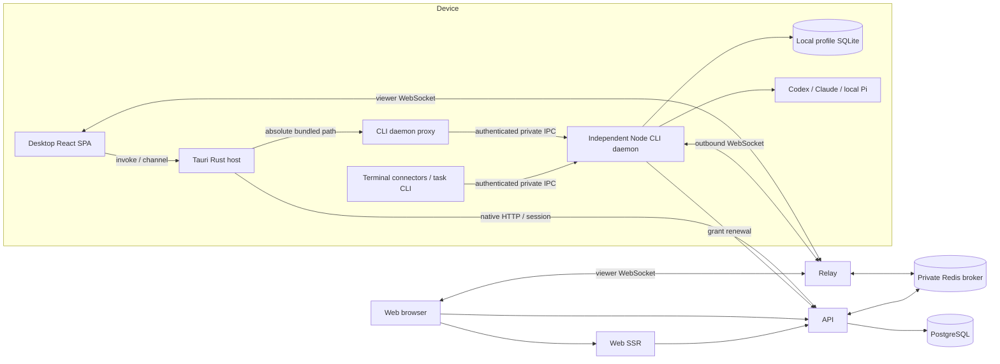

# Current architecture

Raypx uses TypeScript for its applications and execution runtime, and Rust for
the Tauri Desktop host and CLI launcher. This page describes the current
implementation. The [roadmap](../roadmap.md) and
[ADR 0039](0039-local-server-agent-platform.md) describe future Agent platform
work; they do not establish shipped behavior or platform acceptance.

## Runtime and toolchain

| Component    | Current implementation                                | Responsibility                                                                  |
| ------------ | ----------------------------------------------------- | ------------------------------------------------------------------------------- |
| Desktop      | Tauri 2.12.5, Rust 1.99.1, system WKWebView/WebView2  | React SPA, native policy, sessions, windows and CLI transport                   |
| CLI / daemon | TypeScript ESM on bundled Node 24.22.2                | Local execution, Agent harness, approvals, scheduling and replay                |
| CLI launcher | Thin Rust executable                                  | Locate the distribution, launch Node, forward arguments/streams and exit status |
| Web          | React / TanStack Start SSR, Nitro `node-server`       | Browser workbench and authenticated remote views                                |
| API          | Node 24.22.2, Nitro / Hono / oRPC                     | Accounts, authorization, remote commands and read projections                   |
| Relay        | Independent Node HTTP / `ws` service in `infra/relay` | WebSocket peers and delivery through the private Redis broker                   |
| Mobile       | Expo iOS/Android                                      | Account/login baseline; native task views remain future work                    |
| JS tooling   | pnpm 12.16.1, VP, `tsx`, TypeScript                   | Install/lockfile/catalogs, task graph/cache, scripts and no-emit checks         |

Root `package.json` pins Node and pnpm and is the workspace discovery source.
`pnpm-workspace.yaml` is generated from its patterns, catalogs and overrides;
pnpm uses the default isolated dependency layout and one lockfile.
`rust-toolchain.toml` pins Rust; the root Cargo workspace contains the launcher
and Tauri host. The Tauri Rust framework is 2.12.5; its independently released
npm API/CLI packages are 2.12.4. See [ADR 0045](0045-tauri-node-pnpm.md).

Desktop targets macOS 13.5+ and Windows. Linux CLI/core checks and GUI compilation
do not establish Linux Desktop acceptance. Native signing, installer and GUI
results are recorded separately from source checks.

## Processes and ownership

Applications are composition roots and cannot import each other. Desktop
launches the bundled CLI by absolute path and never imports CLI source. The
renderer uses `DesktopPlatform` / `DesktopBridge`; `src/lib/tauri.ts` adapts that
boundary to Tauri invoke/channels. Rust owns native HTTP, preferences, directory
selection, notifications, tray/window policy and the CLI proxy. TypeScript
contracts remain the authority for business JSON.

On macOS and Windows the independent daemon owns managed Agent processes,
scheduling, terminal approval arbitration, the durable replay journal and the
outbound Relay connection. GUI Quit releases UI approval leases and disconnects
its proxy; Agent tasks continue. Client-owned tools and PTYs end with their
client. Explicit daemon stop cancels and drains owned work. Restart marks active
work interrupted and abandons uncertain effects rather than replaying them.

POSIX uses authenticated owner-only Unix sockets. Windows uses token-protected
loopback TCP with Host/Origin checks. Node clients use an explicit direct
transport so proxy environment variables cannot forward private credentials.
Daemon protocol, version and build identity must match; an incompatible owner
requires an explicit stop/restart, without automatic task takeover.
See [terminal host](../development/terminal-host.md) and
[ADR 0037](0037-windows-daemon.md).

The same private CLI runtime handles commands, foreground stdio and daemon
requests. Ordinary commands and the lightweight `raypx tui` disable scheduling
and close only their own runtime. The citty tree validates global options,
preserves operands after `--`, and keeps help/version independent of profile
opening. Diagnostics use stderr; stdout is command output or bounded NDJSON.

## Local state, identity and sessions

One `ProfileStorage` owns `<profile>/profile.sqlite`, migrations and closure.
Feature repositories borrow its Drizzle `node-sqlite` writer, backed by
`node:sqlite`; cross-repository changes share synchronous transactions. WAL,
migration journals, revision checks and separate OS-backed migration/owner/project
locks preserve the existing format and concurrency rules. Stored JSON is
validated, snapshot queries are bounded, and unsupported formats fail explicitly.
See [local SQLite](../development/local-sqlite.md).

Local execution requires one account/origin-bound instance enrollment. Its signed
identity permits indefinite offline use and survives online logout. Registration
does not grant remote Host access or upload history. A profile cannot be rebound
to another account/origin. Remote data, Host authorization and project opt-in
have separate login/grant checks. See
[ADR 0040](0040-instance-enrollment-and-providers.md) and
[remote tasks](remote-tasks.md).

Tauri keeps server-scoped persistent cookies in a separate
`tauri-sessions.sqlite`, encrypted with AES-GCM and a new OS credential-store key.
Previous-host login storage is neither read nor deleted; switching hosts requires
signing in once. Local projects, history, preferences, TOML settings and offline
identity remain. The shared `desktop-instance.sqlite` lock prevents concurrent
Desktop hosts. Missing session keys preserve ciphertext and allow temporary
in-memory sign-in. These stores never share the CLI business writer.

Only the owned main WebView can call native commands. Native policy restricts
origins, paths, headers, request sizes, navigation and directory grants. Events
use bounded queues, sequence numbers and ACKs. Cookies and host credentials
never enter renderer replies or storage. API-origin scopes isolate WebView
storage, native sessions and remote bindings. Theme/language preferences are
stored atomically by the host and restored before renderer scripts, independently
of CLI availability. See [Desktop configuration and policy](../development/desktop.md).

Built-in file operations require canonical directory grants and reject traversal
and symlinks; writes are version-checked and delete needs confirmation. External
commands use executable/argv/cwd and retain normal OS permissions. A directory
grant is not a process sandbox. Protocol dates are ISO strings and terminal bytes
are base64. Cron uses five fields and an IANA zone, skips missed triggers and does
not retry interrupted commands automatically.

## Agent execution and shared libraries

The Agent harness stays private to CLI. `AgentRuntime` is its ingress/composition
facade; command/query services own use cases and read projections.
`ExecutionCoordinator` owns active handles and lock release after draining;
`ManagedExecution` owns turns, queued input, approvals and cancellation.
`@raypx/providers` supplies Claude/Codex process adapters and the in-process Pi
SDK through narrow ports. Pi is available for device-local tasks; remote
announcements do not grant it. See [ADR 0041](0041-provider-capabilities-and-pi.md)
and [application layering](0042-application-layering.md).

Orchestration is event-sourced inside CLI. A pure decider receives commands and
live process facts. One sink atomically commits receipts, domain events,
task/request/activity projections, Relay journal/outbox and effect intents.
Approvals commit before a provider receives the answer. Effects are process-bound
and never retried after restart. The wire projection preserves current
`AgentEvent`, replay and snapshot formats. See
[ADR 0044](0044-event-sourced-cli-orchestration.md).

| Boundary        | Owner and rule                                                                                                                |
| --------------- | ----------------------------------------------------------------------------------------------------------------------------- |
| Domain          | Core owns task/input/decision schemas and pure rules; no transport, React, files or database                                  |
| Models and wire | Memory/jobs/auth models own pure schemas; Contracts composes HTTP, Relay and private local messages from them                 |
| Task views      | Tasks `/model` owns pure page state and injected ports; `/client` adapts it to React; apps inject remote/private IPC adapters |
| Remote clients  | Client exposes `/api`, `/relay` and `/tasks`; it does not execute providers                                                   |
| Authentication  | API injects the DB adapter, mailer and config into Auth; Web/Desktop inject clients and navigation                            |
| Shared services | Control owns remote authorization/projection rules; API composes PostgreSQL/auth/mail; Relay owns sockets                     |
| Persistence     | Database owns server PostgreSQL schema/migrations; CLI privately owns device SQLite schema                                    |
| UI              | UI owns DOM primitives and theme; Blocks composes router-independent chrome; pure theme tokens/types stay platform-neutral    |
| Locale          | I18n owns Chinese/English catalogs and platform adapters; language preference drives the active locale                        |
| Host helpers    | Runtime-node exposes Node filesystem/process/HTTP helpers, not CLI business composition                                       |

Libraries expose explicit entries with established consumers. Manifests declare
kind/target and per-entry/source targets; policy checks transitive platform
constraints, private imports and the complete acyclic dependency graph, including
development dependencies. Runtime code cannot import tooling or test entries.
Extract a package only when its responsibility and consumers are established.
See [package surfaces](0043-package-surfaces.md) and
[workspace guide](../development/workspaces.md).

## Web, API and Relay

Web runs TanStack Start SSR on Nitro `node-server`; Desktop uses Start SPA mode
with file routes and a prerendered shell, without server functions. Both reuse
React, TanStack, shadcn/Base UI and shared feature views. Device-local Desktop
selection does not depend on an active browser session; Web remote data does.
Selecting a project or URL never dispatches execution or silently changes targets.
Task filters reach storage before pagination; unavailable targets remain explicit.

API's Nitro listener owns shutdown and mounts one Hono Fetch app at `/api/auth/*`,
`/rpc/*` and health/readiness endpoints. Web resolves accounts through API and
forwards only Better Auth cookies; it imports no auth server or database code.
Web and API need a shared public origin or an explicitly configured parent cookie
domain. API issues tickets/grants, routes commands and stores read projections.
It executes no local provider and owns no WebSocket listener.

Relay owns socket peers; API reaches it through private Redis using shared Control
rules. On remote `tasks.create`, Relay's composition resolves account-selected
memory revisions and commits the frozen context receipt before delivery; normal
memory CRUD remains in API RPC. This is command acceptance, not a second memory
API. The gateway routes `/relay` to that independent service at the public origin.
Optional Cloudflare ingress uses the provider-managed Workers runtime; the Relay
container and local tooling use pinned Node. Web, API, migration and Relay build
outputs run outside the repository. See
[deployment](../development/deployment.md) and [infrastructure](../../infra/README.md).

API/CLI configure `@raypx/logger` once per process. Allowed fields pass redaction
before bounded delivery; raw errors, credentials, cookies, task content and paths
are excluded. API HTTP/RPC scopes avoid duplicate completion events, and shutdown
drains pending logs. CLI logs remain on stderr. See
[logger](../../packages/logger/README.md). Browser statistics and sanitized error
reports are separately opt-in; see [analytics](analytics.md). Language and native
preference restoration are detailed in [internationalization](internationalization.md).

## Build, distribution and acceptance

VP is the only task graph/cache. Lightweight `vite.config.ts` files register
tasks; application plugins live in `vite.app.config.ts`. `tsx` runs development
scripts, `tsc --noEmit` checks types, and VP owns JS builds/tests/lint/format.
Cargo owns native incremental builds and is called through the same task graph.

The CLI is a complete versioned directory: Rust launcher, bundled Node, ESM entry
and chunks, full pnpm/pnpx distribution, Herdr, licenses and `runtime.json`
checksums/build identity. The launcher alone cannot run. Child PATH appends
bundled tools after user tools. Connector install/repair copies the full runtime;
Windows daemon uses a private per-build runtime copy with leases so an updater
can replace Desktop resources without deleting files still in use. See
[CLI distribution](../../apps/cli/README.md) and [terminal connectors](../development/terminal-host.md).

`pnpm run verify` selects affected source/native checks; `--full` adds audits,
builds and artifact probes. Database, browser, live-provider and packaged native
acceptance remain explicit gates. The first Tauri release uses a signed installer
after exiting the old host and explicitly stopping its daemon; later updates use
new Tauri updater keys/feed. Platform release requires its GUI, installer and
signing/notarization matrix. See [testing](../development/testing.md),
[Desktop release](../development/desktop.md#build-and-release) and the dated
[migration validation record](../development/migration-validation.md).

## Decision history

Later accepted amendments supersede conflicting earlier implementation details.
Superseded records preserve historical rationale; use the current guides above
for commands, paths and supported behavior.

| Decision                                                                             | Status                                                         |
| ------------------------------------------------------------------------------------ | -------------------------------------------------------------- |
| [0034: Extensible foundation](0034-extensible-foundation.md)                         | Boundaries accepted; runtime/toolchain superseded by 0045      |
| [0035: Local Owner Host](0035-local-owner-host.md)                                   | Accepted; Windows amended by 0037, implementation by 0041/0045 |
| [0037: Windows daemon](0037-windows-daemon.md)                                       | Accepted; distribution/runtime amended by 0045                 |
| [0039: Local and server Agent platform](0039-local-server-agent-platform.md)         | Accepted target; rollout tracked in roadmap                    |
| [0040: Instance enrollment and providers](0040-instance-enrollment-and-providers.md) | Accepted; provider consolidation amendment                     |
| [0041: Provider capabilities and managed Pi](0041-provider-capabilities-and-pi.md)   | Accepted; effect model amended by 0044                         |
| [0042: Application services and adapters](0042-application-layering.md)              | Accepted; transaction boundary amended by 0044                 |
| [0043: Package surfaces](0043-package-surfaces.md)                                   | Accepted                                                       |
| [0044: Event-sourced CLI orchestration](0044-event-sourced-cli-orchestration.md)     | Accepted; SQLite driver amended by 0045                        |
| [0045: Tauri, Node and pnpm](0045-tauri-node-pnpm.md)                                | Current host, runtime, toolchain and distribution              |
