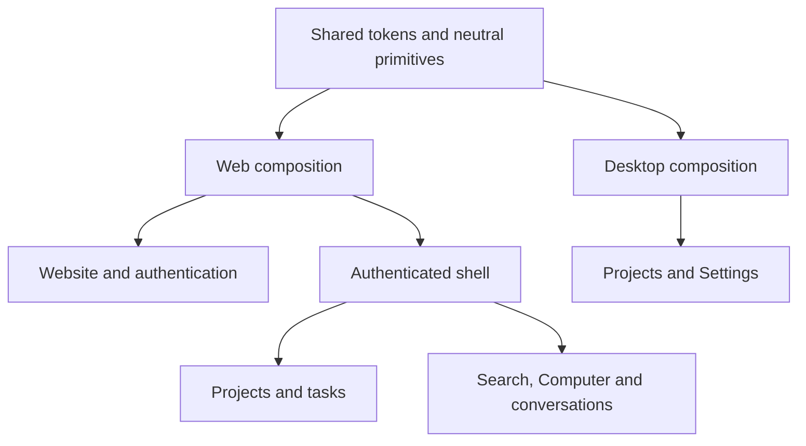

# Product design

Raypx uses one visual language across the cloud website, authentication, Web
and lightweight Desktop. [DESIGN.md](../../DESIGN.md) defines the shipped colors,
typography, sizing and page patterns. [The delivery goal](./raypx-delivery-goal.md)
defines the current cloud and Desktop boundaries.

## Responsibilities

The shared package owns modal focus, pending-state presentation, accessible
controls and semantic tokens. Applications own navigation and domain labels.
App shells are not imported across applications. Admin is retired.

Remote entities stay in route loaders, with AbortSignal and invalidation after
writes. URL search retains cursors and project filters; overlays and form drafts
remain local.
Desktop stores only theme preferences, preserving its storage key/version,
theme migration and storage-failure fallback. Language keeps its existing i18n
storage. The native bridge owns window actions and runtime metadata.

## Truthful data

Desktop's project loader returns either real authorized data or an explicit
unconfigured/offline/unavailable state. Demo fixtures are imported only by tests.
Overview, Activity, Devices and the local execution panel are retired; unknown
routes return to Projects.

The shell contains no fabricated latency or audit timestamps.
Unconnected sync/notification controls and folder authorization are removed.
The Electrobun host grants no filesystem, local execution or credential API to
the renderer. Admin pages, status changes, operational inspection and export
are retired under [ADR-0021](./decisions/0021-retire-admin.md).

## Product imagery

`e2e/capture-product.ts` seeds dedicated synthetic accounts into the guarded test
database and captures the actual project routes in English and Chinese, both themes and desktop/mobile sizes. Only
loopback servers are used. The resulting WebP images are served locally by Web and
labelled as examples; there are no third-party image or font requests.

## Verification

[Visual audit](../development/visual-audit.md) records viewport coverage, screenshot
provenance and results. Shared primitives have deterministic Storybook examples;
product flows use the real test API and PostgreSQL in Playwright.

## Neutral component baseline

All shipped surfaces use shadcn base-nova Neutral light/dark tokens. One Web
shell serves project lists, details and cloud tasks. The historical beUI route
variant has been retired. Shared primitives provide keyboard navigation, menus,
forms and state presentation. Unconsumed components and their exports are removed;
page layout stays app-local.

Utility actions share IconButton with labelled hover/focus tooltips. Setting
explanations use HelpHint popovers that open by click, keyboard or touch; repeated
unavailable notices are grouped by section while disabled controls retain an
accessible reason. Primary actions, destructive actions, errors and permissions
keep explicit text. Public copy uses short, concrete descriptions.

[Neutral UI delivery](../development/neutral-ui.md) records migration details,
responsive image generation and verification evidence.
