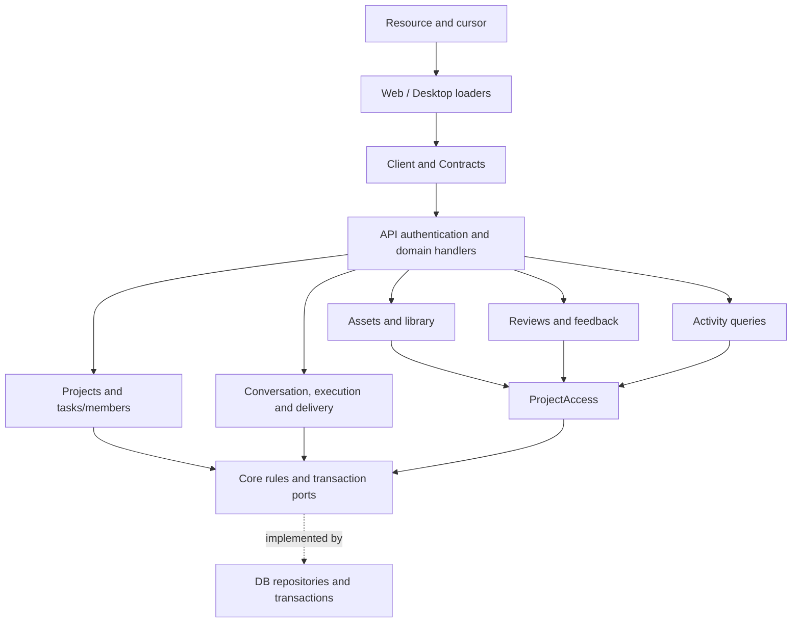

# Domain services and client state

[ADR-0014](./decisions/0014-domain-services-and-client-state.md) assigns workflows
to Application, rules and ports to Core, persistence to DB and transport to API.
[ADR-0021](./decisions/0021-retire-admin.md) retires Identity administration,
management writes, audit consumption and the Admin page/store. The active
Account/Project model and physical Cloud baseline remain unchanged.

## Ownership

| Module   | Application responsibility                                    | Required ports                                             |
| -------- | ------------------------------------------------------------- | ---------------------------------------------------------- |
| Projects | Lifecycle, tasks, members, capability resolution              | Projects, tasks and memberships                            |
| Assets   | Assets, versions, upload and authorized library query         | ProjectAccess, assets, versions and blob storage           |
| Reviews  | Reviews/feedback and version association validation           | ProjectAccess, reviews, feedback and version lookup        |
| Activity | Authorized activity query                                     | ProjectAccess and activity repository                      |
| Cloud    | Scoped conversations, executions, budgets, immutable delivery | Cloud transaction repository, storage and durable dispatch |

API composes fixed-key DB settings readers for Auth and Mail. Core derives the
public Auth capability view; Application owns no settings writer or service.

API resolves current sessions and suspended-account status. Application rechecks
personal/project access and coordinates atomic business writes. Worker uses the
same Cloud execution boundary. The private Gateway and durable outbox remain
required. No global management permission grants access to private cloud content.

## State and transport

Route loaders own remote resource snapshots, cancellation and invalidation after
writes. Query owns ordinary Cloud resource data; Client sessions own active
Run/Conversation projections. Forms and overlays keep local drafts. Desktop
stores only its theme and the existing locale preference.

SSR creates a client per request and forwards only Better Auth cookies to the
configured API. Browser requests include credentials. Protected loader data is
tagged with accountId; the layout hides data from another account while clearing
cached protected routes and refreshing. No shared SSR singleton holds user data.

Nitro Requests are reconstructed through public fields before Better Auth;
native fetch owns decompression; credentialed oRPC batching uses the required
CORS protocol headers. Auth fields wait for hydration so early input is retained.

## Compatibility

Cloud and retained Project paths, error envelopes and native Date fields remain.
Retired device/Project AgentRun paths and Admin paths return ordinary 404s.
Project, library and activity cursors bind actor/query scope and recheck current
membership on every page. API and Worker share the same capability evaluator.

The unused settings mutation/audit ports, initial administrator tooling,
profile-only seed and isolated legacy schemas are removed. Auth/Mail reads,
compatibility database columns/tables, historical SQL and user data are retained.
No new migration or automatic cleanup is introduced.

## Enforcement and validation

Policy rejects reversed runtime dependencies, application imports, private
cross-package imports and workspace cycles. Active enum parity remains checked.
Application names are unscoped under [ADR-0022](./decisions/0022-unscoped-application-packages.md);
shared package names retain `@voidmix/`.

Current results are recorded in
[feature reduction acceptance](../development/feature-reduction-acceptance.md).

## Historical validation before Admin retirement

The results below describe the earlier ADR-0014 delivery, including its now
retired Admin interfaces; they are retained as historical evidence.

See [testing](../development/testing.md) for focused, full, PostgreSQL and browser
commands. The clean baseline passed 599 tests. Local validation on 2026-09-28:

| Gate                                                                               | Result                                                                                                  |
| ---------------------------------------------------------------------------------- | ------------------------------------------------------------------------------------------------------- |
| `bun run verify --verbose`                                                         | Passed: 636 tests; i18n, policy, format, lint, workspace checks, builds and Web/API Node runtime probes |
| `bun run test:unit`                                                                | 573 passed                                                                                              |
| `bun run test:integration`                                                         | 21 passed                                                                                               |
| `bun run test:component`                                                           | 47 passed                                                                                               |
| `bun run test:coverage`                                                            | 636 passed, coverage reports generated                                                                  |
| `NODE_ENV=test TEST_DATABASE_URL=… bun run test:postgres`                          | 10 passed against isolated PostgreSQL 17.11, including direct Memory parity and concurrent writes       |
| PostgreSQL command without `TEST_DATABASE_URL`                                     | Failed explicitly as required; no database fallback                                                     |
| `NODE_ENV=test TEST_DATABASE_URL=… VOIDMIX_E2E_PORT=59430 bun run test:e2e`        | 13 passed, including 3 authenticated API/database scenarios                                             |
| `DATABASE_URL=postgres://voidmix:ci@example.invalid:5432/voidmix bun run generate` | No schema changes or migration drift                                                                    |
| Route generation and `git diff --check`                                            | No generated-route drift or whitespace errors                                                           |

Layer counts are not additive: the component substring selector includes
`*.component.test.tsx`, while unit excludes only the exact `component.test.tsx`
basename. The four existing layer commands remain unchanged. PostgreSQL and browser
fixtures use separate dedicated test databases; no production data was accessed.
No Rust source changed. CI adds PostgreSQL 17 services to its database and E2E jobs;
its remote results are separate from these completed local checks.
