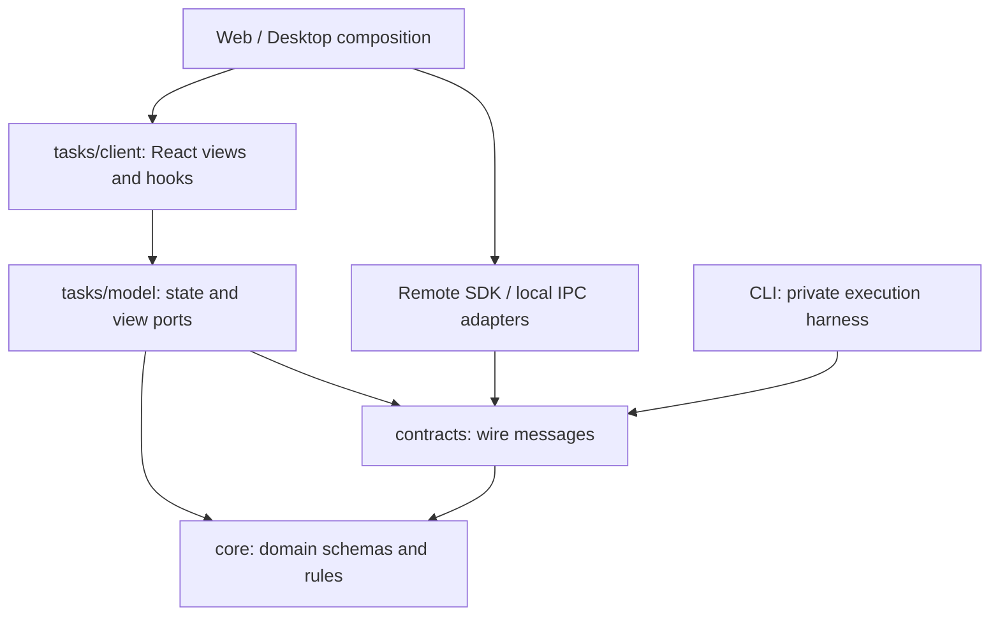

# Extending workspaces

Bun workspaces below cover TypeScript applications and libraries. Desktop also owns
a MyGo host and Go module in `apps/desktop`.
For native build and release commands,
see the [Desktop guide](desktop.md#build-and-release).

Infrastructure provider tooling lives under `infra/*`; API/Relay runtime roles share `apps/api`
and provider deployment tooling. Each manifest declares its actual
dependencies, deployment commands and checks. These are
discovered by the same Bun/Turbo graph; see [infrastructure](../../infra/README.md).

```sh
bun run workspace:list
bun run workspace:new feature-kit --kind library --target universal
bun run workspace:new feature-kit --kind library --target universal --tests --write
```

`--kind` selects the generated layout: `app` omits exports under `apps/`. `--target`
only selects the TypeScript preset and types; it is not written to the manifest.

Preview is the default. Creation refuses existing paths and names. The generated
private ESM package has an explicit source export, strict tsconfig and AGENTS.md;
--tests adds an independent runner config and includes `tests/` in strict checking,
without placeholder tests. Install with
Bun, then import the public entry from a consumer using workspace:*.

## Manifest metadata

Kind is derived from standard fields: a package with `bin` is tooling; a package
without exports is an application; the rest are libraries. Policy rejects the retired
`raypx.kind`, `raypx.target`, `raypx.entryTargets` and `raypx.sourceTargets` fields.
Manifests declare no platform target and policy does not check platform boundaries;
a workspace needs a `raypx` block only for `entryConsumers`,
`bundledDependencies`, `sourceEntries` or `browserTestProject`.

Every public entry has an established consumer in another workspace. `policy`
finds importers across TS/TSX/MTS imports, CSS `@import`/`@source` and tsconfig
`extends`, including repository-root configuration. Suites, files under `tests/` and
the `e2e` workspace are test importers. They satisfy the consumer requirement for
`./testing*` entries, executable tooling and E2E workspaces. Other library entries
need a production importer.
Remove an entry nobody imports, or record a reason in `raypx.entryConsumers` — the
exception list is validated against the exported keys, so a pruned entry cannot leave
a stale reason behind.

Applications cannot be imported. Runtime code cannot import executable tooling or
test-only entries. Production imports need dependencies or peerDependencies, and
type imports may use devDependencies. Cycles include all workspace dependencies.
Private relative paths and aliases cannot bypass exports. Policy traverses public
entries and checks those dependency boundaries in the files they reach.

## Tasks and extraction

`@raypx/dev-cli` owns the `raypx-dev` executable and its implementation. Workspaces
invoking it declare a direct development dependency; reusable build/task imports
come from `@raypx/tooling`. Dev CLI depends on Tooling and has no exports, so its
private code never reaches another workspace's type check.

Turbo schedules the scripts each manifest declares; root `turbo.json` names the
graph tasks and their dependencies. Package scripts are leaf commands and never
re-enter the graph, so no private runner scripts exist.
Root `test [suite]` aggregates declared package commands; `test --package` selects
one owner; see [test commands](testing.md#test-commands).
A task's hash covers its workspace's tracked files, its declared environment keys,
the external dependencies its package resolves from `bun.lock`, and the sources of
its workspace dependencies through the `transit` task, which excludes their tests,
suites and documentation. Root files every suite loads (`test.config.ts`,
`test.dom.ts`, `bunfig.toml`) are global dependencies. Source-only libraries need no
build. Desktop packaging depends on the compiled CLI. Application Vite plugins stay
in `vite.app.config.ts`, while independent Vitest configs keep test initialization
separate. Workspace `check`, build and default/unit/component test tasks are cacheable.
Dedicated deployment, performance and database/browser integration tasks always
execute. A workspace adds its own `turbo.json` only for inputs or prerequisites
outside these defaults (CLI, Desktop, Control and E2E do).

Auth's `@raypx/auth/client` entry exports both `createAuthClient` and the shared DOM
`AuthForm` used by Web and Desktop. Applications keep their file routes and inject
authentication clients, callback origins, query data and navigation adapters. The
form is covered by both applications' route integration tests. DOM form dependencies
stay behind the browser entry; `/hooks` remains platform-neutral, while `/server`
does not import DOM code.

Account's public code entries are the universal root for safe remote read state,
`/access` for permission projections, `/client` for shared DOM views and `/server`
for the injected session projection service. Web/Desktop own client instances and navigation; API owns HTTP
and error mapping. Feature CSS is exported through `/client/styles.css` from auth
and account; these entries register their components as Tailwind sources.
UI's `/styles/app.css` imports the shared theme and layered app base defaults.
Layout and control utilities live in their owning components. Applications also
register i18n's browser controls as a Tailwind source.

`@raypx/testing` owns the manual scheduler, deferred promises and in-memory relay
socket shared by Client and CLI tests. Consumers declare a direct development
dependency. Shared fixtures are independent of the workspaces under test, and suites
stay with their owners. Extract runtime only when another execution host directly
consumes CLI internals.

Repository automation is split by how it is consumed. Root `turbo.json` is the task
graph. `@raypx/tooling` holds build and acceptance helpers imported only by the
applications that use them. `@raypx/dev-cli` implements `raypx-dev` and has no
exports, so its private checks never reach another workspace's type check.

`@raypx/logger` is a private source workspace consumed by API and CLI. It owns
evlog adapters, safe projection and managed delivery; applications own event
schemas, privacy policies and destinations. Its safe/managed entries are universal,
while the root/context implementation and `/stream` remain Node-compatible.
`context` and `pipeline` are private modules, not public package entries. Keep it
local while the
product workflow settles; no Kit release or archive is required.

`@raypx/icons` is the shared browser icon library consumed by UI, Blocks, feature
views, Web, Desktop and Storybook. It owns the Hugeicons Free renderer and explicit
per-icon exports; UI registers its styles without an Icons → UI dependency. See
[shared icons](icons.md).

## Agent domain and page boundaries

`@raypx/core` is the universal source of task-domain schemas, inferred types,
pure activity/decision rules and public account models through `/auth`.
`@raypx/contracts` adds protocol envelopes. Consumers
import domain definitions from their owning package; compatibility aliases are not provided. Never define a second copy of a domain
interface or introduce a core dependency on contracts, React or host implementations.

`@raypx/tasks/model` exposes workspace scopes, draft identities, conversation state
and task-view ports. Its browser entry adds hooks and DOM views. Applications inject
remote SDK or local IPC adapters; the page feature does not derive its interface from
the concrete SDK. Keep route navigation and account-session resolution in the app.
Conversation coverage distinguishes authoritative pages from live projections.
The browser adapter reports subscription interruptions before resuming, and aborts
pending history reads on workspace/task changes; late responses cannot refresh
another owner. Activity order values are opaque global row IDs, not consecutive
per-task counters.



Unified diff parsing uses the external `diff` library behind a bounded pure model.
Provider-specific approval payloads remain in the feature adapter, including Codex's
unnumbered snippets and Claude writes with unknown original content. Invalid or
unsupported patches retain the complete original request instead of presenting a
partially understood change as complete.
The full request shares a 1200-line, 20-file preview budget. Truncated files remain
labelled; unknown structures retain the original request rather than disappearing
behind a partially parsed preview.

The execution harness currently lives in `apps/cli/src/runtime/agents/harness`.
Its coordinator owns one task lifecycle; provider adapters own private wire formats;
SQLite and process implementations remain at their existing CLI boundaries. Keep
page queries, drafts and authentication navigation in tasks/apps. A separate
`@raypx/harness` workspace is justified when another execution host consumes this
boundary directly, rather than creating a second owner inside Desktop.
Managed local Pi is a selectable provider through `@raypx/providers/pi`; the CLI
private harness owns task policy, persistence, approval and cancellation. See
[Pi Agent loop and acceptance](ai.md#injected-agent-loop).

## Scheduled jobs

`@raypx/core/jobs` owns pure job schemas, inferred types and calendar rules.
`@raypx/jobs/server` owns injected cloud scheduling use cases and ports, and
`@raypx/jobs/client` owns shared browser views and their ports. Contracts composes
wire schemas from Core; API supplies SQL/Relay adapters, while CLI supplies local
scheduling and execution.
Cloud schedules do not claim local plans or move them between accounts. See
[server jobs](server-jobs.md).

## Provider adapters

One private `@raypx/providers` source library holds the CLI provider adapters and
server-owned Computer port. CLI consumes the session adapters; Computers and API
consume `/computer`, and API lazily selects `/computer/docker`. The private Sandbox
service consumes the port and owns the Engine connection. `/testing/computer` is
the shared runner-injected conformance suite consumed by Sandbox tests. `./core` defines the injected session, execution and process I/O
ports and normalized conversation events. `./codex` and `./claude` implement native
protocol adapters; `./pi` and `./pi/context` hold the Node-targeted Pi SDK session and
transcript schema, the only sources that import `@raypx/ai` or the Pi SDK. CLI supplies
the process transport and owns task policy, approval arbitration, persistence and
draining. Provider code never imports CLI, auth or database source. Shared conformance
helpers live in the library's `tests/helpers`. Split an entry into its own workspace
only when a second execution consumer establishes that boundary (ADR 0040 amendment).
