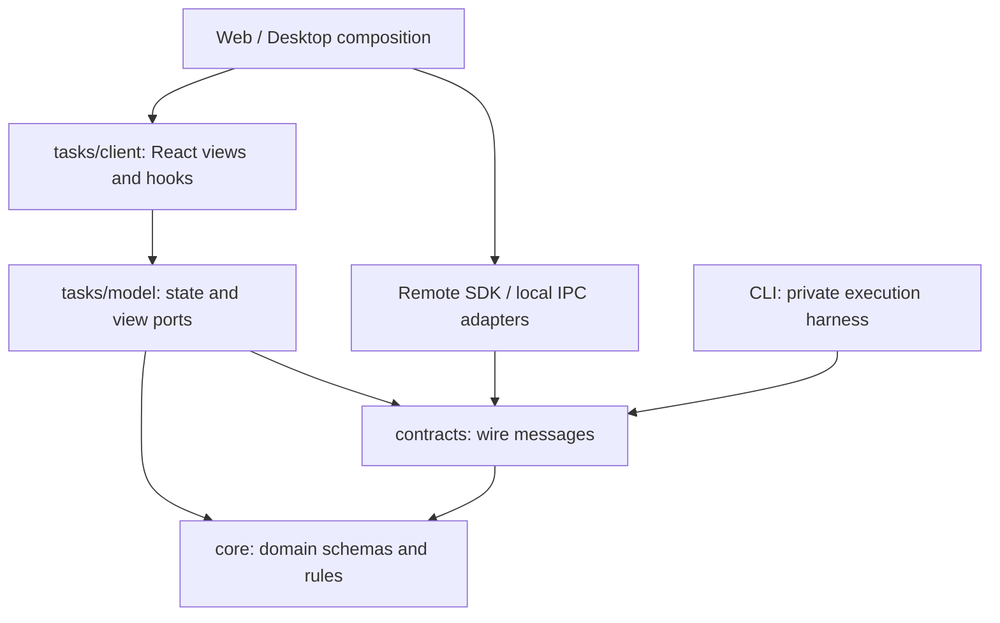

# Extending workspaces

Bun workspaces below cover TypeScript applications and libraries. Desktop also owns
a Go module in apps/desktop; see the [Desktop guide](desktop-release.md).

```sh
bun run workspace:list
bun run workspace:new feature-kit --kind library --target universal
bun run workspace:new feature-kit --kind library --target universal --tests --write
```

Preview is the default. Creation refuses existing paths and names. The generated
private ESM package has an explicit source export, strict tsconfig and AGENTS.md;
--tests adds an independent runner config and includes `tests/` in strict checking,
without placeholder tests. Install with
Bun, then import the public entry from a consumer using workspace:*.

## Manifest metadata

raypx.kind is app, library or tooling. raypx.target is universal, browser, native,
node or bun. entryTargets overrides the default by exports key. sourceTargets
maps package-relative globs to targets; the most-specific matching pattern wins.
Universal code has no platform host dependencies. Bun can consume node code;
other platform crossings require a compatible explicit public entry.

Applications cannot be imported. Runtime code cannot import tooling or /testing
entries. Production imports need dependencies/peerDependencies, type imports may
use devDependencies. Cycles include all workspace dependencies. Private relative
paths and aliases cannot bypass exports. Policy also traverses each public entry
so a pure export cannot conceal DOM/host imports behind private files.

## Tasks and extraction

VP discovers lightweight `vite.config.ts` files. `@raypx/tooling/tasks` derives
private `task:*` definitions from the package scripts and declares build dependencies.
Root `test [suite]` aggregates declared package commands; `test --package` selects
one owner. Public commands with build prerequisites can use `raypx.taskScripts`
to select a private runner inside VP's leaf; see [test commands](test-commands.md).
Actual file reads determine incremental invalidation; source-only libraries need no
build. Desktop packaging depends on the compiled CLI. Application Vite plugins stay
in `vite.app.config.ts`, while independent Vitest configs keep test initialization
separate. Scaffolding creates the task config and declares its Tooling dev dependency.
Use `raypx.uncachedTasks` for scripts whose process side effects must always execute;
entries must name existing scripts. Database/browser integration tasks are uncached
by default.

Auth's `@raypx/auth/client` entry exports both `createAuthClient` and the shared DOM
`AuthForm` used by Web and Desktop. Applications keep their file routes and inject
authentication clients, callback origins, query data and navigation adapters. The
form is covered by both applications' route integration tests. DOM form dependencies
stay behind the browser entry; `/hooks` remains platform-neutral, while `/server`
does not import DOM code.

Account has three public code entries: the universal root for safe remote read
state, `/client` for shared DOM views and `/server` for the injected session
projection service. Web/Desktop own client instances and navigation; API owns HTTP
and error mapping. Feature CSS is exported through `/client/styles.css` from auth
and account; these entries register their components as Tailwind sources.
UI's `/styles/app.css` imports the shared theme and layered app base defaults.
Layout and control utilities live in their owning components. Applications also
register i18n's browser controls as a Tailwind source.

Extract @raypx/testing when generic fixtures repeat across consumers; it must not
import packages under test. Extract runtime only when another execution host
directly consumes CLI internals. Do not create packages before those consumers exist.

`@raypx/logger` is a private source workspace consumed by API and CLI. It owns
evlog adapters, safe projection and managed delivery; applications own event
schemas, privacy policies and destinations. Its safe/managed entries are universal,
while context and stream entries remain Node/Bun-only. Keep it local while the
product workflow settles; no Kit release or archive is required.

## Agent domain and page boundaries

`@raypx/core` is the universal source of task-domain schemas, inferred types and
pure activity/decision rules. `@raypx/contracts` adds protocol envelopes. Consumers
import domain definitions from their owning package; compatibility aliases are not provided. Never define a second copy of a domain
interface or introduce a core dependency on contracts, React or host implementations.

`@raypx/tasks/model` exposes workspace scopes, draft identities, conversation state
and task-view ports. Its browser entry adds hooks and DOM views. Applications inject
remote SDK or local IPC adapters; the page feature does not derive its interface from
the concrete SDK. Keep route navigation and account-session resolution in the app.
Conversation coverage distinguishes authoritative pages from live projections.
The browser adapter reports subscription interruptions before resuming, and aborts
pending history reads on workspace/task changes; late responses cannot refresh
another owner. Activity order values are opaque global row IDs, not consecutive
per-task counters.



Unified diff parsing uses the external `diff` library behind a bounded pure model.
Provider-specific approval payloads remain in the feature adapter, including Codex's
unnumbered snippets and Claude writes with unknown original content. Invalid or
unsupported patches retain the complete original request instead of presenting a
partially understood change as complete.
The full request shares a 1200-line, 20-file preview budget. Truncated files remain
labelled; unknown structures retain the original request rather than disappearing
behind a partially parsed preview.

The execution harness currently lives in `apps/cli/src/runtime/agents/harness`.
Its coordinator owns one task lifecycle; provider adapters own private wire formats;
SQLite and process implementations remain at their existing CLI boundaries. Keep
page queries, drafts and authentication navigation in tasks/apps. A separate
`@raypx/harness` workspace is justified when another execution host consumes this
boundary directly, rather than creating a second owner inside Desktop.
The private PiRunner is an offline-tested SDK experiment, not a new selectable
provider; see [Pi Agent loop and acceptance](ai.md#experimental-agent-loop).

## Scheduled jobs

`@raypx/jobs` now has actual consumers in CLI, API, Web and Desktop. Its root owns
job schemas, inferred types and calendar rules. `/server` contains injected scheduling
use cases, and `/client` contains shared browser views and their injected ports. Contracts
depends on the root; jobs must not depend on contracts or a concrete API SDK.
API supplies SQL/relay adapters, while CLI supplies local scheduling and execution.
Import job models directly from `@raypx/jobs`; Contracts owns only wire definitions.
Cloud schedules do not
claim local plans or move them between accounts. See [server jobs](server-jobs.md).
