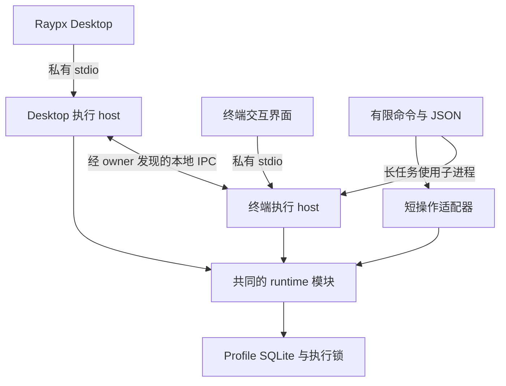

# Raypx CLI 与桌面执行架构设计

> 状态：待实施。设计基线：Raypx `9024436`，2026-10-19。
> 本文定义目标和迁移顺序；当前实现仍以各 workspace 的 AGENTS.md 和架构文档为准。
> 各阶段实现时同步更新相关约束，不把设计命令、跨端取消或 TUI 写成已有能力。

命令框架已先行接入 citty，保留现有 JSON 参数、裸结果和诊断生命周期；全局选项采用严格校验并支持分层帮助。显式 `raypx tui` 已提供轻量任务浏览、执行确认及历史/结果查看，使用单会话内核且不开调度。下文的新参数语法、输出 envelope、完整 TUI、执行归属及跨端控制仍待按阶段实施，当前可用命令见 [开发说明](../development/getting-started.md#local-cli)。

Raypx 提供桌面界面、终端交互界面和脚本命令三个入口，复用本地执行内核、权限规则和数据模型。安装独立 CLI 即可执行本地工作；Desktop 携带版本匹配的 CLI，通过内部协议调用。账户和云端同步继续由 Desktop/Web 的账户层负责。

Codex Desktop、Codex CLI 和 CI 等外部调用方，通过终端或工具执行 Raypx 的非交互子命令，使用同一套 JSON/JSONL 契约；Raypx Desktop 使用 bundled CLI 的私有 stdio 协议。外部调用示例：`raypx --no-interactive --json jobs list`。

借鉴 Codex 将客户端与执行能力分离的方式；Raypx 的终端界面围绕文件、任务和运行记录展开。[Codex App Server 官方文档](https://learn.chatgpt.com/docs/app-server)仅作为架构参考，不作为 Raypx 已实现能力的依据。

## 一 设计决策

| 范围     | 决策                                                                                |
| -------- | ----------------------------------------------------------------------------------- |
| 入口     | `raypx` 进入交互界面，子命令用于有限操作，JSON 用于脚本；私有 stdio 服务 Desktop    |
| 代码复用 | 内核继续在 `apps/cli`，Desktop 不导入 CLI 源码；不新增仓库或预先提取 runtime 包     |
| 进程     | 允许多个执行 owner 共享 profile；每个 profile 只有一个 scheduler                    |
| 任务     | job 是持久化定义，run 是一次执行；观察者、发起会话、执行 owner 分开建模             |
| 跨端控制 | 用 runId 找到 owner，通过受限本地 IPC 查询和取消，不凭 PID 或共享 SQLite 发控制指令 |
| 生命周期 | 发起会话结束会取消该会话的工作；观察者退出不取消被观察任务                          |
| 调度     | 首先保留 Desktop 调度；后续提供显式前台调度 host。系统后台服务另行设计              |
| 数据     | 本地授权、任务和历史不依赖登录，登出不清除；云端只接收独立脱敏投影                  |
| 构建     | 沿用 Vite+ 打包、Bun 编译和 Turbo 缓存，一份独立可执行文件，不要求用户安装 Node/Bun |

### 当前实现与目标的差距

- 当前使用显式 citty 命令表，操作参数仍为 JSON；非 JSON 模式仅增加缩进，尚未提供下文的完整人类可读参数接口。
- `jobs.run` 等整个运行结束，缺少独立启动确认、运行查询和跨进程取消。失败结果可能仍让 CLI 退出零。
- 前台命令和 Desktop 引擎可以共享 SQLite；scheduler/job 锁负责互斥，尚无 owner 发现和跨进程控制协议。
- `tools.cancel` 只访问当前 runtime 的内存；当前事件也仅发给该 runtime 的订阅者。外部 CLI 的运行变化不能天然通知 Desktop。
- 当前只有 Desktop-owned stdio 开启调度，EOF/Quit 关闭引擎；计划保留这一行为直到显式前台调度阶段完成。

## 二 代码和进程架构



图中的 runtime 是共用代码；host 是独立进程。无需把所有操作集中到一个常驻服务。短操作不启动调度器；长任务由 engine 子进程执行，父客户端用私有 stdin 作为存活通道，便于父进程退出后通过 EOF 清理工作。终端 v2 host 默认 `scheduler:false`；Desktop 显式请求调度角色，兼容现有 Desktop stdio 的调度行为。只有 M4 的显式命令允许独立终端 host 请求调度权。

```text
apps/cli/src/
  main.ts                 参数入口和轻量元命令
  commands/               显式公开命令表及参数适配
  output/                 human、json、jsonl 输出
  tui/                    终端展示和输入，不直接读写 SQLite
  client/                 私有 stdio 客户端与 owner 控制路由
  transport/              stdio、本地 IPC、握手、限额
  runtime/                files、jobs、runs、process、state
packages/contracts/src/
  local.ts                本地 DTO 和协议导出
```

公开命令表声明参数、输入来源、结果 schema、副作用、确认方式和内核调用。帮助和 `schema` 从它及 contracts 生成；内部协议增加方法不会自动新增公开命令。CLI、TUI 和 stdio 只做适配，不复制文件检查、调度或取消逻辑。

Desktop 原生层继续使用版本匹配的 bundled CLI 绝对路径。跨 owner 的 IPC 客户端位于 CLI 内，Desktop 通过自己的 stdio host 代理，renderer 不持有 IPC 凭据或自行发现其他进程。

### 命令框架：citty

选择 citty 作为命令树、参数解析和帮助渲染的薄层。Voidmix 已使用 `citty@0.2.2`；该版本无运行时依赖、发布 ESM 产物，支持嵌套子命令和延迟加载，适合当前 Bun 独立构建。版本通过 Raypx 默认 catalog 锁定，实际接入仍须通过 M0 的打包和行为探针。[包定义](https://github.com/unjs/citty/blob/v0.2.2/package.json)、[官方说明](https://github.com/unjs/citty)。

- 使用 `defineCommand`、`runCommand` 和 `renderUsage`；顶层入口由 Raypx 控制，不直接使用会输出帮助、处理错误和调用 `process.exit` 的 `runMain`。citty 的 `runCommand` 与现有 Raypx 同名函数在适配层明确区分。
- 原始 argv 先按首个 `--` 分开，后半段只交给子程序。全局选项集中规范化并显式传入命令上下文，不能依赖子命令自动继承；不得重新拼接后半段字符串。
- `0.2.2` 默认参数解析不满足本方案的严格模式。Raypx 适配层必须拒绝未知选项、缺值、重复和冲突参数，补齐 `--profile --json`、子命令前后全局参数及 `-- --help` 等回归探针。
- 公开命令表生成 citty 定义和机器 schema；contracts 校验业务参数。JSON/JSONL、错误码、确认、退出码、生命周期和诊断均由 Raypx 的服务与输出层决定。
- 元数据与执行 handler 分开，帮助只读取轻量声明，执行时再加载 runtime；TUI 仍是独立适配层。citty 直接作为 `apps/cli` 依赖，不为这一轻量依赖预建 Voidmix 包装层。

## 三 公开命令

以下为目标语法；阶段未完成的命令不能出现在已支持清单中。

```text
raypx
raypx tui
raypx --help | --version
raypx doctor
raypx profile list | show
raypx roots list
raypx roots add <directory> --alias <alias>
raypx roots remove <id-or-alias>
raypx files list | stat | read <path> --root <id-or-alias>
raypx files write <path> --root <root> --from <file|-> --create
raypx files write <path> --root <root> --from <file|-> --if-version <version>
raypx files mkdir <path> --root <root>
raypx files move <path> <destination> --root <root> --if-version <version>
raypx files delete <path> --root <root> --if-version <version> [--yes]
raypx jobs list | show <job-id>
raypx jobs create --file <file|->
raypx jobs update <job-id> --file <file|-> --if-version <revision>
raypx jobs delete <job-id> --if-version <revision> [--yes]
raypx jobs enable | disable <job-id> --if-version <revision>
raypx jobs run <job-id> [--idempotency-key <key>]
raypx runs list [--job <job-id>]
raypx runs show | wait | cancel <run-id>
raypx runs logs <run-id> [--follow]
raypx runs recover <run-id> --acknowledge-unknown [--yes]
raypx tools run --cwd <directory> [--timeout <duration>] -- <executable> [args...]
raypx schema [command...] --json
raypx engine run --scheduler
raypx stdio
```

`stdio` 是内部入口；`engine run --scheduler` 在阶段 M4 开放。新 CLI 不隐式安装或启动系统服务，也不提供脱离存活 owner 的 `--detach`。

### 参数和数据输入

- 无参且 stdin/stdout 都为 TTY 时进入 TUI；`--json`、`--output jsonl`、`--no-interactive` 禁止进入 TUI，即使双 TTY。其余非交互无参调用返回用法错误，不能等待输入。显式 `tui` 遇到这些冲突参数或不支持的终端返回明确错误；`--help` 正常退出。
- `--help`/`--version` 默认输出普通文本；与 `--json` 组合时返回对应元数据 envelope，仍走无副作用快速入口。`--json` 单独出现不视为有效业务命令。
- 全局参数为 `--profile`、`--data-dir`、`--json`、`--output jsonl`、`--yes`、`--no-interactive`、`--no-color`、`--verbose`。输出模式互斥，未知或重复冲突选项报错。
- profile/dataDir 的优先级为显式参数、`RAYPX_PROFILE`/`RAYPX_DATA_DIR`、现有平台默认值；不加载工作目录 `.env`。Desktop 显式指定自己的 profile，renderer 不能覆盖。
- `--` 后所有内容都是子程序 argv，不能继续移除其中的 `--json` 或 `--yes`。外部工具名称和相对 cwd 在 CLI 适配层解析为绝对路径，内核保留现有绝对路径约束；不自动拼接 shell。
- `--file -`/`--from -` 从 stdin 读取有界 UTF-8 内容；此时不再使用 stdin 交互确认。配置文件拒绝未知字段，错误指出字段位置。
- root alias 在 profile 内唯一，映射稳定 rootId；与现有显示名称分开。目录参数规范化后授权；不使用 `alias:path`，避免 Windows 路径歧义。撤销授权不删除目录。
- `--create` 对应 `expectedVersion:null`，与 `--if-version` 互斥。更新、移动和删除遇版本冲突直接失败；不自动覆盖。终端和 Desktop 均不能绕过这些条件。
- 文件删除、任务定义删除和未知清理状态的人工恢复需要 `--yes` 或 TTY 确认；机器模式缺少确认返回 `CONFIRMATION_REQUIRED`。任务删除不隐式取消正在运行的实例，历史按保留策略管理。
- 初期保留现有 JSON 参数命令作为明确的兼容入口；迁移提示仅写 stderr，不污染结果。新参数形式和兼容入口调用同一命令定义，按发布版本明确移除时间。

## 四 输出和错误契约

| 模式             | stdout                                           | stderr                                    |
| ---------------- | ------------------------------------------------ | ----------------------------------------- |
| human            | 表格、摘要、用户请求的数据；前台工具的 stdout    | 错误、进度、前台工具的 stderr、启用的诊断 |
| `--json`         | 恰好一个有限 JSON 对象，成功和失败都适用         | 诊断；不要求调用方解析 stderr 获得结果    |
| `--output jsonl` | 有版本和类型的事件记录，正常完成只有一个终态记录 | 诊断，不混入事件流                        |
| 私有 stdio       | 内部协议消息                                     | 结构化诊断                                |

```json
{ "schemaVersion": 1, "ok": true, "data": { "id": "run-id", "status": "success", "exitCode": 0 } }
```

```json
{
  "schemaVersion": 1,
  "ok": false,
  "data": { "id": "run-id", "status": "failed", "exitCode": 7 },
  "error": { "code": "COMMAND_FAILED", "message": "Command failed" }
}
```

`schemaVersion` 与可执行文件版本、内部协议版本分别演进。公开结果有明确 schema；不要把数据库行或任意内部事件对象直接作为稳定接口。正常错误响应不输出堆栈，诊断遵循 logger 的字段白名单。

| CLI 退出码 | 含义                                                                    |
| ---------- | ----------------------------------------------------------------------- |
| 0          | 请求成功；查询到一个失败历史记录仍属于成功查询                          |
| 1          | 操作失败或所启动/等待的运行失败；原始子程序退出码保留在 `data.exitCode` |
| 2          | 用法、参数、输入 schema 或确认条件错误                                  |
| 124        | 执行超时或等待超时；分别用错误码区分                                    |
| 130 / 143  | SIGINT 用户中断 / SIGTERM 结束                                          |

`jobs run` 和 `runs wait` 以最终运行状态决定成功与否；并发跳过返回非零和明确原因。`runs show`、读取日志等查询以查询是否成功为准。`runs wait` 的等待超时、`runs logs --follow` 的中断仅结束等待/观察；`jobs run` 被中断时只取消该会话新建并仍拥有的工作，幂等命中的既有运行按观察者处理。

有限 `--json` 不产生中间事件，`--json --follow` 拒绝；跟随需要 human 或显式 JSONL。JSONL 包含 `schemaVersion`、`type`、runId/operationId 和顺序号；运行失败与观察失败有不同的终态字段。SIGKILL、磁盘/管道损坏等异常终止不承诺一定输出终态；客户端据 EOF 和退出状态判断结果未知。

工具 stdout/stderr 分开传递，持久化和机器结果记录编码、保留字节数及 `truncated`。PTY 继续使用独立会话和 base64 字节，不伪装成普通文本工具输出。用户主动读取的文件/命令结果属于业务数据，不因诊断日志脱敏而被改写；这些内容不得进入 logger 或云端任务快照。

## 五 Job Run 与执行归属

### 持久化模型

- job 保留稳定 id，并增加整数 `revision`。修改和删除基于预期 revision 原子比较，避免 Desktop 与 CLI 覆盖彼此修改；执行时固定当次定义快照。
- run 增加 ownerId、originSessionId、jobRevision、reason、output 元数据。短工具运行也使用 runId；jobId 可为空。保留现有终态，并增加 `queued`。
- job 在本轮仍要求 Cron、IANA 时区和 action；临时 `tools run` 作为无 jobId 的本地运行。无计划持久任务、DAG 和子任务不随本轮隐式引入。
- 状态为 `queued → running → success/failed/cancelled/interrupted`；入队后竞争任务锁失败可进入 `skipped`。终态不可回退；超时以 `failed + reason:timeout` 区别用户取消。
- owner 标识某个执行 host 实例，包含随机 instanceId、启动代次和受保护 endpoint；PID 仅供诊断，不是控制句柄。session 标识发起客户端会话，不等于账户 session。

### 启动与重试

内部以 `runs.start` 快速确认，返回 runId、当前状态、新建或已存在标志及执行归属。`jobs run` 在确认后等待该实例；Desktop/TUI 通过事件和查询更新界面，不占用一个持续到任务结束的 bridge 请求。新控制请求的端到端默认截止时间设为 5 秒以内，启动确认目标不超过 1 秒；实际执行超时单独管理。这是目标契约，不把当前 renderer 和 native 不同方向的超时配置视作统一限制。

客户端在首次提交前生成幂等键。按 profile、操作和幂等键保存请求摘要与 runId，并在返回启动确认前持久化；同键同内容返回原实例，同键不同内容报冲突。客户端断线或确认丢失后查询/重试同键，不能直接新建运行。同键命中不转移原 ownerId 或 originSessionId；新客户端作为观察者，其退出或 Ctrl-C 不取消原运行。任务锁与 run 执行锁共同防止活跃实例重复启动。

初始键格式为 `v1:<createdAtUnixMs>:<uuid>`，由客户端生成并在帮助/schema 中说明；有效期 24 小时，超期返回 `IDEMPOTENCY_KEY_EXPIRED`，不能把旧键当成新请求。明显超前的时间戳拒绝。去重记录与 run 原子写入，保留到键过期，独立于历史/日志裁剪；执行尚未结束的键继续保留。M0 固定容量和时钟容差，容量满时拒绝接受新键，不能提前淘汰仍有效的记录；过期后的重试由用户重新判断并发起新操作。

这保证已识别请求的去重，不承诺外部命令副作用 exactly-once。发生发送后超时或连接结果未知时，不能自动退回本地 runtime 重放。进程崩溃窗口内结果未知的运行不自动重试。

### 生命周期

| 场景           | 行为                                                                                                 |
| -------------- | ---------------------------------------------------------------------------------------------------- |
| 有限前台命令   | 长任务由该命令的 engine 子进程拥有；默认等待，退出取消自己发起的未完成工作                           |
| TUI            | 拥有自己的终端 host；退出前提示正在运行的数量，确认后取消自身工作                                    |
| Desktop        | 窗口隐藏后托盘和 host 继续；实际 Quit 关闭私有 stdin，取消该 host 的工作                             |
| 观察其他 owner | 断线、关闭日志或离开界面只取消订阅，不取消被观察任务                                                 |
| `runs cancel`  | 路由到真实 owner，幂等请求取消；确认终态后展示真实结果，不能把接受请求或与完成竞争的结果强报为已取消 |
| 前台调度 host  | M4 后显式启动，保持终端存活；结束时停止调度并清理自身工作                                            |

session 只决定自己发起任务的生命周期；其他客户端具有同 OS 用户授权时可以显式取消，但观察不会转移执行归属。私有 stdio 断开表示该发起会话结束，触发其拥有工作的取消；可发现 IPC 的观察连接断开只结束订阅，可重新连接观察。第一版不做正在运行进程的迁移、终端重连或客户端退出后无 owner 的持续执行。

owner lease 释放不能证明其外部子进程已结束。父客户端异常退出可由私有 stdio EOF 触发 engine 清理；engine 自身崩溃需核对进程监督机制。恢复不得仅凭 PID、超时心跳或锁消失杀进程、宣称已清理或自动重放。无法确认的实例标记 `interrupted + reason:cleanup_unverified`，阻断同 job 后续启动；`doctor` 只读展示阻断原因和恢复指引。清理证据必须防止 PID 重用，M0 固定各平台可接受的自动解除证据。

无法取得清理证据时，用户可通过 `runs recover <run-id> --acknowledge-unknown` 明确承担残留进程风险后解除阻断。该命令只在原 owner 和执行 lease 已释放、运行仍为待清理时原子生效，保留 `cleanup_unverified`、确认时间和来源记录；不宣称残留已清除，不终止进程，也不在恢复操作中启动新运行。确认文案说明后续手动启动可能与残留工作重叠，仍启用的 job 也会从后续计划点恢复调度；不补跑被中断的实例。

### 变更通知与恢复

所有 owner 的 root/job/run 元数据变更，在同一事务中推进 profile 级 `changeSeq` 并写入有界变更记录。运行开始、跳过和终态都必须推进序列；不能继续仅靠当前 job 定义 revision 或进程内 finished 事件通知。

订阅者从一致快照和对应游标开始，随后读取变更；事件缺口、过期游标或 owner 重启要求重取快照。事件是通知，SQLite 是可恢复状态。元数据变更记录不包含命令、路径、输出或文件内容；输出流另用每 run 的顺序号和有界读取。事件 schema 使用判别联合，明确 `run.queued/started/finished`、`jobs.changed`、`roots.changed` 等形状。

历史保留现有每 job 最近 100 条、30 天边界，永不清理仍在运行或待清理的记录。输出单 run 初始最多保存 1 MiB，并增加 profile 总日志预算；达到预算可删除旧输出，保留状态与明确的不可用/截断标记。变更记录、输出和元数据分别设字节与时间上限，在 M1 冻结具体值和超限行为。

## 六 本地 IPC 与兼容

### Owner 发现和控制

1. 长命执行 host 先持有独立的 owner lease，再原子发布 descriptor；任务运行持有各自执行 lease，scheduler 继续用现有 profile 级唯一锁。
2. profile 增加稳定 profileId；按 canonical 实际目录隔离发现命名空间，握手同时核对 profileId 和目录身份。descriptor 记录 instanceId、binary/protocol 版本、能力、endpoint 和随机连接凭据；放在仅当前 OS 用户可访问的目录。凭据不出现在 argv、日志、状态 JSON 或 renderer 中，每次 owner 重启轮换。
3. 查询终态、保留日志和已结束运行的 `wait` 从 profile 持久状态读取，不要求 owner 存活。活跃运行的取消和实时订阅从 ownerId 定位 descriptor，握手确认实例代次和 profile 后控制；订阅失败仍可读取已持久化状态与输出。过期 descriptor 在确认 lease 已释放后清理；连接失败先重新发现，不向可能复用的 PID 发信号。
4. macOS/Linux 优先 Unix domain socket，Windows 优先 named pipe；用短的 per-user runtime 目录避免 Unix socket 路径过长。profile 身份基于规范化后的实际目录，避免同一数据目录通过别名产生不同身份。
5. 私有 stdio 连接采用父子关系作为信任边界；可发现 IPC 先验证 OS 用户访问控制和连接凭据，握手前不接受操作。只开放明确的运行查询、订阅、取消和诊断能力，不把 IPC 注册到 HTTP API。

M0 必须在编译后的独立 Bun 二进制上验证三平台监听、连接、权限隔离、清理和同名 endpoint 竞争。Node 类型声明不能代替 Bun Windows 行为验证。平台不满足时暂停该平台的跨端控制，保留本机单入口能力；调整传输方案须补协议和验收，不静默改为无保护的 TCP。

### 协议与故障处理

- 内部 stdio v1 与现有 `job.finished` 在迁移期保留。新运行和 owner 能力采用独立 v2 schema/版本入口，不能把新状态直接发给只理解 v1 的客户端。
- M1 的新 profile schema 先在临时 profile/显式能力开关下验证；M2 完成 Desktop 适配后，M1—M2 随同一次协调版本升级启用用户数据迁移。旧版本 fixture 保留到迁移验收，不能单独升级现有 profile 后让已安装 Desktop 无法使用；不默认承诺新 schema 的 v1 投影兼容。
- Desktop 与 bundled CLI 继续严格匹配版本。独立 CLI 连接其他 owner 时只在协议和所需 capability 都明确兼容时操作；第一版写控制要求相同应用版本，版本不符返回可操作错误，不强杀/替换对方进程。
- binary 版本、内部协议版本、公开 JSON schemaVersion、SQLite schema version 分开维护。迁移必须取得现有独占 schema lease；其他活跃进程阻挡升级。旧 binary 发现较新 schema 时明确拒绝，不绕过锁或另建同名空库。
- 请求有有界 id、明确 deadline；长任务 start/status/cancel 和订阅确认都快速返回。超时不等于取消已执行副作用，取消是独立请求。
- 保留现有 8 MiB 消息上限、每连接 64 个在途请求和 16 MiB 输出缓冲边界，并增加 host 总连接/缓冲预算。慢订阅者断开后可重新取状态，不能拖住执行内核；IPC 观察连接断开不触发 owner 的全局关闭。
- daemon 生命周期与 OS 服务注册不在本次基本架构内。`doctor` 区分当前实例角色、真实 scheduler owner、存活 lease、协议不兼容和待清理运行，不把本进程 `scheduler:false` 显示成整个 profile 未调度。
- scheduler 租约忙只让 Desktop host 进入无调度的手动模式，显示真实调度 owner，不能使整个引擎无法查询、执行或观察。显式 `engine run --scheduler` 以取得调度权为启动条件，竞争失败返回 `SCHEDULER_BUSY` 并退出；不隐式抢占其他 owner。

## 七 终端交互界面

轻量入口先行：`raypx tui` 使用原生 readline 的按行菜单，显式双 TTY 启动，首页无参行为保持帮助。它通过现有 request 边界复用本进程 `scheduler:false` runtime，只执行当前会话手动发起的任务，退出/EOF/信号关闭自身 runtime。任务列表、执行确认和历史/完成结果均为实际本地数据；英文/中文可切换，输出经显示层清理控制序列并有界分页。该步骤不等待完整 IPC，属于 M0 的交互验证；不把现有默认开启调度的 stdio 用作终端 host。

下述完整 TUI 仍依赖 M1/M2：独立 host、实时输出、按 runId 精确取消及跨端控制完成后，再把轻量入口迁移为 client 适配层。轻量实现没有达成 M3 的完整验收，也不自动将无参 `raypx` 改成交互模式。

终端首页显示当前 profile、实际调度状态、活跃运行数和 engine 健康状态。主视图分 Tasks、Runs、Files：任务列表及下一次计划时间，运行状态和分路输出，授权目录与受限文件操作。详情和动作统一调用命令服务/本地契约。

- 键盘支持上下选择、Enter 详情、`/` 搜索、`r` 运行、`x` 取消、`q` 返回/退出；危险操作显示对象与后果，并允许取消确认。
- `q` 退出先列出该会话仍拥有的运行，明确“取消自身任务并退出”；观察其他 owner 的任务不进入取消清单。
- Ctrl-C 首次中断当前动作/打开退出确认；连续强制退出要说明可能产生待清理记录。无论渲染错误、信号还是正常退出，都恢复终端 raw mode、光标和颜色。
- 输出视图按字节有界，支持搜索/跟随和截断提示；外部输出作为数据处理，过滤终端控制序列，防止命令输出伪造界面或执行终端控制。
- 中文/英文文案一致，尊重终端宽度、颜色设置和 reduced motion；窄屏与不支持全屏控制的终端降级到可操作的线性菜单。
- TUI 按需加载，不导入 React/WebView/应用前端构建链。M0 用独立二进制比较轻量渲染方案和线性模式，再固定具体依赖；不为界面预先建立插件系统。

## 八 账户 手机同步与文件取回

本地 owner/session 不承担账户认证。Desktop 的账户 session、安装绑定、云端 sequence/epoch 和本地 changeSeq 分别管理，不能互相替代。只有 Desktop 的账户协调器运行且有效登录时才同步；独立 CLI 不隐式上传数据。

第一版只同步 Desktop 当前选定的 profile，现有默认值为 default。同设备其他 CLI profiles 不自动合并进同一远端设备；切换 profile 的云端绑定/撤销行为需要单独设计后开放。

- [手机能力方案](web-mobile-capabilities.md)阶段 2 的一致脱敏快照读取、typed 状态变更事件可以基于 M1 完成，不必等待 IPC 或 TUI。
- 同步只投影当前仍存在的 job 及其允许的运行摘要，排除 tools 临时运行、ownerId、endpoint、action、argv、cwd、输出和本地路径。`queued`/reason 等新字段在本地与远程投影明确映射并一起测试，不能直接复用整个 run schema。
- Desktop 应能通过 profile 变更序列发现独立 CLI 创建、修改和完成的任务；跨进程通知缺失不能导致云端快照永久停留在旧状态。
- 手机方案 4b 的 `files.download.start/status/cancel` 使用相同的快速确认、owner 和取消规则，但保持独立 transfer 类型与安全校验。签名 URL 仅在传输内存中，不能进入 run 定义快照、幂等重试持久化内容、日志或云端状态。
- 大文件字节不进入单条 NDJSON/bridge 消息。下载地址来源白名单、字节/hash 校验、原子提交、root grant 与版本复查仍按 4b 执行。

## 九 启动 构建与诊断

帮助、版本、命令 schema 是无副作用快速入口：不打开 profile SQLite，不连接 owner，不启动 scheduler，也不初始化 evlog。正常短命令按需初始化 logger；结构化诊断不占用结果 stdout，debug/verbose 的默认策略与现有完成日志测试一起更新。

保持一份 CLI 编译产物，TUI/IPC/runtime 都来自同一个构建，不增加独立 TUI 构建任务或安装时编译。通用 logger 保留在 Voidmix；任务、owner、profile 和设备协议仍由 Raypx 拥有。

M0 在固定机器和工具版本上记录编译产物字节数、依赖增量、干净/热构建耗时、帮助启动及首次 TUI 可交互时间。以同机重复测量中位数和 p95 对比：帮助启动和压缩产物体积暂定相对预算 +10%，CLI 构建耗时 +15%；新增 host 启动另外记录，不用热缓存结果替代冷启动。预算是实施门禁，M0 验证后冻结，超出时先审依赖或设计。

诊断只记录允许的 id、状态、时长和安全错误码。主动查询的运行输出由业务结果通道返回；日志轮转、事件缓冲、profile 历史均设边界。`doctor` 不启动执行、不迁移数据库、不自动删除用户任务或授予目录。

## 十 阶段依赖和验收

| 阶段                  | 前置                | 实现范围                                                                                                    | 必须通过的验收                                                                                                                                 |
| --------------------- | ------------------- | ----------------------------------------------------------------------------------------------------------- | ---------------------------------------------------------------------------------------------------------------------------------------------- |
| M0 协议与平台验证     | 无                  | 冻结公开命令/错误/JSON、版本迁移策略、清理证据与人工恢复契约；验证 IPC、编译自启动 host、TUI 方案与性能预算 | 空 PATH 下启动编译子进程；三平台 IPC/权限/清理探针；记录基线。跨端控制未验证的平台保持阻塞                                                     |
| M1 命令与 Run 模型    | M0 的契约           | 显式命令表、flags/stdin、有限 JSON、退出码、root alias、job revision、runId/状态/幂等、profile 变更序列     | 失败 child/job 非零；失败历史查询零；参数保真；版本冲突/确认；重试去重；独立进程变更可见；迁移遇活跃 lease 拒绝                                |
| M2 执行归属与跨端控制 | M1、M0 对应平台验证 | 子进程 host、owner registry/lease、受保护 IPC、run 查询/取消、typed 事件和断线恢复；Desktop 适配新协议      | CLI 启动后 Desktop 可查看/取消，反向亦然；观察断线不取消；父客户端退出清理自身；owner 崩溃/未知结果/PID 重用；版本不符不误连接；幂等重试不重放 |
| M3 终端交互           | M1、M2              | 双 TTY 首页、任务/运行/文件、键盘导航、确认、输出跟随与降级                                                 | 不依赖 Desktop/登录；TTY/非 TTY；raw mode 恢复；窄屏、中英文；退出只取消自己会话；界面与子命令结果一致                                         |
| M4 独立前台调度       | M2，可与 M3 并行    | `engine run --scheduler`、明确启动/退出；更新“仅 Desktop 调度”的现有约束                                    | 与 Desktop 竞争同一 scheduler lease；忙时明确拒绝、不抢占；隐藏窗口不暂停；错过不补跑；同 job 不重叠；结束只清理自己的运行                     |
| M5 系统后台服务       | 另行确认需求        | OS 服务安装/卸载、持久后台 owner、detach/升级/崩溃监督                                                      | 单独设计与安全/发布验收，不阻塞 M1—M4                                                                                                          |

每个实现阶段先运行相关窄测，再 `bun run verify`。变更 CLI 编译产物时执行独立 smoke，保持临时 profile 与空 PATH 验证；协议同时影响 Desktop 时补 native bridge、打包态生命周期和版本握手检查。终端/进程清理和 IPC 需要 macOS、Windows、Linux 的实际独立产物记录，不能用 Node 运行、renderer mock 或只通过类型检查替代。

最低回归矩阵：

1. `--json` 成功/失败各一份结果，stdout 不混诊断；JSONL 有序、唯一终态，输出限额可见。
2. 参数中的引号、空格、Unicode、`--json`/`--yes` 原样传给子程序；缺值、未知字段、stdin 冲突和非 TTY 不挂起。
3. 两个 profile 相互隔离；同 profile 多 owner 共享数据，scheduler/job 互斥，job revision 冲突不覆盖。
4. 启动确认丢失、重连、相同幂等键不同参数、取消与完成竞争、超时和重复取消不会产生第二次执行或终态回退；新客户端重试旧 key 后退出，不改变原归属。
5. CLI/桌面/观察者分别正常退出、SIGINT、SIGTERM、异常退出；保留其他 owner 的任务，未证实清理的实例不自动重跑；人工解除保留未知标记和确认记录。
6. 旧 schema/新 schema、旧内部协议、过期 endpoint、不同 OS 用户访问、错误凭据及慢消费者均明确失败且不泄漏 profile 数据。
7. 目录授权、符号链接、条件写入和删除确认在所有入口一致；命令输出、文件内容、签名 URL 不进入诊断或云端投影。
8. 单独安装 CLI 可完成创建任务、执行、查看历史；owner 退出后新 CLI 仍可 show/logs/wait；TUI 与 Desktop 展示同一 profile 的运行状态，跨端取消准确到 runId。

设计完成不计作上述验收通过。各实现阶段交付源码变更、实际检查结果和开放的平台门禁；达到阶段验收后再声明对应命令可用。
