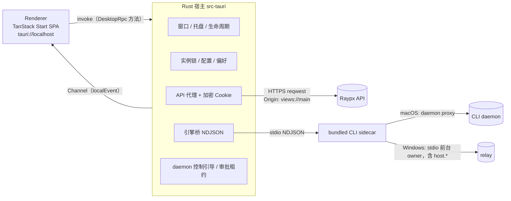

# 执行方案：Desktop 原生宿主迁移到 Tauri 2

> 状态：已接受并执行中（2026-10-27）。基线：raypx `canary` c459ab2（2026-10-27），Electrobun 2.0.5，
> Tauri 2.12.3（2026-10-10）。
> 当前实现边界见 `apps/desktop/AGENTS.md`、[ADR-0035](../architecture/0035-local-owner-host.md)
> 与新增 [ADR-0036](../architecture/0036-tauri-desktop-host.md)。默认构建已接入 Tauri；
> Electrobun 旧壳清理已进入 P5。用户已明确允许暂时跳过缺少凭据的签名、公证和真实账户验收；
> 这些项目继续记录为“未验证”，不作为签名发布完成的证据。

## 执行记录（2026-10-27）

已采用的决策：以 Electrobun 绕行/SDK 维护成本为迁移依据；默认 `bun run verify`
继续不要求 Rust/WebView 开发库；Windows 使用按用户安装的 NSIS；不迁移旧登录会话；
渲染端存储按规范化服务器 origin 加前缀。Windows 升级后需要重新确认远程控制授权，
不会把旧 Desktop owner 的 opt-in 静默转移给新 CLI owner。

新增范围：按用户补充要求，尝试 **仅在 Rust 调用云端 API 时**使用 `orpc-rs` 的
`orpc-client`。自定义 Link 继续经过原生 API 代理，保留路径白名单、Cookie、截止与
响应上限。Renderer ↔ Rust 仍使用现有命令桥和带确认的 Channel；TS 仍是业务 schema
唯一来源。重点验证与仓库 oRPC 2 beta 的错误协议兼容性。

| 阶段 | 代码进度                                                                  | 验收边界                                                          |
| ---- | ------------------------------------------------------------------------- | ----------------------------------------------------------------- |
| P0   | Windows CLI foreground owner、通用桥、渲染端校验、共享夹具已实现          | CLI/TS 自动化通过；真实 Windows 待验收                            |
| P1   | macOS release 冒烟、前台窗口约束和真实 WKWebView Channel 压测已通过       | Windows 待 GitHub Actions；签名公证按用户决定暂缓；DMG 下降 8.33% |
| P2   | Rust 宿主、策略、云端 orpc-client 与原生更新入口已实现，Cargo/Clippy 通过 | macOS 打包态通过；Windows 待 GitHub Actions                       |
| P3   | VP/sidecar、macOS/Windows CI、签名与更新清单工具已接入                    | 本地包为未签名；未把 YAML 配置当作已签名产物                      |
| P4   | 私有 socket 驱动和原 TS 断言已迁移，真实 Agent 门禁保持显式 opt-in        | 没有执行未显式开启的付费推理或外部账户验收                        |
| P5   | ADR、架构、构建和操作文档已更新；旧壳源代码、适配器和 SDK 任务已移除      | 以 Tauri 单宿主重新运行 TS、Cargo 与双平台 Actions                |

本机验证记录：完整 `bun run verify` 的 58 个任务及 API/Web/独立 CLI 产物探针通过。
macOS `native:smoke` 完成 shell → 切服 restore → 原服务器 restore：文件、任务、终端、
偏好恢复、Cookie 跨进程持久化、origin 隔离和 Quit 后 daemon 存活均通过。真实 WKWebView
Channel 压测传输 20 MiB / 640 包，2036 ms，约 10.30 MB/s；消费完整且有序，未确认峰值
263,274 bytes，结束时为 0。P5 后静默回归为 2005 ms / 10.46 MB/s，
未确认峰值 351,024 bytes，结束时同样为 0。该结果证明测试流的传输边界；没有把未执行的 Windows、
真实 HTTPS/付费 Agent 或签名验收写成通过。macOS `native:smoke:interactive` 后续又完成
同样三个阶段，原生 Close 隐藏、焦点恢复和 800 × 620 最小尺寸均通过。按用户要求，
此后的本机测试只使用静默模式；需要前台窗口的检查交给 GitHub Actions 隔离 runner。

界面收尾：原生最小尺寸为 800 × 620（默认 1120 × 720）。Desktop 滚动条使用
10 px 透明轨道和 6 px 圆角滑块，支持横纵滚动、主题切换、悬停/按下反馈；
forced-colors 模式保留系统样式。实际构建 CSS 的后台浏览器检查通过，没有激活本机窗口。
静默冒烟发现的租约时序问题已修复：显示/隐藏和引擎 ready 时立即刷新，并在串行锁内
采样当前可见状态，避免焦点事件依赖和排队旧快照覆盖。

并发单实例验收发现并修正 SQLite 锁升级竞态：先取得排它事务，再设置 EXCLUSIVE 模式，
保留 250 ms 有界等待和整个连接生命周期的排它锁，不替换或删除锁文件。原实现 100 轮
竞争出现 3 次没有持有者；修正后 1000 轮 / 4000 个竞争进程全部满足恰好一个持有者。
测试驱动同时加入完整管道读取、截止与进程清理，避免 BrokenPipe 掩盖失败。

体积验收（P5 后本地验证包，相同 arm64 CLI，未签名）：新 DMG 53,727,806 bytes（51.2388 MiB），
本地旧 Electrobun DMG 58,613,145 bytes（55.8979 MiB），减少 8.33%，未达到最初约 40 MB
估计。`hdiutil verify` 与只读挂载检查通过；宿主/CLI 均为 arm64，CLI 版本 0.1.0。
普通 `.app` 共 126,532,436 bytes（120.6707 MiB）。DMG SHA-256：
`e8afb2a102ab4890fd68f50b1c6d226fac8bb6f4b868a74dc176e20c3f258be7`。
无 Finder 自动化权限时通过 Tauri 支持的 `CI=true` headless bundler 成功生成 DMG，
不改变系统权限；省略 Finder 美化布局，保留应用内容与 Applications 链接。

验收范围调整：2026-10-27 用户确认目前尚无签名与真实 HTTPS 测试账户凭据，明确允许
先跳过相关验收。Developer ID、公证、Authenticode、updater 签名/安装和真实付费 Agent
保持“未验证”。代码入口和配置说明保留，后续有凭据时再执行；本次不以此阻止旧壳清理。

实际源码修正：当前 macOS service 安装器已经使用稳定安装的 CLI 路径，不能按本文
早期假设无条件重写 launchd 为 app-bundle 路径，也不能自动安装系统服务。

## 一 背景与触发条件

ADR-0020 对比 Tauri v2 后选择了 Electrobun，前提是"Desktop 是轻量云端客户端，原生层只需
窗口/托盘"，用 TypeScript 写原生层可以去掉 Rust 工具链。此后原生层的职责大幅增加：bundled
CLI 引擎、macOS daemon 引导、Windows 远程控制、原生 HTTP 代理与加密 Cookie、终端审批租约、
connector 修复。当前原生层 `apps/desktop/native/` 约 1,950 行 TS，原生测试与脚本约 2,950 行。

ADR-0020 的后续条款要求"经验证的产品需求"才重新评估原生运行时。开工前需确认至少一条成立：

1. **Windows 是正式分发目标。** Electrobun 2.x 的 WebView2 封装硬编码 `disable-web-security`，
   只能打包 CEF，并为 CEF 单独维护一套加密 Cookie 存储。Tauri 使用系统 WebView2，不需要 CEF。
2. **Electrobun 缺陷持续产生维护成本。** 现有绕行：partition 不转发（`native/main.ts:109`）、
   消息代理丢弃 transport promise（`native/main.ts:341`）、CEF 无 Cookie 实现；以及
   Hutch/`.hutch/devkit`/`native:prepare`/`native:types` 这一整套 SDK 投影与缓存规则。
3. **安装包体积有硬指标。** 当前 macOS 包内：CLI 102.6 MB、Electrobun 自带 Bun 63.6 MB、
   其他约 6 MB，DMG 58.6 MB。去掉宿主 Bun 后估算 DMG 约 40 MB（P1 实测确认）。CLI 体积不变。

如果三条都不成立，建议维持 Electrobun，只做第五节的 P0（它对现有架构本身也有价值）。

## 二 目标与非目标

目标：

- Rust 原生宿主替换 Electrobun 的 Bun 主进程。macOS 用 WKWebView，Windows 用系统 WebView2。
- Renderer 业务代码不改；只替换 `src/lib/desktop.ts` 的桥接适配器。
- CLI、macOS daemon、本地 NDJSON 协议、API、`@raypx/contracts` 保持不变（P0 的 Windows
  host 迁移除外）。
- 保留现有全部安全约束：Cookie/Set-Cookie 不过桥、API 路径白名单、渲染端不能选择请求目标或
  认证头、只有打包视图和 loopback 开发内容能调用原生方法、目录授权只走原生选择器、CLI 用绝对
  路径启动且版本必须匹配、凭据不进入渲染端。

非目标：

- 不启用 Tauri mobile；不把 CLI 或 `@raypx/host` 改写成 Rust。
- 不向渲染端开放 Tauri 的 fs、shell、http 插件；sidecar 只由 Rust 启动。
- 不改账户、远程任务、relay 协议；不改变 Linux 的"未验证"状态。

## 三 核心原则：Rust 只做传输与策略，不复制业务 schema

TS 契约（zod）仍是唯一来源。Rust 按载荷分三类处理：

| 类别                  | 内容                                                                                        | Rust 的职责                                   |
| --------------------- | ------------------------------------------------------------------------------------------- | --------------------------------------------- |
| 不透明 JSON           | 本地协议请求/响应/事件、API 请求体与响应体、`hosts.authorize` 载荷、偏好内容                | 只检查大小、方法白名单、来源；原样转发        |
| Rust 必须理解的小结构 | `config.toml` 连接字段、Set-Cookie 解析规则、API 路径白名单、本地方法白名单与参数注入       | 用 serde 实现；与 TS 共用同一组夹具，双端都跑 |
| 留在 TS 校验          | `localEvent`（渲染端 zod 校验）、设备偏好（渲染端 `isDevicePreferences`）、host 授权（CLI） | 不解析                                        |

偏好依赖 `@raypx/ui` 主题、`@raypx/i18n` 语言和 `@raypx/analytics` 同意状态三个包的规则，
放到 Rust 会复制三份；因此 Rust 只把偏好当作不超过 4 KiB 的 JSON 对象，合并顶层字段后原子写入，
通知文案需要的语言只读取 `locale` 字符串。

## 四 目标架构

- API 代理继续发送 `Origin: views://main`。它是原生代理的逻辑标识（渲染端从不直连 API），
  API 默认白名单已包含该值，部署侧无需改动。
- Cookie 在两个平台都改由 Rust 管理（reqwest + 加密文件 + 系统钥匙串密钥），不再依赖 WebView
  的 Cookie 存储。这同时去掉了 macOS/Windows 两套实现的分叉。

## 五 分阶段计划

### P0 前置改造（仍在 Electrobun 上完成，可独立合入）

P0 不依赖 Tauri，即使最终不迁移也值得做。

1. **Windows 远程控制移入 CLI。** 现在 Windows 在 Desktop 的 Bun 进程里直接运行
   `@raypx/host` 的 `RemoteControl`，并用浏览器会话续期 grant。改为与 macOS daemon 相同的
   模型：Desktop 用 `hosts.authorize` 引导受限设备凭据，CLI stdio 模式在 Windows 上提供
   `host.*` 方法并自行续期。需要：
   - `apps/cli/src/runtime/daemon/vault.ts` 增加 Windows 后端（`Bun.secrets` 已支持 Credential
     Manager，目前只在 darwin 启用）；
   - stdio 模式复用 `DaemonControl`，Windows 仍是前台 owner，EOF/Quit 照旧取消；
   - Desktop 两平台统一使用 `DaemonControlProxy`，`native/control.ts` 删除，原生层不再依赖
     `@raypx/host`。
   - 兼容不支持 `hosts.authorize` 的旧服务器：沿用现有 `isMissingProcedure` 降级路径。
2. **桥接契约脱离 Electrobun 类型。** 把 `native/rpc.ts` 的 `DesktopRpc` 改为 universal 文件
   （如 `apps/desktop/bridge.ts`），导出运行时常量 `DESKTOP_METHODS` 和由它推导的请求/响应类型，
   不再使用 `electrobun/rpc` 的 `RPCSchema`。保留 `getBridge().request.<method>(params)` 的调用形状，
   其余 17 个调用桥接的渲染端文件不用改。
3. **校验前移到 TS 端。** 渲染端对 `localEvent` 做 `localEventSchema` 校验；偏好快照由原生提供
   `{ status: "missing" | "unreadable" | "read", raw }`，`valid/error` 由渲染端判定。
4. **抽出共享夹具。** 为 `config.toml` 解析、Set-Cookie 规则、API 路径白名单、本地方法白名单与
   `scopeLocalAccount` 建立 JSON 夹具目录（如 `apps/desktop/tests/fixtures/native/`），现有 Bun
   测试改为读夹具。P2 的 cargo test 读取同一批文件。

完成标准：`bun run verify`、`native:smoke` 在 macOS 和 Windows 通过；Windows 远程任务的打包态
冒烟（登录、hidden relay 执行、重启、登出）通过。

### P1 技术验证（限时 1 周，结束时决定继续或停止）

在独立分支建最小 Tauri 宿主，只验证风险项，不追求完整功能：

| 验证项             | 通过标准                                                                                                               |
| ------------------ | ---------------------------------------------------------------------------------------------------------------------- |
| 渲染端加载         | `dist/client` 的预渲染壳、hash history、`ClientOnly` 在 `tauri://localhost`（Windows 为 `http://tauri.localhost`）正常 |
| CSP                | 在 `tauri.conf.json` 声明与 `native:csp` 等价的策略，加上 IPC 所需的 `ipc: http://ipc.localhost`，无违规报告           |
| 终端流量           | 用 `ipc::Channel` 推送 PTY 数据：持续 10 MB/s 下内存有界、无乱序；不满足则加基于 ack 的信用窗口再测                    |
| sidecar 签名与公证 | Bun 编译的 CLI 放在 `externalBin`，开启 hardened runtime 后能通过公证并正常运行（预计需要 JIT 相关 entitlements）      |
| launchd 路径       | 已安装的 daemon plist 指向旧路径 `Contents/Resources/app/bin/raypx`；验证新路径下的重新注册流程                        |
| Windows WebView2   | 未开启 `disable-web-security`；渲染端无法跨域直连 API（ADR-0020 要求的 CORS 负向检查）                                 |
| 体积               | macOS DMG、Windows NSIS 安装包实测，与当前包对比                                                                       |
| macOS 打包态自动化 | P4 的冒烟驱动方案能在 release 配置下执行脚本并取回结果                                                                 |

任何一项无法满足且没有可接受的替代方案时，停止迁移，保留 P0 成果。

### P2 Rust 宿主实现（Electrobun 与 Tauri 并存）

在 `apps/desktop/src-tauri/` 新建 crate（如 `raypx-desktop`），加入根 Cargo workspace。渲染端
`desktop.ts` 同时支持两种壳：`isDesktop()` 识别 Electrobun 或 Tauri，`getBridge()` 返回对应适配器。
Tauri 适配器用 Proxy 把 `request.<method>(params)` 映射为 `invoke("<snake_method>", { input })`，
`localEvent` 通过启动时注册的 `Channel` 接收。切换完成前两种壳都能运行，便于对比。

| 现有文件                                  | Tauri 实现                                                                   | 要点                                                                                                                                          |
| ----------------------------------------- | ---------------------------------------------------------------------------- | --------------------------------------------------------------------------------------------------------------------------------------------- |
| `native/instance.ts`                      | `lock.rs`，rusqlite 沿用 `desktop-instance.sqlite` 的独占锁                  | 与旧版互斥，迁移期间新旧两版不会同时运行；可选加 single-instance 插件聚焦已有窗口                                                             |
| `native/config.ts`                        | `config.rs`，`toml` + serde                                                  | 字段、16 KiB 上限、`RAYPX_HOME` 绝对路径、默认文件内容、`scope`/`partition` 推导与 TS 一致；错误信息不回显文件内容                            |
| `native/preferences.ts`                   | `prefs.rs`                                                                   | 不透明 JSON 对象，原子写入（临时文件 + rename，0600），预加载只给原始内容和读取状态                                                           |
| `native/engine.ts`                        | `engine.rs`，tokio 子进程                                                    | 绝对路径（`current_exe` 同目录），8 MiB 行限制，64 个待处理请求，超时 10 s / 86,410 s，generation 隔离，版本握手，`daemon restart` 替换 owner |
| `native/api.ts` + `native/cookies.ts`     | `api.rs` + `cookies.rs`，reqwest（rustls）+ aes-gcm + keyring                | 路径白名单、请求/响应头白名单、30 s 截止、按 id 取消、8 MiB 响应上限、Set-Cookie 校验与回滚、写失败后禁用会话；两平台同一实现                 |
| `native/daemon-control.ts`                | `control.rs`                                                                 | `account.get`、`hosts.authorize`、`hosts.revoke` 以 oRPC JSON 透传，凭据直接交给 CLI，不经过渲染端                                            |
| `native/local-request.ts`                 | `local_request.rs`                                                           | 禁止 `host.*`、`observed.remote`、`approvals.local.watch`、`roots.register` 等；注入 connector 目录；`scopeLocalAccount` 的 sha256 规则       |
| `native/connectors.ts`                    | `connectors.rs`                                                              | 只运行 bundled CLI 的 `connectors repair`，20 s 超时，输出上限 256 KiB，错误码白名单                                                          |
| `native/approval-lease.ts`                | `lease.rs`，tokio interval                                                   | 仅在引擎就绪、窗口可见且未最小化时续租；隐藏/退出时释放                                                                                       |
| `native/window.ts`                        | `WindowEvent::CloseRequested` + `min_inner_size`                             | 关闭即隐藏到托盘；最小尺寸改用原生约束，删掉 resize 回弹逻辑                                                                                  |
| `native/main.ts` 托盘/退出/重开           | `TrayIconBuilder`、`RunEvent::ExitRequested`、`RunEvent::Reopen`、tokio 信号 | 退出顺序不变：停租约 →（Windows）detach → 停引擎 → 等待页面卸载（最多 2 s）→ 释放实例锁                                                       |
| `Utils.showMessageBox` / `openFileDialog` | `tauri-plugin-dialog`（只在 Rust 侧调用）                                    | 选目录后由 Rust 调 `roots.register`，渲染端仍不能注册任意目录                                                                                 |
| `Utils.showNotification`                  | `tauri-plugin-notification`                                                  | 文案由构建期从 `@raypx/i18n` 导出的小 JSON 提供（`include_str!`），不手写第二份                                                               |
| `Utils.openExternal`                      | `tauri-plugin-opener`（只在 Rust 侧调用）                                    | 先经 `external.rs` 校验：仅 http(s)、无凭据、无控制字符、长度上限                                                                             |
| `preload`                                 | `initialization_script`                                                      | 连接配置、`__raypxDaemon`、偏好快照；对象冻结方式不变                                                                                         |
| `navigationRules`                         | `on_navigation` + capabilities                                               | 只允许应用自身 origin 与开发期 `http://localhost:1420`；capability 只授予主窗口的自有命令，不授予任何插件的渲染端权限                         |
| WebView partition                         | 单一 WebView 存储 + 渲染端按连接 scope 给 localStorage key 加前缀            | Cookie 已不在 WebView 内，剩下的只有草稿、面板宽度、最近项目；避免 `data_store_identifier` 的 macOS 14+ 限制                                  |
| `Updater.localInfo.channel()`             | `tauri::is_dev()`                                                            | 只用于判断开发模式                                                                                                                            |
| Windows CEF 检查与 CEF Cookie 存储        | 删除                                                                         | WebView2 默认开启 web security                                                                                                                |

方法集合一致性：Rust 单元测试读取 P0 导出的 `DESKTOP_METHODS`（构建时写成 JSON），与
`generate_handler!` 注册的命令逐一比对，缺失或多出都失败。

完成标准：Tauri 壳在 macOS 和 Windows 上跑通第八节验收清单中除打包、签名、更新以外的项目。

### P3 构建、打包、签名、更新与 CI

- `tauri.conf.json`：`identifier` 仍为 `com.raypx.desktop`，`productName` 为 `Raypx`；`devUrl`
  `http://localhost:1420`；`frontendDist` `../dist/client`；`bundle.externalBin` 指向 CLI；图标沿用
  `native/icons`。冒烟包用合并配置覆盖为 `Raypx Test` / `com.raypx.desktop.native-smoke`。
- `scripts/native/prepare-cli.ts`：复制到 `src-tauri/binaries/raypx-<target-triple>[.exe]`，保留版本
  一致性检查和"先构建渲染端"检查。
- VP 任务：`desktop#build` 只构建渲染端；`package:desktop` 调 `tauri build`，与其他 Cargo 任务
  一样不缓存。删除 `native:prepare`、`native:types`、`typecheck:native` 及 `.hutch` 相关输入。
- Cargo：根 `Cargo.toml` 的 `members` 加入 `apps/desktop/src-tauri`。`rust.yml` 跑在 Ubuntu，
  编译 Tauri 需要 webkit2gtk 等系统库，因此改为 `--workspace --exclude raypx-desktop`；桌面 crate
  的 fmt/clippy/test 放到 `ci.yml` 的 macOS/Windows desktop job 中。
- CI desktop job：加 `rustup show`（读取 `rust-toolchain.toml`）和 `Swatinem/rust-cache`。
- 签名：macOS Developer ID + 公证（含 sidecar，entitlements 以 P1 结论为准）；Windows Authenticode。
  证书与 Tauri 更新签名私钥只放 CI secrets。
- 更新：`tauri-plugin-updater` + 签名的静态清单。当前 `release.generatePatch` 为 false，不损失增量补丁能力。
- Windows 安装器用 NSIS 按用户安装（与现在的 `%LOCALAPPDATA%` 数据位置一致）；WebView2 默认用
  下载引导器，离线分发场景再改为内嵌引导器。

完成标准：CI 在 macOS 和 Windows 产出已签名的安装包，`native:smoke` 在新包上通过。

### P4 测试迁移

- 原生单元测试：移入 Rust 的逻辑改为 cargo test，并读取 P0 的共享夹具；渲染端适配器保留 Vitest。
- 原生集成测试：`engine.test.ts`（真实子进程）、`instance.test.ts`（真实 OS 锁）改为 Rust 集成测试，
  使用编译后的 CLI 和临时 profile。
- 打包态冒烟：现在 `tests/native/smoke/scenario.ts` 作为 Electrobun 的 Bun 主进程入口运行，直接
  在页面里执行脚本。Tauri 主进程没有 Bun，改为：
  - Rust 增加只在冒烟包里编译的 Cargo feature `native-smoke`，通过带随机令牌的本地 socket（Unix
    socket / named pipe）提供 `eval_with_callback` 和窗口生命周期操作；
  - `run.ts` 继续负责 shell/restore/write/read/beta 各阶段和隔离目录，`scenario.ts`、`beta.ts`、
    `agents.ts` 的断言逻辑保留在 TS，改为通过 socket 驱动；
  - release CI 检查正式包不含 `native-smoke` feature（例如 `getRuntime` 返回编译特性，冒烟断言
    正式包为空）。
- 不采用官方 `tauri-driver`：它只支持 Windows 和 Linux。WebdriverIO 的 embedded provider 支持
  macOS，但插件只在 debug 构建注册，覆盖不了打包态，只作为可选的交互式检查。

完成标准：现有 `native:smoke`、`native:smoke:interactive`、`native:beta`、`native:agents` 的
全部断言在 Tauri 包上有对应实现并通过；未能在某平台运行的检查明确记录为"未验证"。

### P5 切换与清理

- 渲染端删除 Electrobun 适配器、`unavailable-view.ts` 和 Vite 中的 Electrobun alias；
  依赖中移除 `electrobun`，加入 `@tauri-apps/api` 及所需插件包（版本进 Bun catalog）。
- 删除 `electrobun.config.ts`、`hutch.config.ts`、`native/*.ts`、`tsconfig.native.json`。
- 工具链：`packages/tooling/src/cli.ts`（`desktop build`、`doctor`）、`clean.ts`（`.hutch`、
  `build`、`artifacts` 路径）、`tasks/model.ts`（`.hutch` 输入）同步修改。
- `apps/desktop/package.json` 的 `raypx.sourceTargets` 去掉 `native/**: bun` 等条目；确认
  `raypx-dev policy` 忽略 `src-tauri/`。
- 文档：写 ADR-0036；更新根 `AGENTS.md`（"Desktop uses Electrobun's pinned host" 一句）、
  `apps/desktop/AGENTS.md`、`crates/AGENTS.md`、`docs/development/rust.md`、
  `docs/development/testing.md`、`skills/raypx/SKILL.md` 中的 Electrobun 描述。

## 六 用户数据与升级

| 数据                                   | 旧位置（Electrobun）                                            | 处理                                                                                               |
| -------------------------------------- | --------------------------------------------------------------- | -------------------------------------------------------------------------------------------------- |
| 设备偏好 `preferences.json`            | `<app 数据目录>/com.raypx.desktop/stable/`                      | Tauri 使用 `app_local_data_dir()/stable`，路径不变，无需迁移                                       |
| 实例锁 `desktop-instance.sqlite`       | 同上                                                            | 路径和锁语义不变                                                                                   |
| 登录会话                               | macOS：WebKit partition；Windows：`servers/<scope>/session.enc` | 不迁移，升级后重新登录一次；首次启动删除旧的 `session.enc` 及隔离副本                              |
| WebView localStorage（草稿、面板宽度） | Electrobun 的 WebView 存储                                      | 不迁移；发布说明里提示未发送的草稿会丢失                                                           |
| CLI profile、文件授权、任务、Cron      | `~/.raypx`、CLI profile 目录                                    | 不受影响                                                                                           |
| macOS daemon launchd 注册              | plist 指向 `Contents/Resources/app/bin/raypx`                   | 新路径为 `Contents/MacOS/raypx`；首次启动检测到路径不一致时通过 bundled CLI 重新注册，并有冒烟覆盖 |

`<app 数据目录>` 在 macOS 为 `~/Library/Application Support`，在 Windows 为 `%LOCALAPPDATA%`。

## 七 仓库规则变更

- Rust 从"可选"变为"构建 Desktop 必需"。需要决定 `bun run verify` 是否编译桌面 crate（见第十节）。
- `crates/AGENTS.md` 目前只描述 `crates/*` 下的库；需要补充 `apps/desktop/src-tauri` 这个应用 crate
  的位置和边界（它是组合根，不被其他 crate 依赖）。
- 根 `AGENTS.md` 的 "Bun is the only JavaScript runtime" 仍成立；Desktop 不再自带第二个 Bun 版本。
- ADR-0035 的"每个 profile 一个 Bun + TypeScript Host"在 P0 后对 Windows 也成立。

## 八 验收清单

- macOS、Windows 打包态：未登录可用本地工具；文件、任务、终端、Cron、记忆的 IPC 正常；CLI 握手；
  托盘显示/隐藏/退出；关闭隐藏到托盘；完整重启后偏好和本地状态恢复。
- macOS 睡眠唤醒：窗口可见和隐藏到托盘两种状态合计至少睡眠唤醒 5 次（至少一次超过 30 分钟）后，
  窗口仍能重绘和响应输入，本地 IPC、终端输出、托盘显示和已登录时的 API 请求正常。
  手动步骤见 [Desktop 构建、签名与升级](../development/desktop-release.md)。
- 真实 HTTPS（beta）：表单登录、会话跨重启持久、登出；切换 `config.toml` 服务器后 Cookie 与
  存储隔离、远程 opt-in 隔离。
- 安全：Cookie/Set-Cookie 不出现在任何桥接响应中；非白名单 API 路径被拒；渲染端调用 `host.*`、
  `approvals.local.watch`、`roots.register` 被拒；外链仅限 http(s)；capability 中无插件的渲染端权限；
  正式包不含 `native-smoke`。
- macOS daemon：Quit 不停止 Agent 任务；版本不匹配时确认后替换 owner；launchd 路径更新。
- Windows：无 CEF；web security 开启；远程任务由 CLI 承载，Quit 取消前台工作。
- `RAYPX_LIVE_AGENTS=1` 的真实 Claude/Codex 门禁通过。
- 包体积与第一节的估算对比并记录。

## 九 风险与回退

| 风险                                                        | 应对                                                              |
| ----------------------------------------------------------- | ----------------------------------------------------------------- |
| Channel 在终端高吞吐下内存无界                              | P1 压测；必要时引入 ack 信用窗口                                  |
| Bun 编译的 sidecar 无法在 hardened runtime 下运行或公证失败 | P1 确认 entitlements；不满足则停止迁移                            |
| Rust 与 TS 两侧规则漂移                                     | 只在 Rust 实现小结构；共享夹具双跑；方法集合比对测试              |
| 打包态冒烟能力下降                                          | 自建 `native-smoke` 驱动，断言逻辑保留在 TS                       |
| Linux CI 编译 Tauri 需要系统库                              | `rust.yml` 排除桌面 crate，桌面 crate 只在 macOS/Windows job 编译 |
| 迁移期间两套壳增加维护成本                                  | P2 到 P5 控制在同一个发布周期内；P5 一次性删除 Electrobun         |

回退：P5 之前 Electrobun 壳始终可用；P0 的改动与壳无关，回退时保留。

## 十 待决策

1. 第一节的三个触发条件中，哪一条是这次迁移的依据。
2. `bun run verify` 是否包含桌面 crate 的编译（包含则所有开发者需要 Rust 和平台 WebView 开发库）。
3. Windows 安装器：NSIS（推荐，按用户安装）还是 MSI。
4. 是否兼容读取旧的 Windows `session.enc`（推荐不兼容，用户重新登录一次）。
5. WebView 存储隔离：渲染端 key 前缀（推荐）还是 macOS 14+ 的 `data_store_identifier`。

## 十一 工作量估算（单人，粗估）

| 阶段 | 内容                                  | 估算     |
| ---- | ------------------------------------- | -------- |
| P0   | Windows host 移入 CLI、桥接契约、夹具 | 1–1.5 周 |
| P1   | 技术验证                              | 1 周     |
| P2   | Rust 宿主                             | 2–3 周   |
| P3   | 打包、签名、更新、CI                  | 1 周     |
| P4   | 测试与冒烟驱动                        | 1.5–2 周 |
| P5   | 清理与文档                            | 0.5 周   |

合计约 7–9 周。P1 结束时按实测结果重新估算。

## 参考

- [Tauri WebDriver 手动配置（tauri-driver 仅支持 Windows/Linux）](https://tauri.app/develop/tests/webdriver/manual-setup/)
- [WebdriverIO Tauri 平台支持（macOS 使用 embedded provider，仅 debug 构建）](https://webdriver.io/docs/desktop-testing/tauri/platform-support)
- [tauri::webview::Webview（Cookie API、eval_with_callback）](https://docs.rs/tauri/latest/tauri/webview/struct.Webview.html)
- [Tauri 发布记录](https://v2.tauri.app/release/)
- [sidecar 的 target triple 命名规则](https://stuffbucket.github.io/skills/catalog/tauri-sidecar-target-triples/)
