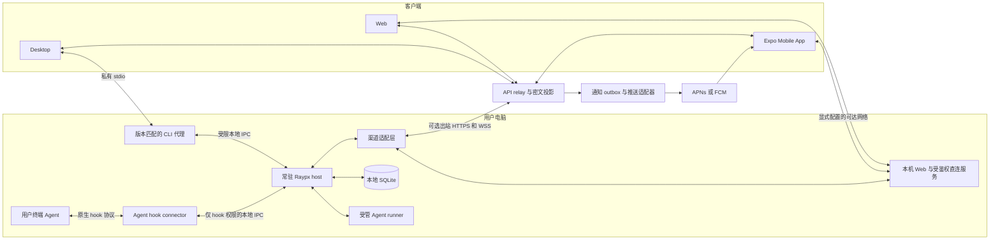

> 2026-10-27 更新：本文件保留分阶段路线；本机优先、租约、接口、迁移和云投影规则以
> [ADR 0035](../architecture/0035-local-owner-host.md) 为准。P1 已有独立 macOS daemon，
> 不再由 Desktop Native 持有 relay 生命周期。

# Raypx 多 Agent 宿主与移动 App 架构方案

> 状态：方向已采用，P0、P1 macOS 私有内测已实现。核实日期：2026-10-25。代码基线：canary `9954a03` 及当前工作区修复。
> 当前实现与未通过门禁见 [P0 协议验证记录](../development/terminal-protocol-p0.md)。现行 Desktop 生命周期仍以 workspace AGENTS.md 为准，不把原型列为已发布能力。

Raypx 的核心闭环应覆盖两种入口：用户在 Raypx 发起的任务，以及用户在终端自行启动的 Agent 会话。两者共享待办和审批界面，但执行所有权不同：常驻宿主负责自己启动的任务；对外部终端会话，只提供协议明确支持的观察和审批。关闭 Desktop 窗口或退出界面，不应终止常驻宿主。

第一个可用闭环缩为 macOS daemon、Claude/Codex 全局 connector、现有 Web/Desktop 审批和 Desktop 系统通知。Expo 在独立目录验证后再接入，首个 iOS App 版本使用前台同步与 App 内审批；APNs、通知内审批和本机 Web 服务不阻塞这个闭环。Pi 接入前完成 adapter 与 capability 迁移。

## 产品方向和参照边界

| 事项     | 方向                                                                                                                                               |
| -------- | -------------------------------------------------------------------------------------------------------------------------------------------------- |
| 手机入口 | 已确定：自有 Expo App；不接飞书、钉钉或 Telegram。Web 保留移动访问，PWA 不作为核心闭环前置。                                                       |
| 执行宿主 | 提议：CLI daemon；Tauri Desktop 是客户端。继续保留现有 Web、账户和自部署能力。                                                                     |
| 内容保护 | 已确定：先做明确披露的明文私有内测，P0 固定内容 envelope；公开托管终端同步以前完成 E2EE、配对与恢复。                                              |
| 平台顺序 | 建议先验收 macOS 宿主与 iOS App，再验收 Linux 宿主与 Android App；Expo 同时保留两端代码入口。                                                      |
| 界面体系 | Web/Desktop 保持 shadcn/Base UI 和 Tailwind。Mobile 使用原生组件及 RN 适用的工具类方案，共享语义设计 token、文案和交互；不把 DOM 组件直接导入 RN。 |

Ikaga 提供产品目标：终端请求同步、Away、审批、远程派活和自动化。AionUi 提供 Agent 接入与渠道分离的参考：其依赖中存在 ACP SDK、定时任务及不同渠道 SDK；Raypx 采用这些职责边界，不引入其办公助手方向、Electron 或 IM 渠道。[Ikaga](https://ikaga.sorrycc.dev/)、[AionUi 依赖](https://github.com/iOfficeAI/AionUi/blob/main/package.json)

Happier 的 Codex 能力矩阵提供了另一条值得验证的路线：由共享 app-server 同时服务 native TUI 和远程客户端，ACP 保留为兼容路径。这是特定版本和启动方式下的能力，不能据此承诺接管任意已经运行的裸 Codex 进程。[Happier Codex 能力矩阵](https://github.com/happier-dev/happier/blob/dev/docs/codex-feature-matrix.md)

## 当前缺口核实

| 范围          | 核实结果                                                                                                                              | 依据                                                                                                                                                        |
| ------------- | ------------------------------------------------------------------------------------------------------------------------------------- | ----------------------------------------------------------------------------------------------------------------------------------------------------------- |
| 外部终端会话  | 当前只管理 Raypx 创建的进程。Claude hook 随受管进程注入；Codex 使用受管 app-server，未提供全局 connector。                            | [AgentRuntime](../../apps/cli/src/runtime/agents/index.ts)、[现行远程任务架构](../architecture/remote-tasks.md)                                             |
| 独立宿主      | macOS 的 relay、续期和终端 broker 位于独立 CLI daemon；Desktop Quit 不停止受管任务。本机 Host 与可选云渠道的现行边界见 ADR 0035。     | [Native host](../../apps/desktop/src-tauri/src/lib.rs)、[RemoteControl](../../apps/cli/src/runtime/daemon/control.ts)、[CLI 约束](../../apps/cli/AGENTS.md) |
| 手机闭环      | Web 已有响应式任务和审批视图；`apps/web/public` 只有 favicon，源码未发现 PWA manifest、service worker、Push Subscription 或发送实现。 | [Web public](../../apps/web/public)、[Web 源码](../../apps/web/src)、[API 源码](../../apps/api/server)                                                      |
| Pi            | 已接入的是 `@earendil-works/pi-ai` 模型传输；尚无 Pi 编程 Agent 的进程、会话与工具审批适配。                                          | [AI 包](../../packages/ai/AGENTS.md)、[依赖](../../packages/ai/package.json)                                                                                |
| Provider 扩展 | contracts 仍是 Claude/Codex 枚举，项目 providers 最多两个；CLI 和任务 UI 均有名称分支。                                               | [任务契约](../../packages/contracts/src/tasks.ts)、[任务 UI](../../packages/tasks/src/client)                                                               |
| 云端正文      | control 表把领域投影写入 JSONB；当前没有内容级密文 envelope。TLS、Windows 本地 cookie 加密与代码对话的端到端加密是不同边界。          | [数据库 schema](../../packages/database/src/schema.ts)、[repository](../../apps/api/server/control/repository.ts)                                           |
| 非核心范围    | 文件、jobs、终端、analytics、存储及双部署目标真实存在；冻结新增功能可减少工作分散，移除默认回归则会削弱已有产品的交付保证。           | [现行架构](../architecture/0034-extensible-foundation.md)、[测试门禁](../development/testing.md)                                                            |

## 需要修正和保留的判断

**Codex 的全局审批接入已有官方入口。** 当前官方 `PermissionRequest` 支持 Bash、apply_patch 和 MCP 工具，可返回允许、拒绝，或不作决定而回到正常审批。用户 hook 需要审阅并信任；异步 hook 不能审批。优先评估 `~/.codex/hooks.json`，而不是把 rollout 读取当成控制通道。[Codex Hooks](https://learn.chatgpt.com/docs/hooks)

本机版本为 Codex `0.163.0-alpha.11.2`（`hooks stable true`）和 Claude Code `2.1.302`。后续 P0 实施已在隔离配置与合成项目中调用真实模型，验证两者的 Bash 允许、拒绝、Away 关闭、审批端断连和 60 秒到期回退；没有改动个人全局 hook。详细证据及尚未通过的门禁见 [P0 协议验证记录](../development/terminal-protocol-p0.md)，不从 Bash 的结果推导其他工具或终端并答能力。

**现有 first-answer 仲裁不等于终端与手机同时可答。** 当前 Raypx 的多个 Web viewer 在同一受管执行里竞争决策；普通终端是另一个决策方。Claude 官方明确描述了 PermissionRequest 与 `--permission-prompt-tool` / SDK `canUseTool` 的竞争，但普通 TTY 下 hook 等待期间是否仍展示可操作提示，需要单独验证。提问可通过 AskUserQuestion 的 `updatedInput.answers` 返回；计划与权限的回包必须分别映射。[Claude Hooks](https://code.claude.com/docs/en/hooks#permissionrequest)、[AskUserQuestion](https://code.claude.com/docs/en/hooks#askuserquestion)

Codex 的同步 hook 默认先等待结果，因此不能从“有 PermissionRequest”直接推导出 TTY 同时可答；也不能把 Claude 的 `updatedInput` 回包直接用于 Codex。两者都需要版本化协议试验。[Codex Hooks](https://learn.chatgpt.com/docs/hooks#permissionrequest)

**daemon 与崩溃后重连需要分开验收。** daemon 可解除 GUI 对执行的生命周期绑定。PTY 提供终端与交互能力，但不能重建已丢失的 stdio 管道、Agent 内存或一次不确定的模型调用。首阶段保证 Desktop Quit 后继续；daemon 崩溃后仍显示中断或结果未知，不自动重发 prompt。可恢复 runner 另设里程碑。

**手机端直接采用 Expo App。** Expo 的通知类别支持操作按钮、文本输入和鉴权选项；但 `registerTaskAsync` 对后台通知按钮的任务回调只明确覆盖 Android。iOS 的完整后台审批需要独立验证原生回调、凭据可用性和执行时限，不能以 Expo Go 或前台 JS listener 验收。[Expo Notifications](https://docs.expo.dev/versions/latest/sdk/notifications/#notificationaction)、[后台任务](https://docs.expo.dev/versions/latest/sdk/notifications/#registertaskasynctaskname)

**安装 hook 不等于追溯控制已启动进程。** 默认承诺安装后由 Agent 正常加载 hook 的新会话；旧会话先提供明确授权的只读导入。已有活跃会话只有在官方 reload、attach 或共享 server 接口通过验证时才开放控制，不能通过读取 JSONL 推导出审批或 steer 能力。

Ikaga 官网确认了全局 hook、Away、终端竞争、通知响应、附件和任务流程；它没有给出其仲裁内部实现、独立 Web 客户端或端到端加密保证。这里只采用可观察的产品目标。[Ikaga](https://ikaga.sorrycc.dev/)

## 目标进程架构

执行内核和 daemon 先留在 `apps/cli`。Desktop 继续调用绝对路径下、版本匹配的 bundled CLI，其 stdio 模式逐步成为 daemon 的客户端代理。Desktop 不导入 CLI 源码。已有 `RemoteControl` 的 relay、outbox 和续期职责迁入 CLI 宿主，Native 保留窗口、托盘、系统通知、目录选择与登录界面桥接。

同一用户、同一执行 profile 只能有一个执行 owner。旧 Desktop stdio owner 与新 daemon 通过 OS 锁、协议握手和迁移检查互斥。TUI 或其他前台入口不能因实例化第二个 AgentRuntime 而把 daemon 的活动任务标成重启中断；短文件操作可保留有限运行模式。

macOS 使用用户级 launchd，Linux 使用 systemd user service，均由显式安装流程启用。Linux 跨 SSH 登出存活还要单独验收用户服务生命周期；不自动启用 linger。Windows 后续使用有当前用户 ACL 的 IPC 与服务方案，不能用无鉴权的 localhost 端口替代。

POSIX 本地 IPC 使用私有目录和 Unix socket，配合仅本机可读的连接凭据、版本和实例 epoch。hook 只能提交事件、等候或撤销自己的请求，不能发起任务、注册根目录或调用文件工具。该边界隔离浏览器和不同 OS 用户，不声称防御已控制同一 OS 账户的程序。宿主到 relay 仍使用出站连接。

### 渠道与无界面运行

Agent adapter 决定执行和审批能力，ChannelAdapter 决定事件送达与客户端连接，两者独立。云 relay 和本机直连复用同一 RequestBroker、请求 ID、revision 与 receipt；多渠道不会生成多个独立审批，更不能改变 Agent 的权限策略。首期只有 Raypx 自有客户端，不实现 IM adapter。

CLI daemon 与 Desktop 窗口独立。无云账户的本机 Web 入口、私网直连和完整服务器产品放到 P4，不作为 P1 前置。届时默认只监听 loopback，并使用受鉴权的产品 API，不暴露整个本地 method router。Desktop 本机任务、connector 和终端审批已按 ADR 0035 提前解除登录依赖；本机 Web 和服务器产品仍属后续阶段。

局域网、Tailscale 和自部署 API 都是显式连接选项。手机访问不到电脑的 localhost；跨网络直连需要真实可达地址、认证和受信任 TLS，不自动开放公网监听或假定 NAT 穿透。仅使用本机/私网客户端可不依赖 Raypx 云 relay；系统推送仍要由可用发送方调用 APNs/FCM，不能承诺“无任何服务也能锁屏推送”。

### 生命周期

| 操作                       | 受管任务                                                             | 外部终端会话                                |
| -------------------------- | -------------------------------------------------------------------- | ------------------------------------------- |
| 隐藏或 Quit Desktop        | daemon 继续执行；重开后重新订阅                                      | 继续运行；Away 由 daemon 持有               |
| 明确停止 daemon 或卸载服务 | 首阶段先取消并清理受管进程，保留历史                                 | 撤销远程等待并交还 Agent 原生流程，不杀终端 |
| 退出账户、换账号或撤销设备 | 撤销对应服务和账户的远程授权，取消该远程绑定的受管工作；本地历史保留 | 停止该绑定上传并交还原生流程                |
| 关闭 Away                  | 不改变 Raypx 明确发起任务的既有审批策略                              | 在途外部请求撤销，后续请求直接回原生流程    |
| daemon 崩溃或机器重启      | 首阶段为 interrupted 或 outcome unknown；不自动重放 inference        | 连接断开或 deadline 到达后按原生流程处理    |
| 睡眠、断网或锁屏           | 不把离线自动判成任务完成；恢复后对账                                 | 锁屏本身不关闭 Away；断网按有界等待策略回退 |

账户登录退出与 GUI Quit 必须是不同操作。不能为了让 GUI 退出后继续任务，就顺带取消登出、设备撤销的安全语义。OS 用户登出、断电、睡眠也不等同于退出应用。

## 会话和审批的数据模型

新增 `ObservedSession`，与 `ManagedTask` 并列。外部会话没有 Raypx prompt、受管工作区锁或可取消进程，不能伪造这些字段来塞进现有 AgentTask。

首期外部同步展示会话生命周期、审批和可验证的状态，完整对话历史是独立能力。若要读取现有 rollout 或 transcript，应另做用户明确选择目录/会话的只读导入器，处理格式版本、增量游标、截断与文件轮转；未验证格式时只显示不支持，不扫描并上传整个用户目录。读取历史不会获得对运行中进程的 steer、cancel 或审批能力。

| 对象            | 职责                                                                                          |
| --------------- | --------------------------------------------------------------------------------------------- |
| HostBinding     | 服务 origin、本机或 Raypx 用户绑定、host ID、授权 epoch 和设备身份；隔离不同服务及本地直连    |
| AgentConnector  | provider ID、用户选定的 Agent 配置目录或账号、协议版本与已验证能力                            |
| ObservedSession | connector、provider session ID、本机会话 ID、项目引用、可观察状态；不带受管执行所有权         |
| ManagedTask     | 已有任务语义和执行 owner；继续保留一次性命令 receipt                                          |
| HumanRequest    | 明确引用 observed session 或 managed task；有 invocation ID、revision、deadline 和 host epoch |

云端数据由 Raypx 账户拥有；纯本地模式由 OS 用户与已配对客户端身份授权，不伪造云账户。Agent 账号是 connector 指向的本机配置，其供应商凭据保留在本机，不能把这些身份合并成一套云端账号或从 token 用量推测剩余额度。

审批渲染可复用现有规范化问题、计划、diff 和按钮；仲裁从 `Execution.pending` 抽出为本地 RequestBroker。它既能服务受管 runner，也能服务独立 hook 进程。不能只扩充原来的 `taskId` 外键而忽略两种所有权。

区分 `decided`、`delivered` 与 Agent 确认的消费结果。hook 写出 JSON 不代表 Agent 一定使用了该答案；只有协议提供消费确认时才显示 applied。回退、hook 断开或取消后拒绝迟到答案，使用 request ID、revision 和 epoch 防止旧按钮作用到新请求。没有稳定 tool-call ID 的 hook，每次调用生成独立 ID；不能按“同一工具加同一参数”合并两次合法调用。

新增资源、状态和密文 envelope 需要新的协商版本。先增加 API 存储与兼容读，再升级 host 和客户端，最后启用新 connector。旧客户端只接收原有受管任务；不支持新版本时显示升级提示，不丢弃新类型字段后继续写入。

## 全局 hook 与 Away

连接某个 Agent 配置目录、授权项目、允许云端同步是三个不同的授权。安装 hook 不自动授权该目录下所有项目，更不等于允许远程启动命令。Away 默认关闭；未知项目或无法验证交互类型的调用先回原生流程。

安装器只增加带 Raypx 身份的 hook 条目。修改前备份并校验文件版本，写临时文件后原子替换；并发编辑冲突就停止。重复安装幂等；卸载只删除当前 Raypx 条目，保留其他 hook、权限、MCP、插件和用户安装后新增的设置。格式不能安全往返的 JSON/JSONC/TOML 不强行重写，改为生成可审阅的增量。Codex 的 `/hooks` 信任由用户完成，不静默绕过。

hook 调用稳定安装位置的 Raypx 二进制，不依赖某个即将被替换的 `.app` 内部版本路径。它只连接本地 daemon，不读取云凭据、不向云直连；受管 Claude 进程使用明确标记跳过全局 connector，避免与现有按进程 hook 重复发布。

Away 默认等待 5 分钟，可配置 1–10 分钟；同步 hook 显式设置 630 秒 timeout。本地连接失败以 250ms 内回退为目标，冷启动另行测量。授权渠道均不可达、绑定被撤销、请求超时或用户关闭 Away 时，撤销对应请求的远程按钮；hook 不输出 allow，交给原有权限流程。外部 connector 不复用受管 hook 的阻断式失败策略。后续直连可用时，云 relay 断线不使其失效。在 headless 场景，原生流程可能是拒绝而不是展示终端。[Claude 超时语义](https://code.claude.com/docs/en/hooks#timeouts)

仅在 Agent 确实支持同时展示和消费两路答案时启用终端竞争模式。否则明确显示“远程等待，超时后返回终端”，不能把它宣传成完全等同于 Ikaga。若同步并答是首版硬要求，协议原型不通过就暂停该功能上线，另选有稳定双向接口的运行方式；不通过模拟按键或修改 rollout 文件来凑齐能力。

仅选取工具名和审批所需输入。Notification、Stop、SessionStart 等事件按字段白名单处理，不上传任意 message、transcript 或 tool_response。PostToolUse 若用于对账，只读取确认所需的标识和状态。工具输入和 diff 也可能含凭据或私有代码，仍须受项目同步授权和内容保护约束。

## 独立宿主的身份和配置

现有十分钟 device grant 依赖 Web 会话；把连接代码搬到 CLI 后，它不会自然获得续期能力。daemon 需要独立设备授权，不能依赖隐藏窗口的 WebKit cookie 或导出整个浏览器 cookie jar。

优先原型验证 Better Auth 的 device authorization 与受限 token 集成：用户在已登录的 Web 页面核对本机短码，明确批准电脑和 scope；宿主得到只用于该账户、该 API audience 的设备凭据。仅使用插件默认返回的广泛 session token，并不自动达到最小权限要求。短码有效期、轮询退避、撤销和刷新轮换必须一并验证。[Better Auth Device Authorization](https://better-auth.com/docs/plugins/device-authorization)、[RFC 8628](https://www.rfc-editor.org/rfc/rfc8628)

设备长期凭据存在系统安全存储，配置里只保留引用。Linux 无可用安全存储时先提供仅内存授权，不回退到明文 token 文件。移除 Desktop 也不复制其 WebView profile。设备撤销应使 API、relay 和本地 connector 共同停止旧授权，其他服务 origin 的身份不受影响。

沿用 `~/.raypx/config.toml` 与 `RAYPX_HOME`、`base_url`、`web_url`、命名 profile；不增加不同环境的构建。现有 SQLite 继续使用 OS 数据目录和原 profile，迁移时停旧 owner、备份、校验后接管，避免出现两个“默认 profile”。新的 host/connector 配置表先发布兼容解析器，再显式写入；当前 Desktop 会拒绝未知顶层键，不能提前写入导致旧版起不来。

手机端通过设置页配置服务器地址，按规范化 origin 隔离账户、推送绑定、密钥与缓存；不要求移动沙箱读取电脑的 TOML。使用同一个 App 连接 beta、线上或自部署系统，不硬编码成不同业务环境。首次连接校验 HTTPS 与服务能力，换 origin 不迁移凭据。APNs 的开发/生产通道和 App 签名由原生构建决定，与用户选择哪个 Raypx 服务是两个维度。

服务地址切换不是凭据迁移：先交还旧绑定的外部请求、处置其受管任务并释放授权，再连接新 origin。日志只记录状态和错误码，不记录 hook 输入、短码、token、cwd 或正文。

## Adapter 与 Pi

传输契约使用有格式和长度约束的 provider ID；执行端仍由受信任的 adapter registry 决定可执行程序，不能把任意 provider 字符串传给 shell。providers 数量保留合理上限。未知 provider 可显示安全名称和“需升级”，不能获得默认执行能力。

最小接口先分为 SessionConnector 和 ManagedAgentAdapter。前者处理外部事件、审批和确认；后者处理 start、turn、steer、queue、interrupt、resume、usage 和关闭。统一事件进入既有 SQLite 投影及 RequestBroker，provider wire 数据留在 adapter 内。

领域事件可借鉴 ACP 的会话、消息和权限命名，但 Raypx contracts 不直接存放 ACP wire payload，也不要求 Claude/Codex 绕过原生协议。新增 ACP adapter 用于经验证的外部 Agent，支持 Custom ACP 的明确可执行文件与参数配置。自动检测只做有界的安装和版本探测，不自动执行 npx 下载、安装软件、读取登录 token 或运行项目提供的任意命令；自定义程序由用户明确授权后启动。

能力至少区分 observe、permission、question、plan、steer、queue、follow-up、cancel、resume-session、reattach-process。`resume-session` 不表示恢复原进程，`observe` 不表示可控制。UI 读取当前 session 的能力和 input 语义；不能只看 provider 名字，也不能把一台电脑的能力直接套到它的所有外部会话。

Pi 内置 Agent 优先使用 `@earendil-works/pi-coding-agent` SDK，在独立 runner 中执行，无需用户另装 Pi CLI。现有 `packages/ai` 继续作为分诊和模型调用层，不承担 coding-agent 生命周期。SDK 的会话、工具和资源加载需要显式指定项目与策略，不直接继承并执行未授权项目扩展。“填 key 即可用”仍须有模型默认值、项目授权和清晰的工具权限。[Pi SDK](https://pi.dev/docs/latest/sdk)

Pi CLI RPC 可作为连接用户自装 Pi 的另一种适配：它提供持久双向 JSONL 和 extension UI，但默认没有逐工具审批。permission capability 必须来自经过验证的权限扩展或宿主策略，不能接上 SDK/RPC 就宣称具有 Claude/Codex 的同等审批保护。[Pi RPC](https://pi.dev/docs/latest/rpc)、[Pi 安全模型](https://pi.dev/docs/latest/security)

## Expo App 和手机审批

新增 `apps/mobile` 作为独立组合根，采用 React Native、Expo 和 Expo Router。共享纯 contracts、领域状态、翻译 catalog 和设计 token；网络客户端先审计平台依赖再提取公共入口。Mobile 不导入 Web/Desktop 应用，不直接复用依赖 DOM、CSS 或浏览器路由的 `packages/tasks` 组件。RN 运行时、Metro、Expo 版本及原生依赖遵循 Expo 支持矩阵，实施时验证与根 React catalog 的兼容性和 workspace target 规则，不直接复制 Web 的依赖清单。

先在仓库外的独立目录和 lockfile 中验证 iOS、NativeWind、Metro 与共享纯契约消费，再纳入 workspace。首个 App 版本不申请通知权限或注册推送，仅在前台订阅并在恢复前台时补齐状态；后台请求按宿主的等待和回退策略处理。以下通知设计属于后续阶段。

首版只有五个核心入口：待你处理、运行中任务、会话详情、新建任务、电脑与设置。待办聚合权限、问题和计划；会话页显示已授权同步的正文与 diff。允许、拒绝、拒绝附说明、总是允许、问题选择及计划批准由会话 capabilities 决定。总是允许仅使用 Agent 提供且用户明确选中的规则，保留规则目标与作用域，不把一次 allow 扩成任意命令白名单。

移动端是公共客户端，不内置服务端密钥。账户登录与内容设备配对分开：系统浏览器授权流程及回跳在 P0 验证，回跳只接收受校验的一次性结果，不在 URL 放长期 token 或内容密钥。深链接只能导航到已配置服务的资源，不能靠一个 URL 完成批准或切换服务并携带旧凭据。

Web/Desktop 继续使用 shadcn/Base UI 与 Tailwind。Mobile 保留相同色彩、间距、语义状态和中英文文案，使用 RN 原生交互原语；工具类方案实施时按 Expo 兼容性选定。窄屏 diff、选项可读性、VoiceOver/TalkBack、动态字体和危险操作确认都要单独验收，不把 Web 响应式截图算作原生验收。

### 推送和通知操作

`expo-notifications` 支持获取原生推送 token，Expo 不要求必须使用其推送服务。建议产品发送端直接适配 APNs，Android 再适配 FCM；Expo Push Service 可用于隔离原型，不成为自部署必需依赖。[Expo 直接发送 APNs/FCM](https://docs.expo.dev/push-notifications/sending-notifications-custom/)

请求先持久化，再通过可靠 outbox 发送通用通知和不透明引用，不带命令、diff、prompt、可直接批准的 bearer token 或长期凭据。push receipt 不是用户已看到或 Agent 已应用的证明。App 恢复前台时拉取未处理请求并补齐通知遗漏，系统限流、专注模式或网络故障都不能让宿主无限等待。[Apple User Notifications](https://developer.apple.com/documentation/usernotifications)

| 交付层级              | 行为与验收                                                                                                                                                          |
| --------------------- | ------------------------------------------------------------------------------------------------------------------------------------------------------------------- |
| M1 通知到审批页       | 后续通知阶段：锁屏点击并解锁后进入对应请求，重新取状态并解密内容，用户查看后作答；不作为首个 App 版本前置。                                                         |
| M2 通知操作入口       | 注册允许、拒绝、拒绝附说明等适用操作；首次实现可要求进入前台，恢复冷启动 action。若通知只有通用提示，允许按钮只进入详情确认，不盲批不可见的输入。                   |
| M3 不打开主界面的审批 | 原生回调在有界时间内完成鉴权、内容验证、签名与投递；未完成时保持未确认并引导打开 App。iOS 后台原型通过后才开放，不从 Expo Android TaskManager 的行为推导 iOS 支持。 |

M2/M3 绑定具体 request ID、revision、内容摘要、host epoch 与设备身份；宿主校验当前权限和期限，RequestBroker 只接受第一个有效答案。网络超时显示待确认，查询同一 receipt 后再决定重试；不换 ID 重发。请求过期、被终端回答、撤销或变更后，旧通知永远不能批准新内容。“总是允许”和复杂计划先在 App 展示规则或全文，不放成无法复核作用域的快捷动作。

后台处理使用 development build 和 release build 验收，不依赖 Expo Go。若标准模块不足，使用 Expo 原生模块与 config plugin 管理 iOS 通知 delegate、扩展和 entitlement。[Expo Development Builds](https://docs.expo.dev/develop/development-builds/introduction/)

iOS 的 notification service extension 可在展示前解密受保护的预览，但它有执行时限，也不负责提交用户答案；失败时仍展示通用通知。它不能代替 M3 的审批回调。[Apple 通知扩展](https://developer.apple.com/documentation/usernotifications/modifying-content-in-newly-delivered-notifications)

普通批准要求解锁或前台认证；不能为了后台执行而把受生物认证保护的签名密钥复制成无保护副本。SecureStore 用于少量设备凭据及密钥引用，正文不放在其中。生物信息变化可能使认证项不可读，需要重新配对或恢复；不能把卸载 App 当成可靠的 Keychain 删除方式。[Expo SecureStore](https://docs.expo.dev/versions/latest/sdk/securestore/)

推送注册绑定 origin、账户、App 安装、签名应用及平台 token 类型；轮换、注销、换账号或设备撤销后停止旧绑定投递。自部署分两种：自行签名构建并配置自己的 APNs/FCM 凭据；使用官方 App 时，通过单独授权的最小推送网关代发不透明通知，或先仅使用前台同步。官方 App 的 APNs 私钥不分发给用户服务器，App 填入一个自部署 URL 也不等于该服务器已获得推送资格。该网关可独立于正文 relay，自部署用户可不用它。

### 内容保护

建议为新会话协议预留并默认面向 E2EE：明文路由头只含必要的身份引用、资源类型、状态、顺序、deadline 和版本；prompt、计划、输入和 diff 放在认证加密的正文中。路由与关联字段纳入完整性保护，重试复用已持久化的同一密文。云端按明确的元数据列分页，内容搜索在解密端进行，不继续新增依赖正文内容的表达式索引。

加密实现需另行选择经过评审的方案，覆盖可信设备配对、密钥验证、轮换、撤销、丢失恢复及浏览器存储被清理。账号登录不自动等于获得内容密钥。Web 客户端仍信任其代码分发 origin，不能声称抵御服务器主动下发恶意 JavaScript。旧 JSONB 正文不会因新协议启用就自动变为 E2EE，需独立迁移和保留策略。

审批答案、附言、附件和草稿也属于受保护正文。宿主必须验证决策来自当前授权客户端；云端只能路由密文和必要元数据，不能因为掌握账户数据库就伪造批准。具体加密与签名协议另做安全评审，不自创未经验证的密码协议。通知投递加密与会话 E2EE 分开验收。

受控自用验证可沿用明确披露的明文模式，并由项目逐项开启；面向他人的托管终端同步，把内容保护方案和完整设备配对作为发布门槛。App 原生发布与 Expo OTA 更新也属于客户端代码信任边界，需要明确签名、分发权限、兼容版本和回滚策略；不声称 E2EE 能抵御主动下发恶意客户端代码的分发者。

## 远程任务和重启恢复

远程新建任务继续显式选择电脑、已授权项目和本机 Agent 账号。三种 workflow 分别声明权限，执行前显示最终范围：直接执行；先分析，再在独立 worktree 实施；先分析，等待用户批准实施。提交、合并和推送是可选的授权动作，绑定目标分支与 remote，不因选择“分析”而默认获得权限。已明确授权的流程不逐步重复确认；遇到新目标、冲突或范围变化才停止并请求处理。

worktree 使用独立目录和任务分支，保留用户工作区及未提交内容；合并前确认分支基线、冲突和必要检查。失败保留可审阅结果，不自动 force push、覆盖脏目录或绕过分支保护。附件采用有类型和大小上限的独立对象传输；启用 E2EE 时云端只存附件密文，不把图片或 PDF 塞进普通事件帧。模板和 `/` 技能是明确选择的本地资源，不把外部输入当成新增系统授权。

额度展示区分当前任务 token usage、供应商返回的账户余额和下一次可重试时间。没有账户接口就显示未知；不从累计 token 倒推出余额。自动续跑只在供应商明确的可恢复限制、用户已允许等待、原 turn 结果可对账时启用，并有最大等待和重试次数；认证、计费、参数错误直接转待处理。

可恢复 runner 需要独立进程所有权、持久会话 ID、命令 receipt、事件游标和重连协议；PTY 只提供终端能力。分别验收 GUI Quit、daemon 崩溃、runner 崩溃和整机重启。只有能证明原进程仍在或供应商会话可安全继续时才恢复；一次模型请求或工具调用结果不确定时显示 outcome unknown，不能自动重放。外部终端进程没有被 Raypx 接管时，机器重启后不能承诺让它原地继续。

## GitHub 自动化

自动化运行在宿主，先使用现有 cron 能力与本机 `gh` 授权轮询用户选定仓库；webhook 是可选触发，不作为用户电脑的公网入口前置。保存游标、ETag、去重键和最近成功时间，处理分页、离线恢复及有限补扫；相同 issue/PR 更新不重复建任务。

规则先过滤，再用 `packages/ai` 的便宜模型生成摘要、类别和回复草稿。Issue、评论和 PR 内容均为不可信输入，模型输出只作为建议，不能携带隐式工具权限。明确命中的静默规则可不发通知；拿不准的项目进入低频待审摘要，不能静默丢失。

手机 App 展示原文引用、摘要、动作及准确草稿。用户批准后，才创建受管修复任务，或使用本机凭据发送对应评论。审批绑定仓库、对象、原文版本和草稿内容摘要；目标变化时重新确认。写入响应丢失先查询并对账，不直接重复发评论；关闭 issue、修改标签或推送代码分别声明权限，不把“允许分诊”扩成允许所有 GitHub 写操作。

GitHub 凭据留在本机，云端不获取 `gh` token。分诊可只在本地调用模型；授权同步的摘要和草稿走同一内容加密与设备仲裁流程。第三方事件源不能直接触发绕过人工审批的修复或公开回复。

## 分阶段交付与验收

| 阶段              | 交付范围                                                                                | 必须拿到的证据                                                                                          |
| ----------------- | --------------------------------------------------------------------------------------- | ------------------------------------------------------------------------------------------------------- |
| P0 协议原型       | Claude/Codex 真实录制、私有 IPC、RequestBroker、回退、安装增量、设备身份与内容 envelope | 隔离配置验证允许、拒绝、超时、重复与迟到答案；未验证能力不声明支持；Expo 独立原型不阻塞主路径           |
| P1 最薄闭环       | macOS daemon、Claude/Codex connector、独立设备授权、Web/Desktop 审批及现有桌面通知      | 两种 CLI 的真实请求可处理，Quit Desktop 后继续，跨 grant 续期；完整退出后不承诺桌面通知                 |
| P2 自有 iOS App   | Expo 登录配对、前台同步、待办、会话、新建任务及设置                                     | 真机前台审批、恢复对账、登出换号、自部署和过期请求通过；不要求推送                                      |
| P3 会话增强       | 授权 JSONL 读取、轮转游标、计划和 diff、Codex 共享 app-server                           | 历史读取与活动控制分别标识；工具输出留本机                                                              |
| P4 独立访问与平台 | 本机 Web、完整无界面服务器、Linux、Android                                              | 各渠道鉴权、可达性与各平台分别验收                                                                      |
| 内容保护发布门禁  | E2EE、可信设备配对、恢复、撤销及旧明文策略                                              | 明文私有内测可先交付；公开托管终端同步前通过                                                            |
| P5 远程任务完整化 | 三种 workflow、worktree、附件、模板/技能、可验证额度与续跑、独立 runner 重连            | 授权动作及目标正确；失败保留工作；daemon/runner/OS 重启分别验收，不确定调用不重放；明确停止仍清理进程树 |
| P6 ACP 与内置 Pi  | Claude/Codex 完整 adapter 迁移、ACP/Custom ACP 与检测、Pi SDK runner 和工具权限         | 统一契约验证队列、取消、审批、usage；Pi 无需另装 CLI；不支持的能力禁用；已有 provider 无回归            |
| P7 移动推送       | APNs/FCM，先通知打开 App，再增加通知内审批                                              | 各平台真机分别验收，失败不显示批准成功                                                                  |
| P8 自动化         | GitHub 拉取、规则与便宜模型分诊、App 审批、创建任务或发送回复                           | 不可信输入、草稿变化和响应丢失不造成未授权或重复写入                                                    |

P0 先取得协议证据，不进行全仓重构。P1 就交付可用的 Claude/Codex 桌面闭环，P2 再增加自有 iOS App。内容 envelope 在 P0 定型，E2EE 不排到公开托管终端同步之后。P5 的进程恢复不阻塞 GUI Quit 后继续；最小 adapter 边界提前设计，完整迁移不阻塞第一版。

冻结文件管理、jobs、analytics、对象存储等模块的新增产品功能，保留必要修复与既有默认门禁。日常迭代可筛选 CLI、contracts、client、tasks 和受影响应用的测试；交付仍跑完整 verify 及受影响平台门禁。服务端统一采用 Node，继续与本机 Host 共享协议和领域服务。

PWA/Web Push 是可选增强。本机 Web 和完整服务器产品放在 P4；Docker Runner、托管 Runner、多 Agent 团队、办公助手及更多渠道不进入首个闭环。

## 已确定的实施边界

1. **终端体验底线**：接受有界远程等待；同时竞答只在真实协议验证后启用。
2. **首版生命周期**：建议保证 GUI Quit 后继续；daemon/OS 重启后的进程恢复单独交付。
3. **托管内容策略**：先做逐项目授权的明文私有内测，P0 固定 envelope；公开托管终端同步以前完成 E2EE 与恢复。
4. **平台与推送发布**：先 macOS，再接入 iOS 前台 App；Linux/Android 后移，推送不在关键路径。
5. **当前实施范围**：P0 已有真实协议录制；P1 macOS daemon、Claude/Codex 终端审批与 Web/Desktop 界面已实现，验收边界见 [P1 指南](../development/terminal-host-p1.md)。尚未修改个人 hook、注册个人系统服务或发布 App。

现行 [远程任务架构](../architecture/remote-tasks.md) 继续描述已实现产品；旧 [CLI 执行方案](cli-desktop-runtime.md) 对常驻服务的排除条款在本提议采用后才相应调整。[Web 手机方案](web-mobile-capabilities.md) 的“排除原生 App、手机只读”不再是后续产品方向，其中尚未实施的上传与引导流程不因本文而自动进入范围。实施时同步更新契约版本、workspace 约束和用户可见生命周期文案。
