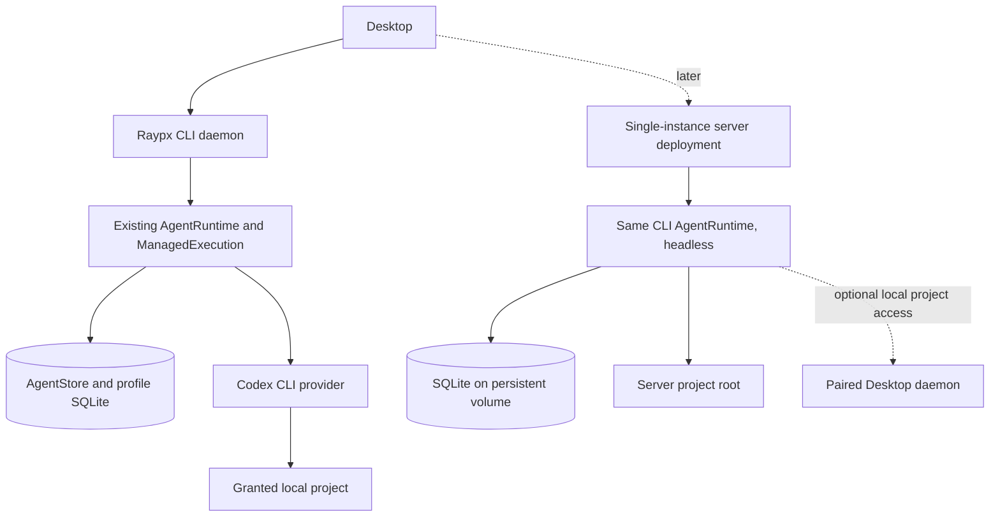

# Persistent Agent Platform Roadmap

Status: In progress. Updated 2026-11-02. Phase 0 decisions are recorded; Phase 1 is being closed against the local acceptance flow below. Phase dates beyond the first delivery goal remain planning estimates.

This roadmap describes the target product, not currently shipped behavior. The first phases intentionally reuse proven CLI, Desktop, storage, memory and scheduling components; later architecture remains open to evidence from those workflows. `PRODUCT.md` remains the description of the current product until the target product specification and first implementation decision are accepted.

## Product Direction

Build a platform for persistent AI teammates. Each Agent has a durable identity, instructions, a continuous conversation, inspectable memory, work history, automations, and an authorized computer. A Run is one execution started by a user message or another trigger.

The implementation starts with one operating mode: a personal local instance backed by the existing CLI daemon. Reuse its `AgentRuntime`, `ManagedExecution`, provider adapters, `AgentTask` persistence, approvals, and SQLite journal; Desktop is only its control surface. The first acceptance uses one existing provider, Codex CLI. A server instance and linked local/server mode follow only after the local workflow is complete and exercised. Cloud initially runs the same CLI Agent Runtime headlessly; when an Agent is explicitly migrated, the server becomes authoritative. Pair a Desktop only when a server-owned Agent needs access to a local project. Web and desktop provide the first control surfaces; mobile follows after the core workflows stabilize.

Each Agent has exactly one authority. During the local-first phase, the local CLI instance owns the Agent, Runs, workspace, memory, credentials, model calls, approvals, and event history; nothing is synced implicitly. After an explicit export/import, a shared Agent belongs to the server instance; the server owns its configuration, conversation, Run state, approvals, model calls, and event history. A paired Desktop Host then exposes only scoped, revocable Computer/tools for selected projects and does not run a second copy of the shared Agent Runtime. Project files and raw terminal output stay on the Host. File content requested for a shared Run may transit through the server Runtime to the selected model provider, but is not copied into the server workspace by default. If the Host is offline, a migrated Run targeting its project waits or fails by policy; it never silently switches to a server workspace.

## First Delivery Goal

By 2026-11-10, validate one account-free local flow through the existing Raypx CLI daemon: select a granted project, start a Codex-backed Run, read a project file, request and approve one file write, continue the provider session, then close/reopen Desktop or reconnect the daemon without losing committed state. Raypx Agent Runtime and Run ownership stay local. Cloud migration, local/server pairing, and container/VM isolation are outside this acceptance; Codex CLI may itself use its configured model service.

## Progress Snapshot (2026-11-02)

These percentages are rough effort estimates, not issue-count metrics. The complete six-phase product is about one-third implemented. The local-first delivery slice is about 75-85% implemented and covered by deterministic tests; its real-provider acceptance has not been recorded as passed.

| Phase                                    | Progress | Status                                                                                                                                                                                                                     |
| ---------------------------------------- | -------: | -------------------------------------------------------------------------------------------------------------------------------------------------------------------------------------------------------------------------- |
| 0. Deployment and ownership contracts    |     ~75% | Local ownership, Run mapping and transition contracts are documented and tested as pure rules. Runtime integration and the full failure-injection matrix remain open.                                                      |
| 1. Personal local vertical slice         |     ~80% | Local CLI execution, approvals, follow-up and restart recovery have synthetic integration coverage. The opt-in native real-provider acceptance is implemented but still needs a recorded run.                              |
| 2. Local tools, effects and approval     |     ~60% | Project grants, approval hooks, command receipts and duplicate-delivery protection exist. A consistent durable effect intent/result/uncertainty and reconciliation path remains incomplete.                                |
| 3. Desktop-backed computer and memory    |     ~75% | The local daemon, granted project roots and revisioned memory UI are in place. Real Desktop/daemon acceptance and any missing restore checks remain.                                                                       |
| 4. Automations and continuous local work |     ~40% | Local schedules support Cron, timezone, pause, preview and history, but local scheduled actions do not yet create Agent Runs through `AgentRuntime`. Cloud Agent schedules are separate and do not close this local phase. |
| 5. Explicit cloud migration              |     ~10% | Existing relay pieces may be reusable. Reviewed export/import, ownership transfer and headless server execution of the same CLI Runtime are not implemented.                                                               |
| 6. Clients and extensibility             |     ~20% | Web/Desktop and multiple provider adapters exist. Client parity, mobile flows, MCP/connectors and safe configuration import remain.                                                                                        |

The local synthetic lifecycle test is in `apps/cli/tests/integration/runtime/agents/host.test.ts`; it passed locally on 2026-11-02 (17 tests). The opt-in native gate in `apps/desktop/tests/native/smoke/agents.ts` exercises real provider reads, approval and writes, daemon-owner restart, session continuation and process cancellation. A test implementation is not evidence that the live gate passed; record the provider and platform result when it is run.

## Near-Term Plan

The 2026-11-10 target is the local first-delivery flow, not completion of all roadmap phases. Keep the scope to one granted project and Codex CLI; do not start cloud migration, Host pairing, container isolation, MCP or mobile work before this gate passes.

1. **Close the local acceptance gate.** The targeted deterministic Agent Runtime integration suite is green (17 tests). Next, run the isolated native real-provider gate with Codex. Record the OS, provider version and result. The current native gate also exercises Claude, which is useful additional coverage but is not required by the first-delivery goal.
2. **Connect the Run contract at read boundaries.** Use the existing Core task-to-Run projection for local task inspection, including pending request kind for `waiting`; preserve `AgentTask` as the only persisted lifecycle record. Add focused runtime-level tests for the mapped states and ambiguous waits.
3. **Resolve acceptance failures and recovery gaps.** Fix issues found by the gate. Verify approval denial prevents writes, approved work is visible after daemon restart, follow-up resumes the same provider session, and interrupted or ambiguous effects are never replayed silently. Add durable effect records only where this flow demonstrates a concrete gap.
4. **Finish with a release check.** Rerun affected CLI/Desktop checks and the acceptance gate, then update this snapshot with actual results. If the live-provider gate cannot run by 2026-11-10, report the local implementation as ready for acceptance but leave the delivery goal unverified.

After the local gate passes, the next product increment is Phase 4's local Agent automation: add one scheduled Agent trigger through the same `AgentRuntime`, with idempotent delivery, visible run history, pause/resume and an explicit missed-trigger policy. Expand to migration and client extensibility only after that local workflow is proven.

## Architecture Target

- Keep the existing CLI daemon as the sole local runtime. Desktop sends commands over the current local protocol and owns no model, Run, approval, or tool state.
- Treat the existing `AgentTask` record as the first durable Run representation and `AgentStore` as its single source of truth. Reconcile the new Core Run contract with current task statuses; do not create a parallel Run table, execution registry, receipt store, or event journal.
- Reuse the profile SQLite database, command receipts, activity records, replay/snapshot code, `ManagedExecution`, project grants, provider approval hooks, local memory, and jobs scheduler. Add fields or states in place with migrations only where the local workflow exposes a concrete gap.
- The first Computer is a local profile, the independent CLI daemon, and one explicitly granted project root. It uses normal OS permissions; the grant scopes access but is not sandbox isolation.
- Use one existing provider adapter for first acceptance. Keep the existing adapter boundary, but defer adding providers, a generalized tool plugin system, and a new Tool Gateway until multiple real implementations need one.
- Local model/provider calls and any data they send follow the selected provider's connection and privacy behavior. Agent/Run ownership and local persistence remain on the device.
- After local workflows are proven, run the same CLI Agent Runtime in a headless single-instance server composition with a persistent SQLite volume. Keep server APIs and credentials at the composition boundary; do not add a second Agent Runtime or Agent persistence model.
- Make cloud migration an explicit reviewed ownership transfer. A server-owned Agent may use its server project; pair the Desktop daemon only when the user explicitly needs a local project. Pairing is outbound, scoped, revocable, idempotent, and recoverable from an acknowledged event cursor.
- Defer PostgreSQL for Agent state, horizontal Workers, multi-tenant scheduling, object-storage snapshots, and container/VM isolation until the single-instance deployment establishes a need and conformance requirements.
- Preserve explicit ownership, revocation, and uncertain-effect semantics at both local and server composition roots. Never claim exactly-once behavior for external side effects.

## Phases

### 0. Define Deployment and Ownership Contracts

- Define the local-first product scope, threat model, data ownership, startup/shutdown behavior, and recovery contract.
- Inventory the existing CLI `AgentRuntime`, `ManagedExecution`, `AgentStore`, local IPC, project grants, approval hooks, memory, and jobs. Name each as the initial owner instead of creating replacement modules.
- Treat `AgentTask` as the only persisted Run record for the first local version. Map its lifecycle to `agent-runs` statuses and add only missing transitions/fields in the existing store.
- Decide what may leave the device when a user explicitly selects a remote model or connector. Local mode must work without an account.
- Define the first Run input from fields already captured by `AgentTask`: prompt, provider/session, project grant, context snapshot and trigger. Defer a separate versioned Agent configuration until local workflows establish its shape.
- Define local Run, Attempt, effect, and approval state machines; event ordering and retention; and recovery when a model call or external effect has an ambiguous outcome.
- Establish deterministic local fakes and failure-injection scenarios for lost wakeups, lease expiry, process crashes, and duplicate tool delivery.
- Establish deterministic tests against the existing SQLite/runtime paths. Design PostgreSQL, migration, and Host pairing in a later phase; none blocks local completion.
- Start with one working implementation for each necessary runtime seam. Extract reusable adapter contracts as real variation appears; do not require a broad provider framework before the first vertical slice.

Exit criteria: the CLI daemon is the sole local authority; Run, approval, effect, and recovery rules are reviewable and testable without live providers; local product acceptance does not depend on a server account or PostgreSQL.

### 1. Personal Local Agent Vertical Slice

- Run the Agent platform locally without account setup. A Desktop-managed daemon owns the API, background execution, local SQLite database, and shutdown/recovery lifecycle.
- Keep the current CLI `AgentRuntime`, `ManagedExecution`, Codex adapter, task store and provider session as the execution path. Do not introduce a second runtime or first-class Agent database in this slice.
- Use the existing local task and follow-up flow as the first conversation/Run experience; preserve provider session continuity and project locking.
- Project the existing task lifecycle into the Core Agent Run vocabulary at read boundaries; keep `AgentTask` as the sole persisted status. Map `pending` to `queued` and `delivery_failed` to `failed`; resolve `waiting` from its pending request kind (`question` to input, `permission`/`plan` to approval), and reject ambiguous waits instead of guessing. Keep receipts, activity, approvals and replay in the existing SQLite journal.
- Verify Desktop-to-daemon create, stream, inspect, follow-up, disconnect and restart flows against synthetic providers before live-provider acceptance.
- Limit first acceptance to one configured provider, one granted project, a project read and an explicitly approved write through existing provider approval hooks. Track usage through existing activity/provider paths where available.

Exit criteria: by 2026-11-10, the existing CLI daemon can complete the first delivery flow above without login or a server dependency; committed local state survives Desktop reconnect and daemon restart; ambiguous provider/effect outcomes are not replayed invisibly.

### 2. Local Tools, Effects, and Human Approval

- Reuse current project grants, provider permission hooks, local terminal approvals, confirmation paths and per-project execution locks.
- Harden the first approved write with durable effect intent, result and uncertainty records where the current path lacks them.
- Extend to one narrowly scoped command action only if the local workflow needs it; require explicit approval and retain current payload/revision checks.
- Never blindly replay an ambiguous effect; require inspection or reconciliation before another attempt.
- Defer a general-purpose Tool Gateway until tools execute inside Raypx or a second real tool implementation requires a common boundary.

Exit criteria: every local action is authorized by the local Agent instance; pending approval does not block unrelated conversations, and retries cannot silently repeat a completed or uncertain effect.

### 3. Desktop-Backed Computer and Memory

- Treat the existing CLI profile, daemon and explicitly granted project root as the first durable Computer. Its stable identity is the profile/project binding; its workspace is the user's existing directory.
- Keep the daemon independent from the Desktop window so closing the UI does not stop a Run. Reconnect and process restart recover the binding and Run history; they do not claim snapshot or VM restore semantics.
- Reuse `packages/memory` and CLI `runtime/memory` for revisioned local context; add Agent-specific scope only when the local workflow requires it.
- Reuse existing profile backup/retention mechanisms for local records and artifacts; add missing restore checks without introducing object storage.

Exit criteria: a local Run can use the selected Desktop project after UI close/reopen and daemon reconnect; the project grant remains explicit and revocable; users can inspect and remove what the Agent remembers. Container or VM replacement remains a later phase.

### 4. Automations and Continuous Local Work

- Reuse the local `jobs`/Cron scheduler and make supported triggers create work through the same CLI AgentRuntime path as chat.
- Add routine versioning, test runs, pause/resume, trigger history, timezone handling, bounded/coalesced catch-up, and explicit missed-run policy.
- Add notifications for completion, failure, and requests for input; allow users to continue chatting while a Run waits for a decision.
- Add safe recovery and retry controls with visible attempt history and user-configurable automation budgets/limits.

Exit criteria: local triggers create Runs through the CLI daemon; trigger delivery is idempotent, missed or delayed work follows a documented policy, and every routine run is traceable to its trigger and result.

### 5. Explicit Cloud Migration and Server-Owned Agent

- Add reviewed export/import from the local CLI instance to a server-owned Agent. Exclude secrets and workspace content by default; let the user preview and select portable Agent configuration, memory, and history.
- Run the same CLI Agent Runtime headlessly as a single server instance with one persistent SQLite profile volume; keep the same task store, receipts, activity and provider adapters.
- Transfer ownership only after import succeeds. A migrated Agent is server-owned; the local copy is retained or retired according to an explicit user choice, never live-synced by default.
- Use a server project root as the first cloud Computer. Add Desktop Host pairing only when a migrated Agent needs a project that remains on the user's computer.
- If pairing is required, reuse the existing host/relay foundation where it fits and add only the missing grants, command receipts, cursor recovery and revocation fencing.
- Defer PostgreSQL Agent tables, horizontal Workers, multi-tenant limits and object-storage snapshots until measured scale or recovery needs justify replacing the single-instance profile.

Exit criteria: the same CLI Runtime can recover a migrated server-owned Agent after process restart on its persistent volume; ownership changes only after reviewed import; local data and secrets move only by explicit selection.

### 6. Clients and Extensibility

- Complete Web and Desktop parity across local and server instances; add mobile control and notification flows.
- Add MCP and selected application connectors through the Tool Gateway, with credentials isolated from model context.
- Add import from common Agent configuration formats with preview, explicit selection, and executable content disabled by default.
- Add more model and Computer providers through conformance-tested adapters.

Exit criteria: supported clients expose the same durable state and authorization behavior; importing or changing providers cannot silently broaden an Agent's access.

## Deliberately Deferred

- Multi-Agent delegation and shared Agent teams.
- A large integration catalog or public plugin marketplace.
- Voice calls, visual workflow builders, and broad messaging-platform support.
- Multiple Computer providers before one provider's lifecycle, isolation, and recovery contract is proven.
- A second Agent Runtime, parallel AgentRun persistence table, duplicate event journal, or generalized orchestration framework.
- PostgreSQL for Agent records, horizontal Worker fleets, and multi-tenant server execution before the single-instance CLI deployment is proven.
- Container or VM isolation for Computer execution before the Desktop-backed Host contract and effect recovery are proven.
- Microservices, a mandatory Redis deployment, or a separate workflow engine before measured operational needs justify them.
- Transparent synchronization of local-only Agents before conflict, offline, and ownership semantics have a concrete need and design.

## Technical Principles

- One Agent Runtime implementation and one persisted Run source at a time. The CLI daemon owns local work; the same runtime runs headlessly after explicit server migration.
- One canonical owner for each durable Agent and Run. After migration the server owns the Agent; a paired Host owns only granted local execution state.
- Every model-visible tool is enforced by the owning instance's authorization and effect path. A paired Host adds a second local grant check before touching a local project.
- A Desktop-backed Computer is a trusted user-host process with normal OS permissions, not a sandbox. Never describe its project grant as container isolation; add a separate isolation provider when the threat model requires it.
- Never treat prompt instructions as a security control. Scope, approval, secret access, and computer isolation are enforced outside the model.
- Do not claim exactly-once behavior for external systems. Use durable intent, idempotency where supported, and explicit uncertain outcomes.
- Keep tests deterministic and offline by default. Run provider-specific acceptance separately from core state-machine and adapter conformance tests.
- Measure queue delay, time to first useful response, recovery time, effect uncertainty, and computer restore success without logging prompts, credentials, paths, or file contents.
