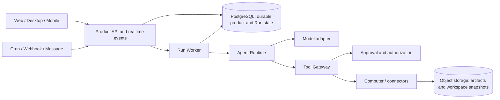

# Persistent Agent Platform Roadmap

Status: Direction accepted for planning. Phases are ordered proposals, not dated release commitments.

This roadmap describes a greenfield target for Raypx. It is not a statement of currently shipped behavior, and the existing implementation does not constrain the target architecture. `PRODUCT.md` remains the description of the current product until the target product specification and first implementation decision are accepted.

## Product Direction

Build a platform for persistent AI teammates. Each Agent has a durable identity, instructions, a continuous conversation, inspectable memory, work history, automations, and an authorized computer. A Run is one execution started by a user message or another trigger.

The default deployment is server-authoritative so work can continue when a client closes. Web, desktop, and mobile clients control and observe Agents. Self-hosting uses the same application and data model. A user's own computer may be added later as an explicitly authorized execution provider; it does not silently become the owner of server Runs.

## Architecture Target

- Start as a modular monolith with separate API and Worker processes in one repository. Keep domain modules and their interfaces small and deep; split deployable services only when an operational need is demonstrated.
- PostgreSQL is the source of truth for Agents, conversations, Runs, attempts, approvals, effects, routines, and events. Queue messages wake workers; they are not the only record that work exists.
- A Run has a durable state, wake time, checkpoint, lease owner, lease expiry, and fencing token. Attempts record individual executions. Recovery scans reclaim expired work according to explicit retry rules.
- Messages are user-visible conversation content. Run events are sequenced progress and lifecycle records. Clients resume from a cursor and request a fresh snapshot when retained history has a gap.
- A Tool Gateway resolves a tool and its target, checks scope and policy, records the exact intended effect, requests approval when required, executes the adapter, and stores the outcome. Ambiguous external outcomes are marked uncertain instead of blindly replayed.
- Separate the Agent Runtime, model access, computer execution, connectors, memory, and object storage behind interfaces only where behavior genuinely varies. Use capability declarations and offline conformance tests for adapters.
- Store artifacts and durable computer snapshots in object storage. Keep operational metadata in PostgreSQL. Encrypt user content and secrets with a key hierarchy that supports backup, rotation, deletion, and self-hosted operation.
- Keep memory separate from conversation history. Start with revisioned, portable documents scoped to an Agent or shared workspace; make semantic retrieval optional.

## Phases

### 0. Define the Contracts

- Write the target product specification, threat model, data ownership rules, and deployment model.
- Decide how Agent configuration is versioned and which configuration a Run captures at start.
- Define the Run state machine, event envelope, tool invocation lifecycle, approval record, and adapter interfaces before UI breadth.
- Establish deterministic model, tool, and computer fakes plus PostgreSQL integration tests.

Exit criteria: the architecture decisions name one authority for each Run, workspace, secret, and approval; the core contracts can be exercised without live model or computer providers.

### 1. Persistent Agent Vertical Slice

- Create an Agent with versioned instructions and one continuous conversation.
- Persist user messages and Runs transactionally, stream normalized events, support cancellation and follow-up input, and restore visible state after reconnect.
- Add fenced Worker leases, heartbeats, Attempts, checkpoints, recovery scans, and explicit interrupted/uncertain outcomes.
- Integrate one Agent Runtime, one model provider, and one isolated Computer provider.

Exit criteria: a Run survives client disconnects and Worker restarts without losing committed history or allowing a stale Worker to write; ambiguous model execution is represented honestly rather than duplicated automatically.

### 2. Tools, Effects, and Human Approval

- Add a small set of built-in tools and a single Tool Gateway for all model-requested actions.
- Persist effect intent and idempotency keys before external side effects. Record completion, refusal, failure, and uncertainty.
- Add Ask, Auto, and Never approval modes with exact tool/resource allow and block rules. Auto review errors or uncertainty must ask.
- Bind approvals to the exact arguments and resource version shown to the user; resume only that approved request.
- Add audit history and artifact delivery for tool results.

Exit criteria: every action is authorized by server-side policy, pending approval does not block unrelated conversations, and retries cannot silently repeat a completed or uncertain effect.

### 3. Durable Computer and Memory

- Give each Agent an isolated durable workspace with lazy start, snapshot, restore, stop, and recovery operations.
- Keep workspace data independent of the underlying container or VM identity so a replacement provider instance can restore it.
- Add revisioned Agent and shared memory, explicit retrieval scope, inspect/edit/delete/export flows, and memory provenance.
- Add workspace and artifact retention, backup, restore, and encryption-key rotation procedures.

Exit criteria: a computer can be replaced without losing the latest verified workspace; users can inspect and remove what the Agent remembers; backup restoration is exercised against a disposable deployment.

### 4. Automations and Continuous Work

- Make schedules, file watches, and webhooks create Runs through the same execution path as chat.
- Add routine versioning, test runs, pause/resume, trigger history, timezone handling, bounded catch-up, and explicit missed-run policy.
- Add notifications for completion, failure, and requests for input; allow users to continue chatting while a Run waits for a decision.
- Add safe recovery and retry controls with visible attempt history.

Exit criteria: trigger delivery is idempotent, missed or delayed work follows a documented policy, and every routine run is traceable to its trigger and result.

### 5. Clients and Extensibility

- Make the core Agent, conversation, approval, artifact, and routine workflows available on Web and Desktop; add mobile control and notification flows.
- Add MCP and selected application connectors through the Tool Gateway, with credentials isolated from model context.
- Add import from common Agent configuration formats with preview, explicit selection, and executable content disabled by default.
- Add more model and Computer providers through conformance-tested adapters.
- Package the same platform for self-hosted deployment with documented upgrades, backups, and restricted-network installation.

Exit criteria: supported clients expose the same durable state and authorization behavior; importing or changing providers cannot silently broaden an Agent's access.

## Deliberately Deferred

- Multi-Agent delegation and shared Agent teams.
- A large integration catalog or public plugin marketplace.
- Voice calls, visual workflow builders, and broad messaging-platform support.
- Multiple Computer providers before one provider's lifecycle, isolation, and recovery contract is proven.
- Microservices, a mandatory Redis deployment, or a separate workflow engine before measured operational needs justify them.

## Technical Principles

- One canonical owner for each durable Run and workspace; synchronize projections, not competing authorities.
- Every model-visible tool is enforced by the same server-side authorization and effect path.
- Never treat prompt instructions as a security control. Scope, approval, secret access, and computer isolation are enforced outside the model.
- Do not claim exactly-once behavior for external systems. Use durable intent, idempotency where supported, and explicit uncertain outcomes.
- Keep tests deterministic and offline by default. Run provider-specific acceptance separately from core state-machine and adapter conformance tests.
- Measure queue delay, time to first useful response, recovery time, effect uncertainty, and computer restore success without logging prompts, credentials, paths, or file contents.
