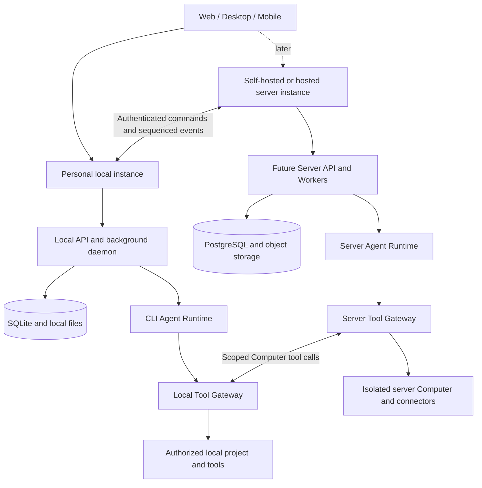

# Persistent Agent Platform Roadmap

Status: Planning baseline. Phases are ordered proposals, not dated release commitments; Phase 0 confirms the product and data-ownership decisions below.

This roadmap describes a greenfield target for Raypx. It is not a statement of currently shipped behavior, and the existing implementation does not constrain the target architecture. `PRODUCT.md` remains the description of the current product until the target product specification and first implementation decision are accepted.

## Product Direction

Build a platform for persistent AI teammates. Each Agent has a durable identity, instructions, a continuous conversation, inspectable memory, work history, automations, and an authorized computer. A Run is one execution started by a user message or another trigger.

The implementation starts with one operating mode: a personal local instance backed by the existing CLI daemon. The CLI owns the first Agent Runtime, local SQLite state, model/provider calls, tool execution, approvals, and recovery; Desktop is its control surface. A server instance and linked local/server mode follow only after the local workflow is complete and exercised. When an Agent is explicitly migrated to a server, the server becomes authoritative and a paired Desktop acts only as a scoped Computer provider. Web and desktop provide the first control surfaces; mobile follows after the core workflows stabilize.

Each Agent has exactly one authority. During the local-first phase, the local CLI instance owns the Agent, Runs, workspace, memory, credentials, model calls, approvals, and event history; nothing is synced implicitly. After an explicit export/import, a shared Agent belongs to the server instance; the server owns its configuration, conversation, Run state, approvals, model calls, and event history. A paired Desktop Host then exposes only scoped, revocable Computer/tools for selected projects and does not run a second copy of the shared Agent Runtime. Project files and raw terminal output stay on the Host. File content requested for a shared Run may transit through the server Runtime to the selected model provider, but is not copied into the server workspace by default. If the Host is offline, a migrated Run targeting its project waits or fails by policy; it never silently switches to a server workspace.

## First Delivery Goal

By 2026-11-10, validate one account-free local flow through the existing Raypx CLI daemon: create/select an Agent, hold a continuous conversation, start and inspect a Run, use one scoped project read tool, then close/reopen Desktop or reconnect the daemon without losing committed state. Keep Agent Runtime and Run ownership local. Cloud Runtime migration, local/server pairing, and container/VM isolation are explicitly outside this first acceptance; a configured external model CLI may still need its own provider connection.

## Architecture Target

- Start with the local CLI composition as the primary product. Add the server composition only after the local vertical slice and conformance suite are stable; keep domain modules and their interfaces small and deep.
- A local instance uses SQLite for its private Agents, conversations, Runs, approvals, effects, routines, and events; the server instance uses PostgreSQL for server-owned state. Local artifacts and workspaces use local files; server artifacts and portable workspace snapshots use object storage.
- Creating a Run and its initial event is transactional with its owning instance. The CLI daemon claims local work and survives Desktop disconnects; later server Workers claim server-owned work and a paired Host claims only server-issued commands under a scoped lease. Durable dispatch/outbox records and recovery scans repair missed wakeups; realtime delivery is a projection and never the only copy of an event.
- A Run has a durable state, wake time, immutable input/configuration manifest, lease owner, lease expiry, fencing token, and runtime checkpoint when the selected runtime supports one. Attempts record individual executions. Recovery scans reclaim expired work according to explicit retry rules.
- Define Run and effect state machines, including waiting for approval/input/Host, cancellation, interruption, and uncertain outcomes. A process restart preserves committed history; inference resumes only with a provider-supported resume token, otherwise the attempt is interrupted and requires an explicit retry or documented safe retry policy.
- Messages are user-visible conversation content. Run events are sequenced progress and lifecycle records. Commit user-visible output and its event together. Clients and paired Hosts resume from a cursor and request an authoritative snapshot when retained history has a gap.
- A Tool Gateway at the owning Runtime resolves a tool and target, checks scope and policy, records the exact intended effect, requests approval when required, executes the adapter, and stores the outcome. A paired Host independently enforces its local project grant before executing a Computer/tool request. Before dispatch the owner verifies current Run ownership; external systems that cannot honor idempotency or fencing may leave an explicitly uncertain outcome after a lost response.
- Pairing is outbound-only from the local Host. Commands have immutable IDs and payload hashes; events have durable sequence numbers and acknowledgements. Revocation fences old credentials and leases. A disconnect never replays an uncertain command or lets a stale Host overwrite a newer one.
- Separate the Agent Runtime, model access, computer execution, connectors, memory, and object storage behind interfaces only where behavior genuinely varies. Use capability declarations and offline conformance tests for adapters.
- Encrypt user content and secrets with a key hierarchy that supports backup, rotation, deletion, and self-hosted operation. The local instance stores credentials in the OS credential store where available; the server instance uses an encrypted secret store.
- Keep memory separate from conversation history. Start with revisioned, portable documents scoped to an Agent or shared workspace; make semantic retrieval optional.
- Establish ownership and authorization for every Agent, Run, workspace, artifact, memory document, and secret. A personal instance has one local owner; server instances scope data to authenticated users and spaces. Define pairing, export, deletion, retention, and model-usage limits before enabling unattended work.

## Phases

### 0. Define Deployment and Ownership Contracts

- Define the local-first product scope, threat model, data ownership, startup/shutdown behavior, and recovery contract.
- Confirm the CLI daemon is the owner of local Agents, Runs, credentials, project grants, and model/tool execution; Desktop is a control surface, not a second runtime.
- Decide what may leave the device when a user explicitly selects a remote model or connector. Local mode must work without an account.
- Version Agent configuration and define an immutable Run input manifest: instruction version, selected model, authorized workspace, references, memory scope, and trigger context.
- Define local Run, Attempt, effect, and approval state machines; event ordering and retention; and recovery when a model call or external effect has an ambiguous outcome.
- Establish deterministic local fakes and failure-injection scenarios for lost wakeups, lease expiry, process crashes, and duplicate tool delivery.
- Establish local SQLite/runtime conformance. Design and test PostgreSQL, migration, and Host pairing in a later phase; none blocks local completion.
- Start with one working implementation for each necessary runtime seam. Extract reusable adapter contracts as real variation appears; do not require a broad provider framework before the first vertical slice.

Exit criteria: the CLI daemon is the sole local authority; Run, approval, effect, and recovery rules are reviewable and testable without live providers; local product acceptance does not depend on a server account or PostgreSQL.

### 1. Personal Local Agent Vertical Slice

- Run the Agent platform locally without account setup. A Desktop-managed daemon owns the API, background execution, local SQLite database, and shutdown/recovery lifecycle.
- Reuse the existing CLI `AgentRuntime`, `ManagedExecution`, provider adapters, command receipts, and active execution registry as the first Agent Runtime. Add a Raypx-owned Agent port only at the boundary needed to persist Runs and normalize events.
- Create an Agent with versioned instructions and one continuous conversation; persist messages, Runs, and initial events transactionally; stream normalized events and restore state after reconnect.
- Add the shared Run state machine, Attempts, lease fencing, checkpoints where supported, cancellation, explicit interrupted/uncertain outcomes, and recovery after process or OS restart.
- Add a minimal Tool Gateway and one narrowly scoped, read-only project tool with an explicit directory grant. State clearly that host commands use the user's OS permissions; do not claim they are sandboxed.
- Integrate one Agent Runtime and one model provider, including loopback/local model endpoints. Track per-Run model usage and enforce basic execution, tool-call, and token limits.

Exit criteria: a Run survives client disconnects and Worker restarts without losing committed history or allowing a stale Worker to write. Tests prove the chosen behavior for a crash during model generation and immediately before/after a tool effect; no inference or effect is replayed invisibly.

### 2. Local Tools, Effects, and Human Approval

- Add a small set of built-in tools and a single Tool Gateway for all model-requested actions.
- Persist effect intent and idempotency keys before external side effects. Record completion, refusal, failure, and uncertainty.
- Keep per-Agent and per-Computer execution ownership explicit so concurrent Runs cannot mutate the same workspace unsafely.
- Add Ask, Auto, and Never approval modes with exact tool/resource allow and block rules. Auto review errors or uncertainty must ask.
- Bind approvals to the exact arguments and resource version shown to the user; resume only that approved request.
- Add audit history and artifact delivery for tool results.

Exit criteria: every local action is authorized by the local Agent instance; pending approval does not block unrelated conversations, and retries cannot silently repeat a completed or uncertain effect.

### 3. Desktop-Backed Computer and Memory

- Treat the local CLI daemon and an explicitly granted project root as the first durable Computer. Its stable identity is the Host/project binding; its workspace is the user's existing directory.
- Keep the daemon independent from the Desktop window so closing the UI does not stop a Run. Reconnect and process restart recover the binding and Run history; they do not claim snapshot or VM restore semantics.
- Add revisioned Agent and local memory, explicit retrieval scope, inspect/edit/delete/export flows, and memory provenance.
- Add local workspace and artifact retention, backup, restore, and encryption-key rotation procedures.

Exit criteria: a local Run can use the selected Desktop project after UI close/reopen and daemon reconnect; the project grant remains explicit and revocable; users can inspect and remove what the Agent remembers. Container or VM replacement remains a later phase.

### 4. Automations and Continuous Local Work

- Make schedules, file watches, and webhooks create Runs through the same execution path as chat.
- Add routine versioning, test runs, pause/resume, trigger history, timezone handling, bounded/coalesced catch-up, and explicit missed-run policy.
- Add notifications for completion, failure, and requests for input; allow users to continue chatting while a Run waits for a decision.
- Add safe recovery and retry controls with visible attempt history and user-configurable automation budgets/limits.

Exit criteria: local triggers create Runs through the CLI daemon; trigger delivery is idempotent, missed or delayed work follows a documented policy, and every routine run is traceable to its trigger and result.

### 5. Explicit Cloud Migration and Server-Owned Agent

- Add reviewed export/import from the local CLI instance to a server-owned Agent. Exclude secrets and workspace content by default; let the user preview and select portable Agent configuration, memory, and history.
- Pair the Desktop daemon with one server account using an outbound authenticated connection and a restricted, revocable Host grant. Pair only after local tool and effect recovery is proven.
- Add the minimum server composition: authenticated API, PostgreSQL, background Worker, server-owned Run records, and sequenced event history. Use the paired Desktop daemon as the first Computer provider.
- After migration, the server owns the shared Agent Runtime and model calls. The Host receives only scoped tool requests and independently checks its current grant before execution.
- Persist command journals/outboxes and server receipts. Retry with the same command ID; fence stale Host generations; resume from acknowledged cursors and recover from gaps with an authoritative snapshot.

Exit criteria: a migrated Agent has one server authority, duplicate commands do not duplicate effects, revocation prevents stale execution, and local-only data never enters the server projection without explicit export.

### 6. Clients and Extensibility

- Complete Web and Desktop parity across local and server instances; add mobile control and notification flows.
- Add MCP and selected application connectors through the Tool Gateway, with credentials isolated from model context.
- Add import from common Agent configuration formats with preview, explicit selection, and executable content disabled by default.
- Add more model and Computer providers through conformance-tested adapters.

Exit criteria: supported clients expose the same durable state and authorization behavior; importing or changing providers cannot silently broaden an Agent's access.

## Deliberately Deferred

- Multi-Agent delegation and shared Agent teams.
- A large integration catalog or public plugin marketplace.
- Voice calls, visual workflow builders, and broad messaging-platform support.
- Multiple Computer providers before one provider's lifecycle, isolation, and recovery contract is proven.
- Container or VM isolation for Computer execution before the Desktop-backed Host contract and effect recovery are proven.
- Microservices, a mandatory Redis deployment, or a separate workflow engine before measured operational needs justify them.
- Transparent synchronization of local-only Agents before conflict, offline, and ownership semantics have a concrete need and design.

## Technical Principles

- One canonical owner for each durable Agent and Run. Local Agents are owned by the CLI daemon; after explicit migration, the server owns the migrated Agent and the paired Host owns only granted local execution state.
- Every model-visible tool is enforced by the owning instance's authorization and effect path. A paired Host adds a second local grant check before touching a local project.
- A Desktop-backed Computer is a trusted user-host process with normal OS permissions, not a sandbox. Never describe its project grant as container isolation; add a separate isolation provider when the threat model requires it.
- Never treat prompt instructions as a security control. Scope, approval, secret access, and computer isolation are enforced outside the model.
- Do not claim exactly-once behavior for external systems. Use durable intent, idempotency where supported, and explicit uncertain outcomes.
- Keep tests deterministic and offline by default. Run provider-specific acceptance separately from core state-machine and adapter conformance tests.
- Measure queue delay, time to first useful response, recovery time, effect uncertainty, and computer restore success without logging prompts, credentials, paths, or file contents.
